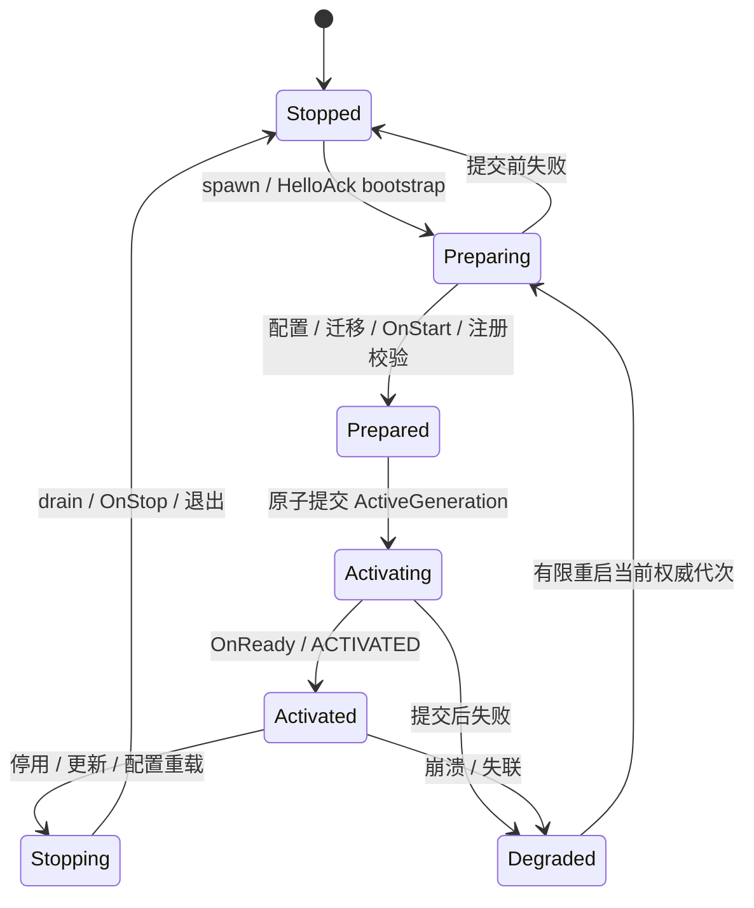

# AlonaBot 技术设计

**状态：** 现行技术设计。精确行为以 [CONTRACTS-v0.1.md](CONTRACTS-v0.1.md)、[WIRE-FORMAT.md](WIRE-FORMAT.md)、[MESSAGE-MODEL.md](MESSAGE-MODEL.md) 为准；实现目录见[架构地图](../ARCHITECTURE.md)，开发流程见[源码开发](../docs/development.md)。

## A. Core 与插件职责

Core 负责 Adapter、标准事件与命令路由、权限、消息发送、Service Broker、Event Bus、Scheduler、插件进程、公共 HTTP、配置/Secret 与安装代次。每个正在运行的已安装插件包使用一个独立 Native Go 子进程，插件使用普通 Go Modules、goroutine、net/http 和 GORM；跨插件通过 Core 调用。

独立进程隔离崩溃，不构成同一 OS 用户下的恶意代码沙箱。只有使用 SDK 的受管资源与生命周期遵守框架恢复契约；插件自行管理的外部文件、HTTP 或数据库不受 Core 事务回滚。

### 生命周期



SDK 公开三个可选进程 Hook：`OnStart(context.Context) error`、`OnReady(context.Context) error`、`OnStop(context.Context) error`。OnStart/OnReady 不得等待自己的公开路由或发起业务 Send/Service；后台工作等待 SDK 就绪门并服从 lifetime context。SDK 串行写完 ACTIVATED 后打开就绪门，Core 按帧顺序先激活再接受业务。

同一 data_dir 只有一个 Core，同一插件管理操作串行，SDK 持有跨代次 runtime.lock；旧进程未释放受管资源时不能再启动第二个写入者。主 RPC 断开即取消 lifetime、关内部 HTTP 并限时退出。普通异常退出采用既有 5 分钟内 3 次自动禁用规则；正常停用不自动重启。

### 插件休眠

Core 与全部 Adapter 常驻；`always_on` 为缺省，`component_idle` 允许 `role: plugin` 或 `role: agent` 声明 `sleep_capable: true` 的独立进程按策略空闲退出。同进程开发组件保持运行。管理层单独保存 `enabled` 与 `STOPPED/WAKING/ACTIVE/QUIESCING/SUSPENDED/FAILED`，底层 Session 继续使用上面的生命周期。

Router 在交付前执行消息事件的 `message_filter`（CONTRACTS §2.5），按可信 to_me、会话类型与本会话生效配置中的唤醒词作 OR 匹配；可用 triggers 配置选择条件。声明只保存路径，配置文件的覆盖值由 Core 读取，SDK Rule 在交付后继续过滤。未命中时不唤醒。Router 以当前已提交代次的完整路由快照完成无进程匹配；快照与 ActiveGeneration、COMMITTED 同时生效，保存路由描述、Schema 绑定与包/路由摘要，Session、Listener 与认证材料随进程退出撤销。唤醒以新 Session 复用原代次与 `activation_reason=resume`，在交付前校验 REGISTER 摘要、权限和原 deadline。Supervisor 合并并发 EnsureActive 并持有进程唯一所有权；请求取得活动引用，实际结束后释放。等待队列的条数与字节有界，取消移除，无副作用重试。

Idle Controller（`internal/core/idle/`）读取 `settings` 的生效策略与 Supervisor 的活动状态，只决定是否请求正常停止。Handler、Service、HTTP、媒体、schedule、多轮等待、后台工作、租约及管理变更都阻止休眠。进入 QUIESCING 前复核 Session、零引用与实际活动结束时刻，变化时撤销空闲决定；进入后冻结新派发，新请求按原期限与预算等待旧树退出、SUSPENDED 和下一次 Ready。排空、STOPPING、OnStop 与整树截止复用正常停止。空闲退出使用 StopReason `IDLE`，成功后写 `SUSPENDED`，保留路由快照与调度计划，正常退出不计入异常重启。精确规则与可调初值见 CONTRACTS §4.4、§4.5、§16。

`core_config.json` 的 `sleep` 保存模式、全局空闲时长与按插件覆盖；未声明 Core 过滤的消息事件、Raw、HTTP、Hook 与持续监听缺省常驻，管理员显式时长仅覆盖路由准入，manifest 的可休眠声明始终有效。Admin API（ADMIN-API §24）、CLI 与 WebUI 共用管理服务，写回后立即应用、不重载插件；`never` 与切回 `always_on` 会唤醒相应的已启用插件。

## B. 安装包、平台与来源

首发目标为 linux/amd64、linux/arm64、windows/amd64、darwin/amd64、darwin/arm64。市场预构建优先，本地源码构建可选；Native 进程只要求协议兼容，不要求 Core 与插件使用相同 Go patch。

工程中的 `plugin.yaml` 只写 ID、显示名、版本、描述、作者与来源等作者信息，是 ID/版本真源；`build` 与 `pack` 补上协议、平台、入口与迁移方式等构建信息（D-78），安装包包含 manifest、`config_schema.json`、`i18n/` 和可执行程序。市场 ID 按角色使用 `alonabot-plugin-`、`alonabot-adapter-`、`alonabot-agent-`、`alonabot-webui-` 前缀与连字符分词，精确正则见 CONTRACTS §9.1（D-172）；本地允许原有安全 slug 并警告缺前缀。ID 不直接当作数据库标识符或主机名。

不同包 ID 冲突保留持久化安装记录中的首个，拒绝后来的冲突来源；同一插件内部重复 route ID、命令路径/别名或 HTTP method+path 报错。已有插件更新必须校验原来源/发布者，不能借 first-wins 绕过更新身份校验。

归档为 tar.gz；外部 release 清单记归档 SHA256，归档内 manifest 只记录程序/资源摘要，避免自包含摘要循环。签名验证清单确切字节，安装器受控解压、检查大小/链接/路径，再原子移入候选目录。完整命令及信任策略见 CONTRACTS §9。

## C. Protobuf RPC 与两种传输

TCP 为默认，Core 持有 loopback 端口 0 分配的 Listener；stdio 可选，stdout 只传协议，stderr 为日志。统一 `4-byte big-endian length + Protobuf Envelope`，单帧最大 4 MiB，协议首发 1.0。每个进程有独立随机凭证与 Session，完整首帧鉴权后才下发 Bootstrap。

匹配键为 `(session_id, initiator_side, call_id)`，支持并发与乱序 Response。读帧/响应配对独立于 Handler；唯一 writer 保证帧不交错；控制/响应/取消不能被业务排队堵住。计数与字节预算都受限，超额立即拒绝，不能因嵌套调用等待自己的额度。

业务副作用不自动重试。取消只是合作式终止；迟到响应不会重新完成请求。Service/Send 的父调用关联由 Core 记录，不能信任插件提交的 Actor/权限。Bootstrap、控制错误、注册描述与媒体 RPC 详见 WIRE-FORMAT。

## D. Go SDK 与 Handler 注册

一个插件包导出一个 `func New() *sdk.Plugin`（D-114）：`sdk.NewPlugin()` 创建插件对象，路由、生命周期回调（`p.OnStart`、`p.OnReady`、`p.OnStop`）、配置回调（`p.OnConfigLoad`）与数据库迁移都在 `New()` 返回之前登记在它上面，回调的签名由编译器检查，没有登记的回调不执行。配置由包内的 `config_schema.json` 声明，不定义 Go 配置类型（D-76），经 `p.Config()` 或 Handler 内的 `c.Config()` 读取。元数据 ID 只来自 plugin.yaml。插件自己的状态放在自己的类型中，以方法值注册；包级函数也这样注册，没有第二种写法（D-79），不引入自动 DI，也不在包级变量或 `init` 中注册。`sdk.Run` 开始后注册描述固定，之后再调用注册方法是编程错误。

`alonabot build` 只处理当前模块的目标构建包，遵守 Go build tags/GOOS/GOARCH，排除外部依赖、vendor 和测试文件；生成的 Go 代码嵌入 manifest、配置 schema、`i18n/` 与 Service Schema，并生成正式入口；库模式的 main 包另外扫描其依赖中的组件入口包（CONTRACTS §15.5）。正式运行不从磁盘扫描任意包，只有 plugintest 在 `go test` 中扫描被测组件的源码。作者工程中没有生成文件，作者代码也不引用任何生成内容：CLI 构建把按入口包登记资源的代码经 overlay 编入，`sdk.NewPlugin()` 只记录调用方所在的包，启动组件时才取得资源（D-145）。单次 Session 注册描述固定，Core 动态修改权限/开关，不重建插件对象。

以下是接口用法示意，需随 SDK 实现编译验证：

```go
type RSS struct{ db *sql.DB } // 插件自己的状态

func New() *sdk.Plugin {
    p := sdk.NewPlugin()
    r := &RSS{}

    p.OnStart(r.Start)
    p.Command("ping").Handle(Ping) // 包级函数

    g := p.Group("rss")
    g.Command("list").Handle(r.List)
    g.Command("add"). // 参数名取自 Add 的参数 url（D-112）
        Permission(sdk.Admin.Or(sdk.ChatAdmin)).
        Handle(r.Add)
    g.Command("search").Handle(r.Search) // 参数来自结构体（D-115）

    p.On(obevent.Poke).ID("poke"). // OneBot 11 Adapter 声明的扩展事件
        Rule(sdk.ToMe()).
        Handle(r.Poke)

    digest.Register(p.Sub("digest")) // 逻辑子插件（D-116）
    return p
}

func Ping(c *sdk.Context) (message.Content, error) {
    return message.Text(c.Config().String("pong")), nil
}

func (r *RSS) List(c *sdk.Context) (message.Content, error) {
    c.StopPropagation()
    return message.Text("订阅列表"), nil
}

func (r *RSS) Add(c *sdk.Context, url string) error {
    return c.Reply("已收到订阅请求") // 纯文本回复（D-118）
}

type SearchArgs struct {
    Keyword string                 // 没有标签：参数名为 keyword，必需
    Limit   int     `default:"10"` // 可选，缺失时为 10
    Source  *string `arg:"from"`   // 可选，缺失时为 nil
}

func (r *RSS) Search(c *sdk.Context, a SearchArgs) error {
    return c.Reply("搜索：" + a.Keyword)
}

func (r *RSS) Poke(c *sdk.Context, e *obevent.PokePayload) error {
    return c.Reply("别戳啦")
}
```

注册采用链式构建（D-70、D-112）：命令、文本匹配、事件、Service、Event Bus 订阅、Hook、定时任务与 HTTP 路由都由插件对象（或子插件）的方法开始，`Handle` 结束；漏写 `Handle` 是注册错误。带类型参数的 `service.Serve`、`bus.Subscribe`、`button.On` 与 `task.On` 是各子包的包级函数，第一个参数收 `sdk.Registrar`，即插件对象或子插件；Service 与 Event Bus 事件先用 `service.JSON`、`service.Proto`、`bus.Define` 声明成带类型的值，再注册或调用（§G，D-122）。根包只放插件对象、Handler 上下文、注册 builder、权限与运行入口；动态任务、Service、Event Bus、按钮、媒体、会话历史、工具、平台动作与选项来源分别在 `sdk/task`、`sdk/service`、`sdk/bus`、`sdk/button`、`sdk/media`、`sdk/conversation`、`sdk/tool`、`sdk/action` 与 `sdk/options` 中（D-146）。命令参数名缺省取 Handler 的参数名，由生成器记录（Go 运行时取不到参数名），只在需要另起名字时写 `Args`；订阅的路由 ID 缺省为事件名。分组上设置的权限由组内路由继承。Permission 是不可变的值，用 `Or` 组合，满足其中任一即可（D-69）；Rule 是在 SDK 内执行的 Go 函数，`Rule(...)` 多个时全部满足，`sdk.Any` 表示任一。事件常量带 payload 的 Go 类型，SDK 在收集注册时核对 Handler 的参数类型；Adapter 的常量包（例如 `alonabot-adapter-onebot11/perm`、`alonabot-adapter-onebot11/event`）只含常量与数据类型，插件导入它们不链接 Adapter 的运行时。插件 API 不暴露生成的 pb 类型，Message、Actor、SendResult 与错误码由 SDK 自己定义；会话字符串、消息句柄与用户字符串（D-102、D-104、D-105）都是 `string`（D-144）。

两类 Handler 保留：返回 `(Content,error)` 的自动回复型成功时由 Core 在 Handler 返回后发一次非空内容，Content 是 Chain 或单个片段，每种片段都有构造函数（D-108）；两种 Handler 都可以在内部多次 `c.Send`（D-70）；只回一段文本时用 `c.Reply(text)`，它不返回发送结果（D-118）。Handler 发往当前事件以外的会话时用 `c.SendTo(sid, content)`；包级 `sdk.Send(ctx, sid, content)` 只供没有 Handler 上下文的后台任务使用，只发一段文本时用 `sdk.SendText(ctx, sid, text)`（D-118、D-144）。触发者与所在会话用 `c.User()`、`c.Session()` 取得，分别是用户字符串 `<adapter_id>:<external_user_id>` 与会话字符串，都是 `string`，可以原样保存和比较（D-120、D-144）。带错误码的错误用 `errcode.NotFound.New("…")` 构造、`errcode.Of(err)` 判断（D-123）。`c.StopPropagation()` 锁存传播结果，由 SDK 统一编码到 HandlerOutcome；不会给开发者增加第三套 Handler 签名。

命令参数有两种接收方式（D-115）。常用的是位置参数：`*sdk.Context` 之后逐个写出，名字取参数名，可选、默认值与 raw 尾部用 `Optional`、`RawTail` 声明。参数较多时可以只收一个结构体：字段按声明顺序对应参数位置，名字取字段名（开头的大写字母段转为小写）或 `arg` 标签，指针字段与带 `default` 标签的字段是可选参数，`arg:",raw"` 是末位的 raw 尾部；此时名字、可选与默认值只有结构体一个来源，不能再写 `Args`、`Optional` 与 `RawTail`。两种方式不混用，生成的注册描述相同，分词、类型转换与 usage 仍由 Core 完成。结构体由 SDK 用反射绑定，字段类型、顺序与标签都在 SDK 收集注册时检查，问题在启动时报告，不会留到第一条消息。

一个插件可以分成一层逻辑子插件来整理模块（D-116）：`p.Sub(id)` 返回 `*sdk.SubPlugin`，注册方法与插件对象相同，但没有 `Sub`，不能继续嵌套；通常每个子包导出 `func Register(s *sdk.SubPlugin)`。子插件只存在于 SDK 内，Core 不知道它，不能单独启停；它的 ID 不进入 route_id、命令路径、Service 名、HTTP 路径与 job ID，在子插件之间移动路由不影响管理员已保存的策略。子插件可以设置其中路由的缺省权限（`s.Permission`），读取自己的那一段配置（`s.Config()`，见 §J），日志带 `sub_plugin` 字段。生命周期回调、`OnConfigLoad` 与数据库迁移只登记在插件对象上。

Handler 调用受普通请求期限约束，返回后不能再以原上下文工作。需要等待用户回复或较长时间生成时，Handler 请求一次延续调用：Core 在本次调用结束后，以原可信上下文另发一个独立期限的调用，它不占用分发链（CONTRACTS §2.4）。多轮等待只在延续调用内使用。通常在注册时用 `.Continue()` 声明，Handler 整体在延续调用中执行，写法与普通 Handler 相同（D-119）：

```go
p.Command("quiz").Continue().Handle(q.Start)

func (q *Quiz) Start(c *sdk.Context) error {
    if err := c.Reply(c.T("quiz.ask")); err != nil {
        return err
    }
    reply, err := c.Wait(2 * time.Minute) // 同一用户在同一会话的下一条消息
    if err != nil {
        return err
    }
    return c.Reply(c.T("quiz.got", "answer", reply.Text()))
}
```

用 `.Continue()` 注册的路由，原调用的传播结果固定为继续，Handler 中的 `c.StopPropagation()` 不起作用。需要先在原调用中判断条件、停止传播或只在部分情况下才进入延续调用时，不写 `.Continue()`，改在 Handler 内调用 `c.Continue(func(c *sdk.Context) error { … })`。

## E. 消息、命令和权限

MessageChain 表示一次逻辑 Send；多条独立推送应多次 Send。一个逻辑 Send 可产生多个平台消息 ID，并用 ACCEPTED/PARTIAL/REJECTED/UNKNOWN 和逐部分结果描述；错误返回不得丢掉已经确认的 ID。整条 Chain 在第一次平台调用前预检，失败后不继续发送剩余部分。

Target 明确 Adapter、实例、账号、聊天和可选话题；插件 API 只写会话字符串 `<adapter_id>:<chat_id>[#<thread_id>]`，机器人用可选的 `sdk.Via` 指定，其余字段由 Core 补齐（D-102）。没有真实入站默认目标时必须给出 sid（`c.SendTo` 或 `sdk.Send`，D-144）。原事件 Target 的回复范围与主动/跨实例的 allowed_adapter_instances 按 CONTRACTS §8 准入，不以 User/Admin 代替发信许可。平台 ID 在公共 JSON 中用字符串。系统任务没有虚构的账号/Actor。Text/Image/Video/File/Mention/Reference/Buttons/Forward 的可表达组合和 Telegram 映射见 MESSAGE-MODEL。

普通命令按完整 token 路径最长匹配，再以 priority/plugin_id/route_id 选稳定胜出者；已识别的禁用、无权限、参数错误命令不回落 Regex/Raw/短路径。没有普通命令才按文本匹配（Regex、keyword、startswith、endswith、fullmatch）→Raw 处理，支持停止传播。跨插件同名命令在诊断中显示遮蔽关系，不由启动顺序决定。

路由权限是一组权限名，满足任一即可（D-69）：Core 内置 `user`、`admin`（按 Adapter 与外部用户 ID 配置的机器人管理员，同一 Adapter 的全部实例共用，D-105）与 `chat_admin`，Adapter 另行声明自己的平台权限，例如 QQ 的群主与群管理员。平台权限只在该会话有效，不自动取得 Core 管理权限。命令树取最近显式权限策略，允许子命令放宽或收紧，但所有层的禁用和 Core 全局禁止始终生效。每次派发前读取当前策略，已开始调用不宣称可撤销。

## F. 事件管道：Hook、Rule 和传播

同一 Event 只有一条按固定顺序推进的普通 Handler 链，不同事件并发。入站 `Normalize → PreEvent → Match/Permission → Rule/Handler`；Permission 由 Core 在派发前判定，管理员可以覆盖；SDK 在一次 Handler RPC 内先执行自定义 Go Rule（例如 `ToMe`），False 返回 matched=false。

priority 数字小的先执行，同值按稳定 plugin_id/route_id 排序。业务错误记录并继续普通事件分发；显式 Stop 优先，命令被识别后的拒绝不进入其他匹配类别。PreEvent 仅可修改允许的业务 payload/停止普通传播，不能改 Core 保存的身份、Target、按钮/任务绑定或来源。

每次 Send 独立执行 `BeforeSend → Adapter.Send → AfterSend`。BeforeSend 只改 Chain 或拒绝；AfterSend 只观察已经发生的发送结果，其自身错误不能把平台成功改写成发送失败。出站 Hook 及其派生子调用禁止再次 Send，避免递归。Hook 类型、阶段及最小结果字段按 Wire/消息专章生成。

## G. Event Bus、Service Call 与后续动态 Router

Event Bus 使用 `plugin_id/event_name`，非持久化尽力广播，离线不补、满队列丢最新并计数。每订阅者同时限制条数和字节，慢订阅者不阻塞其他插件。发布者只能发布自己命名空间；订阅由描述声明，事件内容不能赋予用户权限。

Service 以 `plugin_id/service_name` 注册，使用显式 schema/version 的 JSON 或 Protobuf 请求/响应。Core 检查目标状态和授权，继承父请求的 Actor/scope/deadline，A→B→C 可用；同调用链出现重复插件或超过深度上限明确拒绝。父请求结束后其未完成子调用取消，后台独立请求仅有插件身份。

Service 与 Event Bus 事件各用一个带类型的声明表示，名字与 Go 类型只写一处（D-122）。提供方在自己的包里导出声明，注册与调用都从它出发；调用方导入这个包即可，不必再写目标字符串与类型参数：

```go
// 提供方包 weather
var Search = service.JSON[SearchRequest, SearchResponse]("weather/search")
var Updated = bus.Define[UpdatedPayload]("weather/updated")

service.Serve(p, Search).Access(service.AccessPublic).Handle(w.search)
Updated.Publish(ctx, UpdatedPayload{City: city})

// 调用方
resp, err := weather.Search.Call(c.Context(), weather.SearchRequest{City: city})
bus.Subscribe(p, weather.Updated).Handle(r.onUpdated)
```

通过 Core 动态调用其他插件命令/事件 Router 不在 v0.1 范围内（Q-15）；v0.1 不暴露该执行 API，只保留稳定 route ID。Go Modules 用于编译期复用，不能当作跨进程 Go 对象调用。

## H. Core Scheduler

调度器固定支持 interval 与 cron，规范含语法、IANA 时区、起点和夏令时处理，见 CONTRACTS §4。Core 唯一拥有触发权，`scheduled` 使用有 CallID/完成响应的 Request；不同 job 可并发，同 job 未结束时跳过本次。已启用的 `SUSPENDED` 插件到期时由 Scheduler 经 Supervisor 的 EnsureActive 唤醒，再执行原 scheduled 请求；唤醒占用原任务的 15 分钟期限与运行槽，活动引用保留到实际完成或旧进程树退出。异常离线不追补。

每次执行有独立 run_id、job deadline 与 lifetime context，不被 30s 普通 RPC 默认值截断。任务超时后若插件未确认协作结束，不释放同 job 的运行槽并再次重叠启动；恢复策略见运行时契约。定时身份是显式 job/plugin scope，不获得默认 Admin。

定时任务有两种（D-124）。静态任务在 `New()` 中用 `p.Every`、`p.Cron` 声明，随插件一直存在，可以在运行时暂停与恢复（`task.Pause`、`task.Resume`，D-126、D-146）。动态任务在运行时增删：处理函数仍然静态注册，创建的是带参数的任务实例，由 Core 保存。

```go
type RemindArgs struct {
    SID  string // 会话字符串（D-144）
    Text string
}

var Remind = task.Define[RemindArgs]("remind")

task.On(p, Remind).Handle(func(c *sdk.Context, a RemindArgs) error {
    return sdk.SendText(c.Context(), a.SID, a.Text)
})

// 在命令 Handler 中创建、取消
key, err := Remind.At(c.Context(), time.Now().Add(10*time.Minute), RemindArgs{SID: c.Session(), Text: text})
err = Remind.Cancel(c.Context(), key)
```

实例可以是一次性的（`At`）或周期的（`Every`、`Cron`），用 key 区分，同 key 再次创建即替换。任务触发时没有触发者身份，需要的会话与用户写在参数里。调度状态保存在 Core 状态库（D-125）：任务定义与周期任务的起点在 Core 与插件重启后保留，间隔任务不因重启重新计时。Core 未运行、插件停用、异常离线或任务暂停时到期的触发作废，周期任务从下一次继续，一次性任务过期即删除。正常休眠保留未来定时器，到期唤醒执行，原计划时刻、interval 起点与暂停状态保持不变。任务以 plugin_id 为键存在 Core 一侧，卸载时不经过插件进程就能清理，去留由卸载的清理范围决定（D-127，CONTRACTS §9.3）。

## I. HTTP 与 SQLite

### HTTP

遵守 D-25：插件只注册 `http.Handler`，SDK 仅在有 HTTP 路由时持有 `127.0.0.1:0` Listener，不先找端口再重新绑定。REGISTER 报告实际端口与路由；Core 只代理已认证、Activated 的 Session，并在停止/断链时撤销。

外部统一 `/plugins/{id}/...`，SDK Handler 接收去掉插件前缀的路径。Core 校验路由/权限，清理外部内部认证头、Core Cookie/Authorization，再注入 Session 认证；用标准库 ReverseProxy.Rewrite，不能由请求指定代理目标。

管理界面与插件路由使用同一个主机名、同一公开 Listener/端口（D-84）。Core 给插件路由的全部响应加上不含 allow-same-origin 的 CSP sandbox，插件页面运行在不透明源中，读不到管理 Cookie 与 WebUI 的存储；WebUI 用 iframe 嵌入插件页面，页面只经 postMessage 桥请求本插件的路由，由 WebUI 以管理员会话转发（CONTRACTS §7.3）。部署时不需要第二个域名。

### 数据库

Core 管理状态库与插件业务库分开。框架只托管 SQLite（D-48）：`sqlitedb.Open(ctx) (*sql.DB,error)` 与 `gormdb.Open(ctx) (*gorm.DB,error)` 共用 Session 的同一个连接，插件只导入用到的包，不用 GORM 就不链接 GORM（D-49）。需要外部数据库的插件自带驱动、自行管理连接与数据。驱动组合在 CONTRACTS §6 指定，实际版本由 `go.mod` 与 `go.sum` 锁定。

受管 SQLite 每插件、每候选代次独立文件。配置重载与版本更新统一先停止旧进程、备份候选副本，再迁移/初始化；不能复用旧可写 DB 来承诺提交前回退。准备期会改动外部数据的插件声明 `prepare_effects=external`，已有安装的升级按维护模式处理。

自管迁移 `Migrate(p, fn)` 与辅助迁移 `Migrations(p, list)` 可选且互斥，由 `sqlitedb` 与 `gormdb` 各提供一组登记函数（D-114），回调在插件 SDK 内执行，Core 负责调度与代次门槛。辅助迁移的 Up 与成功记录在插件 DB 的同一事务；没有迁移接口就不主动迁移。维护许可和启动原因在 Bootstrap 明确下发。

## J. Config、Schema 与 i18n/

运行配置为普通 JSON 对象，无外层 config；i18n/ 翻译才以 config 为顶层。字段由包内手写的 `config_schema.json` 声明（D-76），键名沿用 AstrBot 的 `_conf_schema.json`，另有 `secret`、`required` 与只能选一个模板的 `template`；键的顺序就是表单顺序。每个字段都有值：缺失键补 default 或类型零值，显式 false/0/空串与 invisible 字段保留，未知键保留。

`OnConfigLoad` 是配置回调，区别于三个进程 Hook，也负责拒绝不合法的业务取值，SDK 不另设 Validate 回调。流程为原始对象→OnConfigLoad→补缺失值与校正→required 校验→Candidate；不能先用 schema 拒绝配置。持久化保留未知键，不能用只含已声明字段的结果丢掉它们。插件经 `p.Config()` 或 `c.Config()` 按类型取值，键未声明或类型不符直接 panic，这类错误在开发时就会暴露。

子插件的配置不另设文件（D-116）：它是 `config_schema.json` 中与子插件 ID 同名的顶层 `object` 字段，`s.Config()` 返回这个对象的只读视图，等于 `p.Config().Object(id)`；表单把它显示为一个分组，i18n 覆盖、secret 与校正照 object 的现有规则。`c.Config()` 在子插件的 Handler 中仍是整个插件的配置，共用的配置项经它读取。字段在根与子插件之间移动时，旧值成为无效配置，需要保留旧值时在 OnConfigLoad 中搬移。

配置没有版本，也不写迁移（D-161，CONTRACTS §5.5）：新增字段补默认值，删除或改名后的旧键作为无效配置保留并忽略，管理员可以在 WebUI 一键清理；类型不符的值先做无损转换，不行再恢复默认值，并记一条校正记录提示管理员。作者改名时要保留旧值，就在 `OnConfigLoad` 中搬移。Adapter 实例配置与 `core_config.json` 用同一套规则，校正不改写用户的原文件。

Core 状态库的 ActiveGeneration 是权威，`config.json` 是用户编辑快照。直接编辑不热生效，`plugin reload` 导入 Pending 后走候选流程。新 secret 产生新不可变引用，候选失败不修改旧凭证；普通配置 API 不返回明文。表单 PATCH 采用明确操作，掩码不当作真实值。

```json
{
  "interval": {"description": "Refresh interval", "hint": "Polling interval in seconds", "type": "int", "default": 10, "slider": {"min": 1, "max": 600}},
  "mode": {"description": "Mode", "type": "string", "options": ["fast", "safe"], "labels": ["Fast", "Safe"], "default": "fast"},
  "music": {"description": "Music source", "type": "template", "templates": {
    "netease": {"name": "NetEase Cloud Music", "items": {"cookie": {"description": "Cookie", "type": "string", "secret": true, "required": true}}}
  }}
}
```

```go
interval := p.Config().Int("interval")
if m := p.Config().Template("music"); m.Key() == "netease" {
    cookie := m.String("cookie")
}
```

```json
{
  "config": {
    "interval": { "description": "刷新间隔", "hint": "轮询间隔（秒）" },
    "mode": { "description": "模式", "labels": ["快速", "安全"] },
    "music": { "templates": { "netease": { "name": "网易云音乐" } } }
  }
}
```

以上依次是 `config_schema.json`、插件取值与 i18n/zh-CN.json 示例：源文案写在 schema 中，翻译文件与 schema 同形覆盖（保留 items、templates 两层）。语言仅影响文案，查找为当前 locale→schema 中的源文案→字段键。选项的存储值不翻译，显示文案由 labels 提供。

同一文件的顶层 `messages` 存放机器人回复的文案，例如 `{"messages": {"quiz.got": "You answered {answer}."}}`。SDK 的 `c.T` 按用户的 locale、Core 默认 locale、en-US 的顺序选择语言；日志与错误只用英文，不进入文案目录（CONTRACTS §5.4）。

## K. WebUI、安装与运行安全

WebUI 是可替换的组件（§T），静态文件由 Core 提供，也可带使用 SDK 的 Go 进程；通过带主版本号的 Admin API 管理 Core（CONTRACTS §7.5）。官方 WebUI 提供状态/日志、安装启停、更新/恢复、配置表单与命令权限。管理 API 采用 Core 的管理员认证、CSRF 与独立 Session；首次启动生成管理 token（终端中显示一次，非终端时写入数据目录的 `admin_token`）、admin-token init/show/reset、浏览器登录与 CLI Bearer 按 CONTRACTS §7.4 实现；插件页面不会收到管理 Cookie。没有可信来源/合法归档就不执行程序，首次信任与后续更新绑定持久化。

环境变量只传该插件所需信息，SDK 将日志标记 plugin/session/route/call；secret 原文不进入普通日志。工作目录与进程隔离不是 OS 权限隔离，首发只支持可信 Native 插件。进程树按 Linux/macOS/Windows 的合作型子进程机制回收，验证不涵盖恶意 detach。

## L. 接口实现与验收入口

| 议题 | 行为依据 | 实现入口 |
| --- | --- | --- |
| Handler、Rule、Hook 与权限 | CONTRACTS §2/§3、MESSAGE-MODEL | `sdk/`、`internal/core/router/`、`hook/`、`policy/` |
| 帧、Bootstrap、Session、错误与取消 | WIRE-FORMAT、CONTRACTS §1/§12 | `contracts/`、`internal/wire/`、`internal/core/host/` |
| 消息、媒体、按钮与回执 | MESSAGE-MODEL、CONTRACTS §1.3 | `internal/core/message/`、`media/`、`buttons/` 与独立 Adapter 仓库 |
| 调度、HTTP 与生命周期 | CONTRACTS §4/§7/§12 | `internal/core/scheduler/`、`supervisor/`、`httpproxy/`、`idle/` |
| 配置、secret、DB 与 Journal | CONTRACTS §5/§6/§12 | `internal/core/config/`、`secret/`、`state/`、`journal/` |
| 构建、来源、安装与恢复 | CONTRACTS §9 | `internal/pluginkit/`、`internal/core/manage/`、`scripts/` |

同一格中的缩写目录沿用前一完整路径的父目录。验证方法见[开发指南](../docs/development.md#验证改动)，现有候选结果见[发布说明](../changelog/v0.1.0/zh-CN.md)。

## M. Adapter：可安装的平台适配器

Adapter 与插件一样以安装包分发、在独立进程中运行（D-26）；官方 Telegram 是第一个 Adapter 包，可以卸载。同一 Adapter 包只运行一个进程，承载它的全部账号实例；实例由 Core 单独启停，停用 Adapter 即停止该进程。Core 内部用同一个接口表示每个账号实例，正式实现把调用转发给 Adapter 进程，测试中可以使用内存实现：

```go
type Instance interface {
    AdapterID() string
    InstanceID() string
    AccountID() string
    Capabilities() []*pb.Capability
    Start(ctx context.Context, sink Sink) error
    Stop(ctx context.Context) error
    Send(ctx context.Context, target *pb.Target, chain *pb.MessageChain) (*pb.SendResult, *pb.ErrorInfo)
}

// Editor 是支持 message.edit 的实例另外实现的可选接口，调用方用类型断言获取。
type Editor interface {
    Edit(ctx context.Context, target *pb.Target, messageID string, chain *pb.MessageChain) (*pb.SendResult, *pb.ErrorInfo)
}
```

Adapter 作者使用 `sdk/adapter` 实现平台接收、标准化与发送；派发、权限、Target 授权、按钮 token、媒体缓存和游标持久化留在 Core。插件可以声明对某个 Adapter 的依赖，并使用它声明的 extension 片段，见 CONTRACTS §8。Start 完成凭证/实例检查并启动接收后返回；Stop 停止接收；实例的致命错误经 `core.adapter.status` 报告，不静默消失。实例上线、下线时由 Core 生成 `bot.online`、`bot.offline` 事件。同一平台账号只允许一个入站所有者，凭证轮换先停止旧实例。

v0.1 只支持 Telegram long polling，先确定实际 bot 身份并校验 account_id。接收游标与非持久化事件入站的确认语义见 MESSAGE-MODEL；不承诺 exactly-once。平台特有能力按版本声明，不支持的片段组合先拒绝；其他官方 Adapter 后续增加，第三方 Adapter 按同一机制安装，也可以替换同一 `adapter_id` 的官方 Adapter（§T）。

## N. 更新 Journal、快照与恢复

受管 SQLite 候选流程：**下载/验证 → 冻结新根请求 → drain/停旧进程 → 确认 runtime.lock 可取 → Backup 候选 DB → 配置回调与校正、DB 迁移及 OnStart → Prepared → Core 单事务提交 ActiveGeneration+COMMITTED → OnReady/Activated → 服务**。

提交前失败重启旧程序的新 Session；提交后新代次权威，失败进入 Degraded，不能悄悄切回旧 DB 丢弃已发生的新写入。管理员 rollback 以选定快照为输入创建新的恢复 Generation/SQLite 副本，保留原快照不变，并说明会丢弃该点之后的受管写入。插件自行管理的外部数据走维护流程。

包、配置、secret 引用与候选 DB 先持久化，再提交 Core 指针。Core 崩溃恢复还必须确认旧进程退出，Journal 不能替代进程锁。首发采用允许短暂停顿的切换，不实现双实例零停机。

## O. SDK 分层、CLI 与可观测性

最小逻辑分层为 contracts、SDK、Core 和 CLI；contracts 不依赖具体平台 SDK/GORM，数据库作为按需 SDK 包。使用标准 Go 编译、Protocol Buffers、标准 HTTP 代理及选定驱动，不引入额外容器运行时、服务发现或迁移平台。

**按需付费**（D-52）：Core 与 SDK 根包只链接允许清单中的模块，模型 SDK、Provider 客户端、MCP 与外部数据库驱动一律放在需要它们的插件或按需 SDK 包里；GORM 由 Core 状态库使用（D-68），插件仍只在导入 `sdk/gormdb` 时链接；没有安装或没有启用的组件不运行进程。Core 与示例插件的空闲常驻内存按现有实测记录，维护者已接受当前开销并停止继续资源测量（[现有资源实测](../changelog/v0.1.0/zh-CN.md#资源与依赖)）；依赖由审查用 `go list -deps` 核对（V-75）。插件作者的对应规则见 [插件开发规范](../docs/plugin-guide.md)。

CLI/API 的完整管理动作与包协议见 CONTRACTS §9。Core 状态库记录安装序号/来源、ActiveGeneration、Journal、权限、回调与配置引用；业务库由插件负责。所有状态变更通过同一个 Core 管理服务串行化，离线 CLI 不能绕过仍运行的 Core 直接改状态库。

日志使用标准库 `log/slog`（D-31）：每条记录关联来源（Core、插件或 Adapter）、plugin_id 或 adapter_id、instance、route_id、call_id、trace_id、session/generation，记录状态变化、拒绝/丢弃、发送回执、更新/恢复和配置权限审计。控制台格式仿照 AstrBot，例如 `[14:05:42.118] [Plug:weather] [ERRO] [weather/weather.go:57]: ... trace=7c2e91d0`；同一条消息引起的记录共用 trace_id，可以串起跨插件的整条链路。每个插件与 Adapter 可单独设置级别或设为 off，WebUI 的显示筛选只在浏览器中进行（CONTRACTS §14）。既有资源结果记录对应的组件、指标与环境；维护者已停止新增资源测量。

## P. 长期扩展方向（不进入 v0.1）

动态命令 Router、持久化的多轮会话状态与暂停 DSL、子代理、跨会话的记忆检索与 TUI/桌面/移动端保留为后续方向；官方不再提供 Telegram 与 OneBot 11 之外的 Adapter，也不做多语言 SDK，其他平台由社区按 Adapter 协议实现（D-152）。WASM、实例池、蓝绿零停机和复杂表单不进入首发，不为它们预建运行时抽象。

## Q. 多实例与实施维护

Target 与凭证按 Adapter 实例/账号区分，不把特定 X/Twitter 多账号需求硬编码进 Core。实例管理、权限和凭证切换由 Adapter Registry、策略与管理服务分别负责。

修订时同步现行契约、实现、示例与受影响测试，按[贡献指南](../CONTRIBUTING.md)交付。技术基线维持 v0.6-review。

## R. Agent 组件

Agent 分为 Core 基础与 Agent 组件两层（D-27）。Core 负责必须可信的部分：工具目录与按工具的调用策略、调用前的用户确认、会话存储；它们复用 Service Broker、按钮 token 与 Target 准入的实现（CONTRACTS §13）。Agent 组件（`role: agent`，全局至多一个，D-59）只经 SDK 访问 Core。官方 Agent 组件位于 `agent/`，可以被社区 Agent 替换；其他插件经 `@agent` 调用 `llm.generate`，替换后不用修改（D-61）。官方 Agent 组件：

- **一轮对话**：`/ask` 在任何聊天中触发；Admin 为某个聊天开启自由对话后，该聊天中 `to_me` 的非命令消息也触发（私聊的消息都是 `to_me`）。触发的 Handler 请求延续调用，在其中读取会话历史，按人格组装系统提示，调用 Provider 并流式接收。目标实例支持 `message.edit` 时，先发送一条消息，再按固定间隔编辑它，显示已生成的内容，生成结束后用完整内容做最后一次编辑；不支持时生成结束后一次发送。会话按 Adapter 实例、聊天与话题区分。
- **Provider**：官方 OpenAI（`openai`）、OpenAI 兼容（`openai-compatible`）的 Chat Completions，OpenAI Responses（`openai-responses`），Anthropic Messages（`anthropic-messages`），Gemini 原生的 `streamGenerateContent`（`gemini-generate-content`）与 Ollama 原生的 `/api/chat`（`ollama-chat`）。OpenAI 的三种协议经 `openai-go`、Anthropic 经 `anthropic-sdk-go` 发出请求与读取流，不自动重试，也不读取环境变量；Gemini 与 Ollama 用标准库 net/http 实现，流格式为 SSE 或 NDJSON（D-132）。api_key 使用 Secret 引用，只有 `ollama-chat` 允许为空。两种 OpenAI Chat Completions 协议只差输出上限的参数名（D-64）。请求都是无状态的，完整历史由 Agent 每次发送；协议要求随工具调用回传的数据（Responses 的 reasoning 项、Gemini 的 thoughtSignature）在一轮的工具循环内原样回传（D-103）。user 消息可以带图片，六种协议都把图片内联在文本之前（D-132）。Provider 条目可以选择预设（例如 openai、anthropic、gemini、deepseek、ollama），预设给出缺省的协议与 base_url。流结束时得到停止原因与用量。
- **图片输入**：Provider 条目开启 `image_input` 时，本轮消息中的图片随 user 消息发给模型；没有开启时只在文本中留占位。仿照 Hermes，图片字节由 Agent 保存在自己的受管 SQLite，Core 会话条目只存文本与图片编号；之后的请求回放之前最近的至多 3 张，回放窗口按 3 张一批前移以保住 Provider 的前缀缓存，窗口之外的图片删除（D-132）。
- **工具**：模型请求的 Core 工具经 `core.tool.invoke` 调用；MCP 工具（stdio、streamable HTTP，经 `github.com/modelcontextprotocol/go-sdk`）执行前先经 `core.tool.confirm`。单轮的工具步数有上限。
- **技能**：管理员放进技能目录的 `SKILL.md`，包含名称、描述与正文。系统提示只列出描述，模型经 `load_skill` 按需读取正文。
- **定时任务**：用户让 Agent 创建的任务保存在 Agent 的数据库，由一个固定的 schedule 触发，在该回调内运行；没有 Actor，因此需要确认的工具一律拒绝。
- **文本生成服务**：`llm.generate` 让其他插件复用已配置的 Provider（CONTRACTS §13.5），调用方以 `@agent` 为目标。`llm_service_allowed_plugins` 缺省为全部插件，管理员可以收紧为名单（D-83）；一次调用就是一次完整的 Provider 请求，不涉及会话、记忆、人格与工具。

记忆由 Agent 自己实现（D-60，取代 D-28 的记忆插件）。官方 Agent 仿照 Hermes 的内置记忆，数据保存在 Agent 的受管 SQLite：

- 每个会话一份笔记、每个用户一份档案，各有字符上限。
- 会话开始时读取会话笔记，写进会话存储作为冻结的快照；会话内写入的记忆到下一个会话才进入系统提示。
- 每轮把当前说话用户的档案附在本轮用户消息之前，因此群聊中每位用户使用自己的档案。
- `memory` 工具支持 add、patch、remove；它由 Agent 注册为普通工具，模型的调用经 `core.tool.invoke`，管理员可以设置策略。超过上限返回错误，不丢弃已有条目。
- 检索式记忆不在官方 Agent 内，可以由社区写成工具插件；需要完全不同的记忆时替换整个 Agent 组件。

## S. 两种运行方式

AlonaBot 同时面向直接使用机器人的用户和写插件的开发者（D-32），两者运行的是同一个 Core、同一个命令和同一套协议（D-77）：

| | 部署（用户） | 开发（开发者） |
| --- | --- | --- |
| 入口 | 从本仓库的 Release 归档或 `install.sh` 安装 Core，或用 `docker compose` 安装 Core、WebUI 与 Agent 整合包，`alonabot run` 启动，在 `core_config.json` 或 WebUI 中配置 | `alonabot init` 创建组件工程，`alonabot run --reload` 在工程目录中运行 |
| 包含 | 纯 Core 归档初始组件清单为空；整合镜像预装 Agent 与 WebUI，默认启用 WebUI，Agent 由管理员按需启用；其他组件从独立仓库按需安装（D-50、D-62、D-82） | 与部署相同的 Core 与已安装组件，外加当前工程（或给出的多个目录）中开发的组件 |
| 组件进程 | 每个已启用的包一个独立进程（纯静态 WebUI 除外，官方 WebUI 含 Go 后台） | 开发中的组件也是独立进程；改动源码后自动重新构建，只重启该组件 |

开发者只写组件本身，不写 `main.go`，也不写任何生成相关的代码（D-145）：`alonabot build` 生成正式入口，`run` 每次启动前都会构建。开发时与生产时的行为只差安装来源（dev）与固定代次。热部署时 Core 常驻，源码改动后重新编译，只重启变化的组件，Adapter 连接、其他插件与按钮都不受影响；编译失败时旧版本继续运行；只改配置时不重新编译（CONTRACTS §15.4）。

Go 不能在进程内替换已加载的代码，所以热部署通过重启子进程实现。需要断点调试时把调试器附加到组件进程，或改用库模式：在自己的 Go 程序中调用 `alonabot.Run` 或 `alonabot.Start`，组件与 Core 同进程运行。库模式也用于把 Core 嵌入其他 Go 服务与插件测试套件（CONTRACTS §15.5、§17）。

官方组件已迁到各自独立仓库，只经 SDK 或 Admin API 与 Core 通信；主仓的 `tests/` 负责跨组件联验，生产代码只依赖 Core 与 SDK。

## T. 组件角色与替换

可安装的包统称组件（D-59）。四种角色共用 manifest、安装、来源与签名校验、代次和卸载保留规则（CONTRACTS §9）：

| 角色 | 同时安装 | 进程 | 官方组件 |
| --- | --- | --- | --- |
| `plugin`（插件） | 任意多个 | 每个一个 | help、welcome、rss |
| `adapter` | 每个 `adapter_id` 一个 | 每个一个，承载全部实例 | Telegram、OneBot 11 |
| `agent` | 一个 | 一个 | `alonabot-agent` |
| `webui` | 一个 | 纯静态组件由 Core 提供文件；官方 WebUI 含 Go 后台 | `alonabot-webui` |

官方 Adapter、Agent 与 WebUI 都可以换成社区组件：`alonabot install <id> --source owner/repo --replace` 在新组件通过下载、签名与静态检查后卸载旧组件并安装新组件，旧组件原来启用时新组件也随之启用，之后的 `update` 只从新来源取版本（CONTRACTS §9.3）。替换不迁移旧组件的数据：会话、记忆、按组件 ID 记录的策略与被替换 Adapter 的实例配置留在数据目录，按卸载保留规则可以从原来源重装找回；新 Adapter 的实例需要重新创建，因为实例配置按各自 Adapter 的 Schema 解释。

社区组件只依赖公开契约：Adapter 依赖 `sdk/adapter` 与 MESSAGE-MODEL；Agent 依赖 CONTRACTS §13 的工具、确认与会话存储，并实现 §13.5 的 `llm.generate`；WebUI 依赖 Admin API 参考与 CONTRACTS §7.5。组件的图标随组件包发布，由 WebUI 显示，Core 与 WebUI 不内置任何厂商图标（D-63）。
