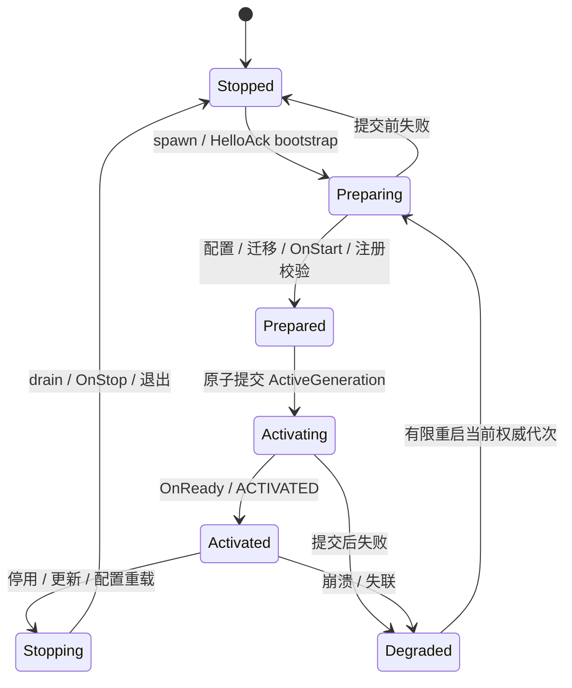

# AlonaBot 技术设计

**版本：** v0.6-review · 2026-10-21  
**状态：** 现行实施基线，待实施验证。实现模块与职责按下文执行；具体工作包见根目录 PLAN。精确行为以 [CONTRACTS-v0.1.md](CONTRACTS-v0.1.md)、[WIRE-FORMAT.md](WIRE-FORMAT.md)、[MESSAGE-MODEL.md](MESSAGE-MODEL.md) 为准，执行顺序见 [PLAN.md](PLAN.md)。

## A. Core 与插件职责

Core 负责 Adapter、标准事件与命令路由、权限、消息发送、Service Broker、Event Bus、Scheduler、插件进程、公共 HTTP、配置/Secret 与安装代次。每个已安装插件包运行一个独立 Native Go 子进程，插件使用普通 Go Modules、goroutine、net/http 和 GORM；跨插件通过 Core 调用。

独立进程隔离崩溃，不构成同一 OS 用户下的恶意代码沙箱。只有使用 SDK 的受管资源与生命周期遵守框架恢复契约；插件自行管理的外部文件、HTTP 或数据库不受 Core 事务回滚。

### 生命周期



SDK 公开三个可选进程 Hook：`OnStart(context.Context) error`、`OnReady(context.Context) error`、`OnStop(context.Context) error`。OnStart/OnReady 不得等待自己的公开路由或发起业务 Send/Service；后台工作等待 SDK 就绪门并服从 lifetime context。SDK 串行写完 ACTIVATED 后打开就绪门，Core 按帧顺序先激活再接受业务。

同一 data_dir 只有一个 Core，同一插件管理操作串行，SDK 持有跨代次 runtime.lock；旧进程未释放受管资源时不能再启动第二个写入者。主 RPC 断开即取消 lifetime、关内部 HTTP 并限时退出。普通异常退出采用既有 5 分钟内 3 次自动禁用规则；正常停用不自动重启。

## B. 安装包、平台与来源

首发目标为 linux/amd64、linux/arm64、windows/amd64、darwin/amd64、darwin/arm64。市场预构建优先，本地源码构建可选；Native 进程只要求协议兼容，不要求 Core 与插件使用相同 Go patch。

`plugin.yaml` 是插件 ID/版本真源，生成产物包含静态描述、Schema、i18/ 和可执行程序。市场 ID 使用 `alonabot_plugin_` 规范；本地允许安全 slug 并警告缺前缀。ID 不直接当作数据库标识符或主机名。

不同包 ID 冲突保留持久化安装记录中的首个，拒绝后来的冲突来源；同一插件内部重复 route ID、命令路径/别名或 HTTP method+path 报错。已有插件更新必须校验原来源/发布者，不能借 first-wins 绕过更新身份校验。

归档为 tar.gz；外部 release 清单记归档 SHA256，归档内 manifest 只记录程序/资源摘要，避免自包含摘要循环。签名验证清单确切字节，安装器受控解压、检查大小/链接/路径，再原子移入候选目录。完整命令及信任策略见 CONTRACTS §9。

## C. Protobuf RPC 与两种传输

TCP 为默认，Core 持有 loopback 端口 0 分配的 Listener；stdio 可选，stdout 只传协议，stderr 为日志。统一 `4-byte big-endian length + Protobuf Envelope`，单帧最大 4 MiB，协议首发 1.0。每个进程有独立随机凭证与 Session，完整首帧鉴权后才下发 Bootstrap。

匹配键为 `(session_id, initiator_side, call_id)`，支持并发与乱序 Response。读帧/响应配对独立于 Handler；唯一 writer 保证帧不交错；控制/响应/取消不能被业务排队堵住。计数与字节预算都受限，超额立即拒绝，不能因嵌套调用等待自己的额度。

业务副作用不自动重试。取消只是合作式终止；迟到响应不会重新完成请求。Service/Send 的父调用关联由 Core 记录，不能信任插件提交的 Actor/权限。Bootstrap、控制错误、注册描述与媒体 RPC 详见 WIRE-FORMAT。

## D. Go SDK 与 Handler 注册

一个插件包恰好一个根类，嵌入 `sdk.Base`，最多一个 Config 类型。`sdk.Base` 为根插件的全部 Hook（`OnStart`/`OnReady`/`OnStop`、`Config`、`Commands`/`HTTP`/`Schedules`）提供空的默认实现，根插件只覆盖需要的方法，SDK 原样调用，不区分是否覆盖；这样编辑器能补全出全部 Hook。`sdk.Root` 接口列出全部 Hook，覆盖时签名不符（或根插件有与 Hook 同名的字段）会使根插件不再满足 `sdk.Root`，在调用 `sdk.Run` 处编译失败，不会静默跳过。`Config` 返回 `config.Config`，配置类型嵌入 `config.Base`（默认 `OnLoad` 原样返回 raw），覆盖 `OnLoad` 时签名不符同样在编译期失败。元数据 ID 只来自 plugin.yaml；辅助 Handler 可以显式接收根类指针，不引入自动 DI。包级函数可用 `//alonabot:command`、`//alonabot:event` 构建期标记发现；实例方法必须提供实例显式注册。

生成器只扫描当前模块的目标构建包，遵守 Go build tags/GOOS/GOARCH，排除外部依赖、vendor 和测试文件；用生成 Go 代码让编译器检查签名。路由、配置 Schema 和 i18/ 的构建检查在 T-01/T-04 落地；不在运行时从磁盘扫描任意包。单次 Session 注册描述固定，Core 动态修改权限/开关，不重建插件对象。

以下是接口用法示意，需随 SDK 实现编译验证：

```go
type RSS struct { sdk.Base }

func (p *RSS) Commands(r *sdk.CommandRegistry) {
    r.Group("rss", func(g *sdk.CommandGroup) {
        g.Command("list", p.List)
        g.Command("add", p.Add)
    })
}

func (p *RSS) List(c *sdk.Context) (message.Chain, error) {
    c.StopPropagation()
    return message.Chain{message.Text("订阅列表")}, nil
}

func (p *RSS) Add(c *sdk.Context, url string) error {
    _, err := c.Send(message.Chain{message.Text("已收到订阅请求")})
    return err
}
```

两类 Handler 保留：返回 `(Chain,error)` 的自动回复型成功时由 Core 发一次非空 Chain；返回 `error` 的主动发送型可多次 Send。自动回复型内部调用 Send 返回 FAILED_PRECONDITION。`c.StopPropagation()` 锁存传播结果，由 SDK 统一编码到 HandlerOutcome；不会给开发者增加第三套 Handler 签名。

Handler 调用受普通请求期限约束，返回后不能再以原上下文工作。需要等待用户回复或较长时间生成时，Handler 请求一次延续调用：Core 在本次调用结束后，以原可信上下文另发一个独立期限的调用，它不占用分发链（CONTRACTS §2.4）。多轮等待只在延续调用内使用：

```go
func (p *Quiz) Start(c *sdk.Context) error {
    return c.Continue(func(c *sdk.Context) error {
        if _, err := c.Send(message.Chain{message.Text(c.T("quiz.ask"))}); err != nil {
            return err
        }
        reply, err := c.Wait(2 * time.Minute) // 同一用户在同一会话的下一条消息
        if err != nil {
            return err
        }
        _, err = c.Send(message.Chain{message.Text(c.T("quiz.got", "answer", reply.Text()))})
        return err
    })
}
```

## E. 消息、命令和权限

MessageChain 表示一次逻辑 Send；多条独立推送应多次 Send。一个逻辑 Send 可产生多个平台消息 ID，并用 ACCEPTED/PARTIAL/REJECTED/UNKNOWN 和逐部分结果描述；错误返回不得丢掉已经确认的 ID。整条 Chain 在第一次平台调用前预检，失败后不继续发送剩余部分。

Target 明确 Adapter、实例、账号、聊天和可选话题；没有真实入站默认目标时必须显式 To。原事件 Target 的回复范围与主动/跨实例的 allowed_adapter_instances 按 CONTRACTS §8 准入，不以 User/Admin 代替发信许可。平台 ID 在公共 JSON 中用字符串。系统任务没有虚构的账号/Actor。Text/Image/Video/File/Mention/Reference/Buttons/Forward 的可表达组合和 Telegram 映射见 MESSAGE-MODEL。

普通命令按完整 token 路径最长匹配，再以 priority/plugin_id/route_id 选稳定胜出者；已识别的禁用、无权限、参数错误命令不回落 Regex/Raw/短路径。没有普通命令才按文本匹配（Regex、keyword、startswith、endswith、fullmatch）→Raw 处理，支持停止传播。跨插件同名命令在诊断中显示遮蔽关系，不由启动顺序决定。

Core 命令 Admin 是按 Adapter 实例与外部用户 ID 配置的机器人管理员；平台群管理员只形成 chat_admin Rule，不自动取得 Core 管理权限。命令树取最近显式权限策略，允许子命令放宽或收紧，但所有层的禁用和 Core 全局禁止始终生效。每次派发前读取当前策略，已开始调用不宣称可撤销。

## F. 事件管道：Hook、Rule 和传播

同一 Event 只有一条按固定顺序推进的普通 Handler 链，不同事件并发。入站 `Normalize → PreEvent → Match/Permission → Rule/Handler`；SDK 可在一次 Handler RPC 内先执行自定义 Go Rule，False 返回 matched=false。

priority 数字小的先执行，同值按稳定 plugin_id/route_id 排序。业务错误记录并继续普通事件分发；显式 Stop 优先，命令被识别后的拒绝不进入其他匹配类别。PreEvent 仅可修改允许的业务 payload/停止普通传播，不能改 Core 保存的身份、Target、按钮/任务绑定或来源。

每次 Send 独立执行 `BeforeSend → Adapter.Send → AfterSend`。BeforeSend 只改 Chain 或拒绝；AfterSend 只观察已经发生的发送结果，其自身错误不能把平台成功改写成发送失败。出站 Hook 及其派生子调用禁止再次 Send，避免递归。Hook 类型、阶段及最小结果字段按 Wire/消息专章生成。

## G. Event Bus、Service Call 与后续动态 Router

Event Bus 使用 `plugin_id/event_name`，非持久化尽力广播，离线不补、满队列丢最新并计数。每订阅者同时限制条数和字节，慢订阅者不阻塞其他插件。发布者只能发布自己命名空间；订阅由描述声明，事件内容不能赋予用户权限。

Service 以 `plugin_id/service_name` 注册，使用显式 schema/version 的 JSON 或 Protobuf 请求/响应。Core 检查目标状态和授权，继承父请求的 Actor/scope/deadline，A→B→C 可用；同调用链出现重复插件或超过深度上限明确拒绝。父请求结束后其未完成子调用取消，后台独立请求仅有插件身份。

通过 Core 动态调用其他插件命令/事件 Router 不在 v0.1 范围内（Q-15）；v0.1 不暴露该执行 API，只保留稳定 route ID。Go Modules 用于编译期复用，不能当作跨进程 Go 对象调用。

## H. Core Scheduler

调度器固定支持 interval 与 cron，规范含语法、IANA 时区、起点和夏令时处理，见 CONTRACTS §4。Core 唯一拥有触发权，`scheduled` 使用有 CallID/完成响应的 Request；不同 job 可并发，同 job 未结束时跳过本次，离线不追补。

每次执行有独立 run_id、job deadline 与 lifetime context，不被 30s 普通 RPC 默认值截断。任务超时后若插件未确认协作结束，不释放同 job 的运行槽并再次重叠启动；恢复策略见运行时契约。定时身份是显式 job/plugin scope，不获得默认 Admin。

## I. HTTP 与 SQLite

### HTTP

遵守 D-25：插件只注册 `http.Handler`，SDK 仅在有 HTTP 路由时持有 `127.0.0.1:0` Listener，不先找端口再重新绑定。REGISTER 报告实际端口与路由；Core 只代理已认证、Activated 的 Session，并在停止/断链时撤销。

外部统一 `/plugins/{id}/...`，SDK Handler 接收去掉插件前缀的路径。Core 校验路由/权限，清理外部内部认证头、Core Cookie/Authorization，再注入 Session 认证；用标准库 ReverseProxy.Rewrite，不能由请求指定代理目标。

Admin 与插件内容采用两个全局主机名，使用同一公开 Listener/端口。插件内容 host 不提供 Admin API，采用独立受控会话；Admin 不允许插件 Origin 访问管理 API。所有插件页面共享插件 Origin 信任域，不声称插件页面彼此隔离。未配置内容 host 时 API/Webhook 可用，但不得在 Admin Origin 直接执行插件 HTML/JS/SVG。

### 数据库

Core 管理状态库与插件业务库分开。框架只托管 SQLite（D-48）：`sqlitedb.Open(ctx) (*sql.DB,error)` 与 `gormdb.Open(ctx) (*gorm.DB,error)` 共用 Session 的同一个连接，插件只导入用到的包，不用 GORM 就不链接 GORM（D-49）。需要外部数据库的插件自带驱动、自行管理连接与数据。驱动组合在 CONTRACTS §6 指定，实际版本由 T-01 验证锁定。

受管 SQLite 每插件、每候选代次独立文件。配置重载与版本更新统一先停止旧进程、备份候选副本，再迁移/初始化；不能复用旧可写 DB 来承诺提交前回退。准备期会改动外部数据的插件声明 `prepare_effects=external`，已有安装的升级按维护模式处理。

`Migrate(ctx, db)` 与 `Migrations() []Migration` 可选且互斥，由 `sqlitedb` 与 `gormdb` 各定义一组，回调在插件 SDK 内执行，Core 负责调度与代次门槛。辅助迁移的 Up 与成功记录在插件 DB 的同一事务；没有迁移接口就不主动迁移。维护许可和启动原因在 Bootstrap 明确下发。

## J. Config、Schema 与 i18/

运行配置为普通 JSON 对象，无外层 config；i18/ 翻译才以 config 为顶层。Go Config 的 json/form/description/secret/hidden tag 生成 Schema 与表单，字段按声明顺序，保留未知键、显式 false/0/空串与隐藏字段。

`OnLoad` 是配置回调，区别于三个进程 Hook，也负责拒绝不合法的业务取值，SDK 不另设 Validate 回调。流程为原始对象→配置版本迁移（OnLoad）→仅补缺键默认→typed decode/Schema 校验→Candidate；不能先用新 Schema 拒绝仍需迁移的旧字段。持久化保留原始完整对象，不能用 typed marshal 丢掉未知键。

Core 状态库的 ActiveGeneration 是权威，`config.json` 是用户编辑快照。直接编辑不热生效，`plugin reload` 导入 Pending 后走候选流程。新 secret 产生新不可变引用，候选失败不修改旧凭证；普通配置 API 不返回明文。表单 PATCH 采用明确操作，掩码不当作真实值。

```json
{
  "config": {
    "interval": {
      "label": "Refresh interval",
      "description": "Polling interval"
    }
  }
}
```

以上是 i18/en-US.json 示例；语言仅影响文案，查找为当前 locale→en-US→默认 tag。选项显示名可翻译，值和配置 JSON 路径保持不变。

同一文件的顶层 `messages` 存放机器人回复的文案，例如 `{"messages": {"quiz.got": "You answered {answer}."}}`。SDK 的 `c.T` 按用户的 locale、Core 默认 locale、en-US 的顺序选择语言；日志与错误只用英文，不进入文案目录（CONTRACTS §5.4）。

## K. WebUI、安装与运行安全

WebUI 是可替换的组件（§T），只含静态文件，由 Core 在 Admin 主机上提供，只经带主版本号的 Admin API 管理 Core（CONTRACTS §7.5）。官方 WebUI 提供状态/日志、安装启停、更新/恢复、配置表单与命令权限。管理 API 采用 Core 的管理员认证、CSRF 与独立 Session；首次本机 admin-token init/reset、浏览器登录与 CLI Bearer 按 CONTRACTS §7.4 实现；插件页面不会收到管理 Cookie。没有可信来源/合法归档就不执行程序，首次信任与后续更新绑定持久化。

环境变量只传该插件所需信息，SDK 将日志标记 plugin/session/route/call；secret 原文不进入普通日志。工作目录与进程隔离不是 OS 权限隔离，首发只支持可信 Native 插件。进程树按 Linux/macOS/Windows 的合作型子进程机制回收，验证不涵盖恶意 detach。

## L. 接口实现与验收入口

| 议题 | 实施依据 | 实证任务 |
| --- | --- | --- |
| Handler/Rule/Hook/权限 | CONTRACTS §2/§3、MESSAGE-MODEL | T-04/T-05/T-06，WebUI 在 T-09 |
| 帧/Bootstrap/Session/错误/取消 | WIRE-FORMAT、CONTRACTS §1/§12 | T-01/T-02 |
| 消息/媒体/按钮/回执 | MESSAGE-MODEL、CONTRACTS §1.3 | T-03 |
| 调度/HTTP/生命周期 | CONTRACTS §4/§7/§12 | T-02/T-07/T-08，正式认证/更新在 T-09 |
| 配置/secret/DB/Journal | CONTRACTS §5/§6/§12 | T-08/T-09 |
| 构建/来源/安装/恢复 | CONTRACTS §9、TEST-MATRIX | T-01/T-09/T-10 |

各接口随对应工作包实现并取得测试证据；跨任务用例按 TEST-MATRIX 的最终闭合点完成。

## M. Adapter：可安装的平台适配器

Adapter 与插件一样以安装包分发、在独立进程中运行（D-26）；官方 Telegram 是第一个 Adapter 包，可以卸载。同一 Adapter 包只运行一个进程，承载它的全部账号实例；实例由 Core 单独启停，停用 Adapter 即停止该进程。Core 内部用同一个接口表示每个账号实例，正式实现把调用转发给 Adapter 进程，测试中可以使用内存实现：

```go
type Instance interface {
    AdapterID() string
    InstanceID() string
    AccountID() string
    Capabilities() []*pb.Capability
    Start(ctx context.Context, sink Sink) error
    Stop(ctx context.Context) error
    Send(ctx context.Context, target *pb.Target, chain *pb.MessageChain) (*pb.SendResult, *pb.ErrorInfo)
}

// Editor 是支持 message.edit 的实例另外实现的可选接口，调用方用类型断言获取。
type Editor interface {
    Edit(ctx context.Context, target *pb.Target, messageID string, chain *pb.MessageChain) (*pb.SendResult, *pb.ErrorInfo)
}
```

Adapter 作者使用 `sdk/adapter` 实现平台接收、标准化与发送；派发、权限、Target 授权、按钮 token、媒体缓存和游标持久化留在 Core。插件可以声明对某个 Adapter 的依赖，并使用它声明的 extension 片段，见 CONTRACTS §8。Start 完成凭证/实例检查并启动接收后返回；Stop 停止接收；实例的致命错误经 `core.adapter.status` 报告，不静默消失。实例上线、下线时由 Core 生成 `bot.online`、`bot.offline` 事件。同一平台账号只允许一个入站所有者，凭证轮换先停止旧实例。

v0.1 只支持 Telegram long polling，先确定实际 bot 身份并校验 account_id。接收游标与非持久化事件入站的确认语义见 MESSAGE-MODEL；不承诺 exactly-once。平台特有能力按版本声明，不支持的片段组合先拒绝；其他官方 Adapter 后续增加，第三方 Adapter 按同一机制安装，也可以替换同一 `adapter_id` 的官方 Adapter（§T）。

## N. 更新 Journal、快照与恢复

受管 SQLite 候选流程：**下载/验证 → 冻结新根请求 → drain/停旧进程 → 确认 runtime.lock 可取 → Backup 候选 DB → 配置/DB 迁移与 OnStart → Prepared → Core 单事务提交 ActiveGeneration+COMMITTED → OnReady/Activated → 服务**。

提交前失败重启旧程序的新 Session；提交后新代次权威，失败进入 Degraded，不能悄悄切回旧 DB 丢弃已发生的新写入。管理员 rollback 以选定快照为输入创建新的恢复 Generation/SQLite 副本，保留原快照不变，并说明会丢弃该点之后的受管写入。插件自行管理的外部数据走维护流程。

包、配置、secret 引用与候选 DB 先持久化，再提交 Core 指针。Core 崩溃恢复还必须确认旧进程退出，Journal 不能替代进程锁。首发采用允许短暂停顿的切换，不实现双实例零停机。

## O. SDK 分层、CLI 与可观测性

最小逻辑分层为 contracts、plugin SDK、Core 和 plugin CLI；contracts 不依赖具体平台 SDK/GORM，数据库作为按需 SDK 包。使用标准 Go 编译、Protocol Buffers、标准 HTTP 代理及选定驱动，不引入额外容器运行时、服务发现或迁移平台。

**按需付费**（D-52）：Core 与 SDK 根包只链接允许清单中的模块，模型 SDK、Provider 客户端、MCP、外部数据库驱动与 GORM 一律放在需要它们的插件或按需 SDK 包里；没有安装或没有启用的组件不运行进程。Core 与示例插件的空闲常驻内存有预算（TEST-MATRIX V-74），依赖检查在 CI 中执行（V-75）。插件作者的对应规则见 [插件开发规范](../docs/plugin-guide.md)。

CLI/API 的完整管理动作与包协议见 CONTRACTS §9。Core 状态库记录安装序号/来源、ActiveGeneration、Journal、权限、回调与配置引用；业务库由插件负责。所有状态变更通过同一个 Core 管理服务串行化，离线 CLI 不能绕过仍运行的 Core 直接改状态库。

日志使用标准库 `log/slog`（D-31）：每条记录关联来源（Core、插件或 Adapter）、plugin_id 或 adapter_id、instance、route_id、call_id、trace_id、session/generation，记录状态变化、拒绝/丢弃、发送回执、更新/恢复和配置权限审计。控制台格式仿照 AstrBot，例如 `[14:05:42.118] [Plug:weather] [ERRO] [weather/weather.go:57]: ... trace=7c2e91d0`；同一条消息引起的记录共用 trace_id，可以串起跨插件的整条链路。每个插件与 Adapter 可单独设置级别或设为 off，WebUI 的显示筛选只在浏览器中进行（CONTRACTS §14）。资源测试包含 Core+不同插件+附属进程，总 RSS/私有内存、Linux PSS、CPU、P50/P95/P99；测试环境和平台差异随结果记录。

## P. 长期扩展方向（不进入 v0.1）

动态命令 Router、持久化的多轮会话状态与暂停 DSL、更多 Adapter、子代理、跨会话的记忆检索、TUI/桌面/移动端、多语言 SDK 均保留为后续方向。WASM、实例池、蓝绿零停机和复杂表单不进入首发，不为它们预建运行时抽象。

## Q. 多实例与实施维护

Target 与凭证按 Adapter 实例/账号区分，不把特定 X/Twitter 多账号需求硬编码进 Core。实例管理、权限和凭证切换分别在 T-03/T-04/T-09 实施并验收。

修订时同步根目录契约、详细计划与测试；选择原因和历史审阅见 [adr/README.md](adr/README.md)。技术基线维持 v0.6-review。

## R. Agent 组件

Agent 分为 Core 基础与 Agent 组件两层（D-27）。Core 负责必须可信的部分：工具目录与按工具的调用策略、调用前的用户确认、会话存储；它们复用 Service Broker、按钮 token 与 Target 准入的实现（CONTRACTS §13）。Agent 组件（`role: agent`，全局至多一个，D-59）只经 SDK 访问 Core。官方 Agent 组件位于 `agent/`，可以被社区 Agent 替换；其他插件经 `@agent` 调用 `llm.generate`，替换后不用修改（D-61）。官方 Agent 组件：

- **一轮对话**：`/ask` 在任何聊天中触发；Admin 为某个聊天开启自由对话后，该聊天中 `to_me` 的非命令消息也触发（私聊的消息都是 `to_me`）。触发的 Handler 请求延续调用，在其中读取会话历史，按人格组装系统提示，调用 Provider 并流式接收。目标实例支持 `message.edit` 时，先发送一条消息，再按固定间隔编辑它，显示已生成的内容，生成结束后用完整内容做最后一次编辑；不支持时生成结束后一次发送。会话按 Adapter 实例、聊天与话题区分。
- **Provider**：官方 OpenAI（`openai`）、OpenAI 兼容（`openai-compatible`）的 Chat Completions 与 Anthropic Messages，用标准库 net/http 与 SSE 实现；api_key 使用 Secret 引用。两种 OpenAI 协议只差输出上限的参数名（D-64）。Provider 条目可以选择预设（例如 openai、anthropic、deepseek），预设给出缺省的协议与 base_url，在配置表单中带各自的图标（D-63）。流结束时得到停止原因与用量。
- **工具**：模型请求的 Core 工具经 `core.tool.invoke` 调用；MCP 工具（stdio、streamable HTTP，经 `github.com/modelcontextprotocol/go-sdk`）执行前先经 `core.tool.confirm`。单轮的工具步数有上限。
- **技能**：管理员放进技能目录的 `SKILL.md`，包含名称、描述与正文。系统提示只列出描述，模型经 `load_skill` 按需读取正文。
- **定时任务**：用户让 Agent 创建的任务保存在 Agent 的数据库，由一个固定的 schedule 触发，在该回调内运行；没有 Actor，因此需要确认的工具一律拒绝。
- **文本生成服务**：`llm.generate` 让其他插件复用已配置的 Provider（CONTRACTS §13.5），调用方以 `@agent` 为目标。只有管理员列入 `llm_service_allowed_plugins` 的插件能调用；一次调用就是一次完整的 Provider 请求，不涉及会话、记忆、人格与工具。

记忆由 Agent 自己实现（D-60，取代 D-28 的记忆插件）。官方 Agent 仿照 Hermes 的内置记忆，数据保存在 Agent 的受管 SQLite：

- 每个会话一份笔记、每个用户一份档案，各有字符上限。
- 会话开始时读取会话笔记，写进会话存储作为冻结的快照；会话内写入的记忆到下一个会话才进入系统提示。
- 每轮把当前说话用户的档案附在本轮用户消息之前，因此群聊中每位用户使用自己的档案。
- `memory` 工具支持 add、patch、remove；它由 Agent 注册为普通工具，模型的调用经 `core.tool.invoke`，管理员可以设置策略。超过上限返回错误，不丢弃已有条目。
- 检索式记忆不在官方 Agent 内，可以由社区写成工具插件；需要完全不同的记忆时替换整个 Agent 组件。

## S. 两种运行方式

AlonaBot 同时面向直接使用机器人的用户和写插件的开发者（D-32），两者运行的是同一个 Core 和同一套协议，区别只在组件由谁启动：

| | 发行包（用户） | 库模式（开发者） |
| --- | --- | --- |
| 入口 | 从本仓库的 Release 用发行归档、`install.sh` 或 `docker compose` 安装（官方整合包），在 WebUI 中配置 | 在自己的 `main.go` 中调用 `alonabot.Run`，执行 `go run .` |
| 包含 | Core、官方 Telegram 与 OneBot 11 Adapter、Agent、WebUI 与预装插件；首次运行自动安装，默认只启用 help 与 WebUI，Agent 由管理员按需启用（D-50、D-62） | 内嵌完整的 Core；开发中的插件、Adapter 或 Agent 由本进程运行，开发中的 WebUI 经 `alonabot.WebUI` 提供 |
| 组件进程 | 每个已启用的包一个独立进程（WebUI 没有进程） | 开发中的组件与 Core 同进程，可直接打断点；已安装的其他包仍是独立进程 |

库模式下开发者只写插件包和一个调试用的 `main.go`，发布时 `alonabot plugin build` 自动生成正式入口。开发时与生产时的行为只差进程隔离与崩溃重启。启用热部署后 Core 常驻，开发中的组件改为子进程：源码改动后重新编译，只重启这些组件，Adapter 连接、其他插件与按钮都不受影响；编译失败时旧版本继续运行（CONTRACTS §15）。

Go 不能在进程内替换已加载的代码，所以热部署通过重启子进程实现，断点调试与热部署不能同时使用。

官方组件只经 SDK 或 Admin API 与 Core 通信，`adapters/`、`agent/`、`plugins/` 与 `web/admin/` 不被本仓库其他包 import；v0.1 协议冻结后迁到独立仓库。

## T. 组件角色与替换

可安装的包统称组件（D-59）。四种角色共用 manifest、安装、来源与签名校验、代次和卸载保留规则（CONTRACTS §9）：

| 角色 | 同时安装 | 进程 | 官方组件 |
| --- | --- | --- | --- |
| `plugin`（插件） | 任意多个 | 每个一个 | help、welcome、rss |
| `adapter` | 每个 `adapter_id` 一个 | 每个一个，承载全部实例 | Telegram、OneBot 11 |
| `agent` | 一个 | 一个 | `agent/` |
| `webui` | 一个 | 没有，Core 提供静态文件 | `web/admin/` |

官方 Adapter、Agent 与 WebUI 都可以换成社区组件：`alonabot install <id> --source owner/repo --replace` 在新组件通过下载、签名与静态检查后卸载旧组件并安装新组件，旧组件原来启用时新组件也随之启用，之后的 `update` 只从新来源取版本（CONTRACTS §9.3）。替换不迁移旧组件的数据：会话、记忆、按组件 ID 记录的策略与被替换 Adapter 的实例配置留在数据目录，按卸载保留规则可以从原来源重装找回；新 Adapter 的实例需要重新创建，因为实例配置按各自 Adapter 的 Schema 解释。

社区组件只依赖公开契约：Adapter 依赖 `sdk/adapter` 与 MESSAGE-MODEL；Agent 依赖 CONTRACTS §13 的工具、确认与会话存储，并实现 §13.5 的 `llm.generate`；WebUI 依赖 Admin API 参考与 CONTRACTS §7.5。组件的图标随组件包发布，由 WebUI 显示，Core 与 WebUI 不内置任何厂商图标（D-63）。
