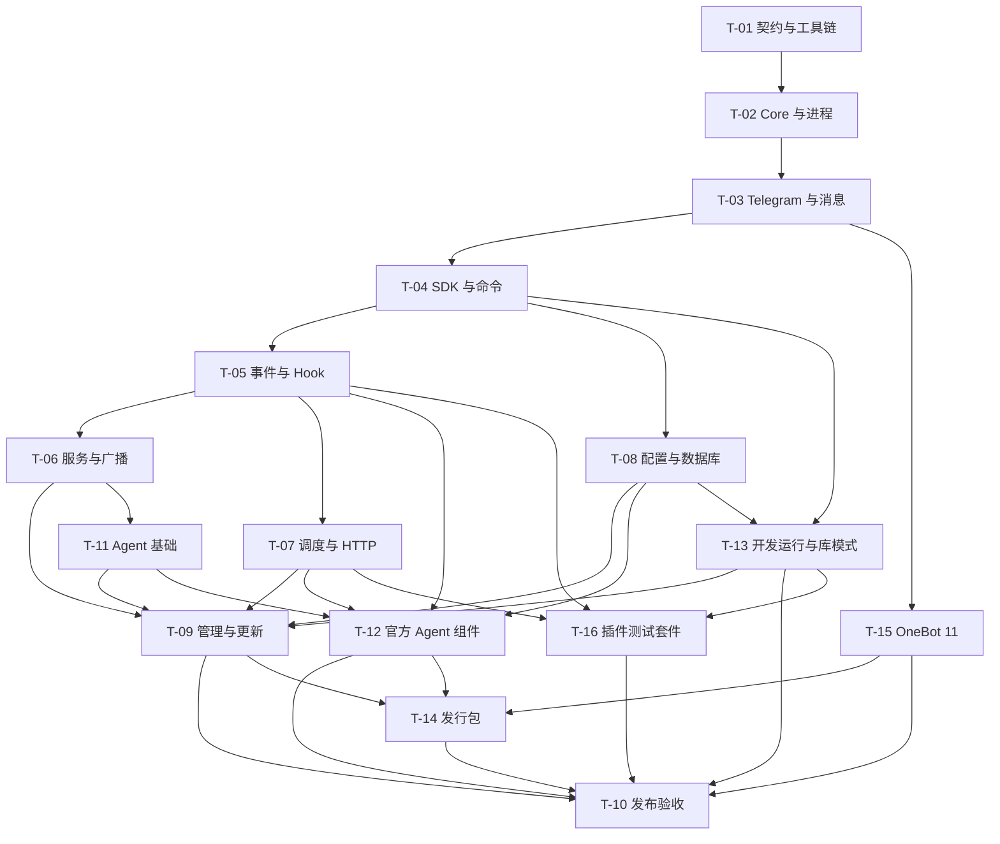

# AlonaBot v0.1 详细实施计划

**技术基线：** v0.6-review  
**编排更新：** 2026-10-22  
**实施状态：** T-01、T-02、T-02.1 已实现，分项证据见 [TEST-MATRIX §3.1](TEST-MATRIX.md#31-已运行的分项证据t-01t-02)，Linux/Windows 的真实运行由 T-10 补齐。独立切片 T-02.2、T-07.1、T-08.2、T-09.2 与 T-12.1 已实现；T-04.19 已完成按配置文件的命令前缀与回复方式（PR #250），证据见 TEST-MATRIX §3.2；其余未开始的切片按 §3.1 推进。

从 T-01 开始，按前置任务推进。每项任务交付可编译、可验证的增量；跨任务验收在对应集成点闭合。协议和行为以 [CONTRACTS-v0.1.md](CONTRACTS-v0.1.md)、[WIRE-FORMAT.md](WIRE-FORMAT.md)、[MESSAGE-MODEL.md](MESSAGE-MODEL.md) 为准，验收编号统一使用 [TEST-MATRIX.md](TEST-MATRIX.md)。

## 1. 最终交付

交付一个 Go Core、Go 插件与 Adapter SDK、可安装的官方 Telegram 与 OneBot 11 Adapter、官方 Agent 组件、可替换的官方 WebUI 组件与管理 CLI。用户用发行归档、`install.sh` 或 `docker compose` 安装官方整合包即可开箱即用，官方 Adapter、Agent 与 WebUI 都可以换成社区组件；开发者用 `alonabot init` 创建组件工程、用 `alonabot run --reload` 在工程目录中开发，改动源码后只重启该组件；需要把 Core 嵌入其他 Go 程序或在同一进程中调试时，也可以把框架当作 Go 库运行。用户能够安装预构建的插件与 Adapter，配置并启用它，在指定聊天/话题执行命令、发送消息和媒体、进行多轮对话，使用 Service、Event Bus、Scheduler、插件 HTTP 与受管 SQLite；能够与 Agent 对话，Agent 调用工具前按策略取得用户确认；管理动作能够按确定的代次和维护规则更新、停止及恢复。机器人回复与 WebUI 提供英文和简体中文。

首发目标为 linux/amd64、linux/arm64、windows/amd64、darwin/amd64、darwin/arm64。每插件一个 Native 子进程，每个 Adapter 包一个 Native 子进程（承载其全部实例），TCP 默认、stdio 可选；框架托管 HTTP 只开放 Core 的一个公开端口。动态跨插件命令 Router、持久化的多轮会话状态与暂停 DSL、跨会话的记忆检索和额外客户端后置；官方 Adapter 只有 Telegram 与 OneBot 11，不做其他官方 Adapter，也不做多语言 SDK（D-152）。插件的按需休眠在 §7 单独规划（S-01～S-03、S-06；Adapter 与整机休眠已取消，D-153），不属于 v0.1 交付。

## 2. 实施目录和工作流

下表列出代码目录及其首次交付的任务，已实现的范围以 [ARCHITECTURE.md](../ARCHITECTURE.md) 为准。全部代码在一个 Go module 中。

| 拟建位置 | 负责内容 | 首次交付 |
| --- | --- | --- |
| `go.mod`、`go.sum` | 实际模块路径、Go 与依赖版本 | T-01 |
| `contracts/` | Protobuf 源文件、生成类型、消息/配置/manifest Schema 和兼容 fixture | T-01 |
| `sdk/` | Native 会话、Context/Send、注册、生命周期、媒体与按需数据库包（`sdk/sqlitedb`、`sdk/gormdb`）；Adapter SDK（`sdk/adapter`）；文本生成服务契约（`sdk/llm`） | T-01 给出类型，T-02～T-08 逐步实现 |
| `internal/core/` | 状态、进程、RPC、路由、权限、服务、调度、HTTP 与管理编排 | T-02 起 |
| `adapters/telegram/` | 官方 Telegram Adapter 程序：接收、发送、能力和平台映射 | T-03 |
| `agent/` | 官方 Agent 组件（含记忆） | T-12 |
| `plugins/help/`、`plugins/welcome/`、`plugins/rss/` | 预装插件 | T-14 |
| 根包（`alonabot.go`） | 库模式入口 `alonabot.Run` 与 `Start`，对 `internal/app` 的薄包装（D-148） | T-13 |
| `internal/app/` | Core 装配、候选与进程管理、开发组件运行与重启，库模式与 `alonabot run` 共用（D-148） | T-13 |
| `scripts/dist/` | 发行归档的构建与打包 | T-14 |
| `Dockerfile`、`deploy/compose.yaml`、`deploy/install.sh` | 官方容器镜像、compose 整合包入口与 install.sh | T-14 |
| `cmd/alonabot/` | Core 启停、开发者与管理 CLI 装配 | T-02 起，T-09 完整 |
| `web/admin/` | 官方 WebUI 组件：配置表单/i18 组件、管理界面与静态资源 | T-08 组件，T-09 完整 |
| `examples/plugins/` | 随 SDK 版本同步编译的最小示例和集成样例 | T-02 起 |
| 各包的 `testdata/` 与测试文件 | 非生产 fixture、错误注入和行为验证 | 随负责任务交付 |

生成代码只由受版本约束的生成命令产生，不手工修改；工具可执行文件和业务凭证不放进发布包。日常编译与验证在仓库根执行：

```sh
go generate ./...
go test ./...
go build ./...
```

Telegram、LLM Provider、浏览器和目标平台的测试单独记录环境与命令；缺少真实环境时不能用普通测试结果替代。Core 可执行文件与 SDK 根包链接的模块由审查时用 `go list -deps` 对照允许清单核对（V-75）。每个任务先验证直接变更及其边界，再做工作包要求的集成检查。

## 3. 任务依赖与交付次序

| 任务 | 前置任务 | 本项完成时的可用能力 | 当前状态 |
| --- | --- | --- | --- |
| T-01 | 无 | 可编译契约、固定生成方式、驱动/备份验证基线 | 已实现；分项证据见 TEST-MATRIX §3.1 |
| T-02 | T-01 | 最小真实 Native 进程的状态、双 IPC、启动和停止；统一日志与调优参数 | 步骤 1～8 已实现，darwin/arm64 运行通过，Linux/Windows 运行未执行（T-10）；日志基线（T-02.1）已实现；调优参数（T-02.2）已完成（证据见 TEST-MATRIX §3.2） |
| T-03 | T-02 | 可安装 Adapter 的进程与 SDK；官方 Telegram Adapter 的入站与显式 Send、媒体、按钮、extension 片段、真实回执 | 未开始 |
| T-04 | T-03 | 根插件 SDK、自动/显式注册、命令树与动态权限 | 步骤 18 配置文件派发与 SDK 已完成（PR #242）；其余切片状态见 plan/core.md，证据见 TEST-MATRIX §3.2 |
| T-05 | T-04 | 完整事件链、Rule、Hook、传播、可信身份、延续调用与多轮等待 | 未开始 |
| T-06 | T-05 | Service Broker 与有界 Event Bus | 未开始 |
| T-07 | T-05 | Core Scheduler、SDK HTTP 与统一代理组件 | 未开始 |
| T-08 | T-04 | 配置/Secret/Schema/i18、用户可见文案与插件 DB 候选准备能力 | 未开始 |
| T-09 | T-06、T-07、T-08、T-11 | 安装更新/回退、完整管理认证、CLI/API/WebUI | 未开始 |
| T-10 | T-02～T-09、T-11～T-16 | 全部验收闭合、目标平台产物与资源报告 | 未开始 |
| T-11 | T-06、T-08 | 工具目录、调用策略与用户确认、Agent 会话存储 | 未开始 |
| T-12 | T-05、T-07、T-08、T-11 | 官方 Agent 组件（含记忆） | 未开始 |
| T-13 | T-03、T-04、T-08 | `alonabot run` 的开发运行与热部署、库模式入口与同进程的开发组件 | 未开始 |
| T-14 | T-09、T-12、T-15 | 发行包、容器镜像、首次运行与预装插件 | 未开始 |
| T-15 | T-03 | 官方 OneBot 11 Adapter（正向与反向 WebSocket）与跨 Adapter 一致性验收 | 未开始 |
| T-16 | T-05、T-07、T-13 | 插件测试套件 `plugintest` | 未开始 |

本表和下图是工作包整体完成的先后，休眠扩展的 S 工作包见 §7。切片按实际用到的成果另列前置（§3.1），可以在上游工作包完成前开始。T-10 的测试设施随任务建立，最终发布门槛在依赖全部完成后检查。



### 3.1 执行切片

每个工作包拆成切片，切片表在各章节实施计划的「执行切片」一节，一个切片对应一个 goal（`goal-N` 目录、分支与 PR）。执行者实现，审查者审查并合并，角色与授权见 [CONTRIBUTING「角色与合并」](../CONTRIBUTING.md#角色与合并)。可直接派发的 goal 语句在 [docs/goals/](../docs/goals/README.md)，按章节分文件，并行派发、共享文件与合并顺序的约束在 [执行顺序](../docs/execution-order.md)。

切片只是把工作包的步骤重新分组，工作包的范围、验收和失败停止条件不变。为了能并行执行，切片的前置按实际用到的成果列出，比 §3 的工作包依赖更细。各工作包的「前置输入」指整个工作包需要的成果，单个切片只需要它在切片表中的前置。例如调度触发计算、配置 JSON 语义和安装包预检不依赖消息链路，可以最先执行；根插件注册只依赖首个 SDK 切片，不等待 Telegram；各工作包的汇总切片只产出示例和证据，因此不作为下一个工作包的前置，统一由 T-10.1 汇总。

- **前置**只列直接依赖。前置都已合并的切片可以派发。
- **主要验收**列出该切片负责的 V 分项。分项证据写在该切片的 tasks.md 中；每个工作包的最后一个切片负责把证据汇总进 TEST-MATRIX §3。整项 V 何时关闭仍按 §5 的跨任务规则。
- **状态**由审查者在合并前写入该切片的 PR：未开始，或「已完成」。
- 需要真实外部环境的分项已在表中注明；缺少环境时，该分项记为未运行。

D-172 的组件市场 ID 改名由核心切片 T-09.27（goal-177）覆盖四角色、官方组件、示例、校验调用者与夹具；本地 ID 规则保持不变。实现与取证完成后由 T-10.1 汇总 V-01、V-62、V-64、V-121 的相关分项。其他切片的改名冲突按 docs/execution-order.md「组件 ID 的改名」处理。

#### 章节

切片与工作包按下表分为七个章节，各章节可以分别派发、审查和推进。前置跨章节时仍写切片编号；适配器章节只依赖核心章节与本平台的切片。章节内工作包与切片的编号保持不变。

| 章节 | 范围 | 实施计划 | goal 语句 |
| --- | --- | --- | --- |
| 核心 | Core、协议契约、SDK（含 Adapter 接口层与插件测试套件）、CLI、库模式与示例 | [plan/core.md](plan/core.md) | [docs/goals/core.md](../docs/goals/core.md) |
| Agent | 官方 Agent 组件 `agent/` | [plan/agent.md](plan/agent.md) | [docs/goals/agent.md](../docs/goals/agent.md) |
| 适配器 · Telegram | 官方 Telegram Adapter 的平台实现 | [plan/adapters/telegram.md](plan/adapters/telegram.md) | [docs/goals/adapters/telegram.md](../docs/goals/adapters/telegram.md) |
| 适配器 · OneBot 11 | 官方 OneBot 11 Adapter 的平台实现与跨 Adapter 一致性验收 | [plan/adapters/onebot11.md](plan/adapters/onebot11.md) | [docs/goals/adapters/onebot11.md](../docs/goals/adapters/onebot11.md) |
| 插件 | 预装插件 help、welcome、rss | [plan/plugins.md](plan/plugins.md) | [docs/goals/plugins.md](../docs/goals/plugins.md) |
| WebUI | 官方 WebUI 组件 `web/admin/` 的前端；页面调用的 Admin API 与 WebUI 的提供在核心章节 | [plan/webui.md](plan/webui.md) | [docs/goals/webui.md](../docs/goals/webui.md) |
| 集成与发布 | 验收汇总、目标平台、发行包、镜像与 install.sh | [plan/release.md](plan/release.md) | [docs/goals/release.md](../docs/goals/release.md) |

## 4. 逐任务实施工作包

各工作包的前置输入、实施步骤、拟目录、验收与失败停止条件写在所属章节的实施计划中。步骤编号在工作包内保持不变；移到其他章节的步骤在原处留有指引。

| 工作包 | 所属章节 | 移到其他章节的步骤 |
| --- | --- | --- |
| [T-01：契约、工具链与构建基线](plan/core.md#t-01契约工具链与构建基线) | 核心 | — |
| [T-02：Core 状态、Native 进程、双 IPC 与基础生命周期](plan/core.md#t-02core-状态native-进程双-ipc-与基础生命周期) | 核心 | — |
| [T-03：标准消息、可安装 Adapter 与官方 Telegram Adapter](plan/core.md#t-03标准消息可安装-adapter-与官方-telegram-adapter) | 核心 | 步骤 4、6（发送计划）、9 → 适配器 · Telegram |
| [T-04：根插件、构建期注册与命令策略](plan/core.md#t-04根插件构建期注册与命令策略) | 核心 | — |
| [T-05：普通事件分发、Rule、Hook、可信权限链与多轮等待](plan/core.md#t-05普通事件分发rulehook可信权限链与多轮等待) | 核心 | — |
| [T-06：Service Broker 与非持久 Event Bus](plan/core.md#t-06service-broker-与非持久-event-bus) | 核心 | — |
| [T-07：Scheduler 与统一 HTTP 入口](plan/core.md#t-07scheduler-与统一-http-入口) | 核心 | — |
| [T-08：配置、Secret 与数据库候选准备](plan/core.md#t-08配置secret-与数据库候选准备) | 核心 | — |
| [T-09：安装分发、正式激活恢复与管理入口](plan/core.md#t-09安装分发正式激活恢复与管理入口) | 核心 | — |
| [T-10：集成、目标平台与发布验收](plan/release.md#t-10集成目标平台与发布验收) | 集成与发布 | — |
| [T-11：Agent 基础](plan/core.md#t-11agent-基础) | 核心 | — |
| [T-12：官方 Agent 组件](plan/agent.md#t-12官方-agent-组件) | Agent | — |
| [T-13：开发运行与库模式](plan/core.md#t-13开发运行与库模式) | 核心 | — |
| [T-14：官方整合包与预装组件](plan/release.md#t-14官方整合包与预装组件) | 集成与发布 | 步骤 1、2 → 插件 |
| [T-15：官方 OneBot 11 Adapter](plan/adapters/onebot11.md#t-15官方-onebot-11-adapter) | 适配器 · OneBot 11 | — |
| [T-16：插件测试套件](plan/core.md#t-16插件测试套件) | 核心 | — |

## 5. 验收与任务完成规则

任务完成需同时具备：本项列出的实现、可复现示例或测试、对应结果记录，以及供后续任务直接调用的明确接口。不得仅因某项接口已声明便把它记作完成。

跨任务 V 用例按 TEST-MATRIX 的阶段分工记录。较早任务只完成自己负责的组件断言；用例整体在最终闭合任务完成后才标为通过。例如动态权限的管理服务测试不等于 WebUI 操作通过，内置 Send 的 Hook 检查不等于跨插件 Service 递归已经验证。后续接入仍复用较早实现，测试装配不能成为生产放行路径。

每项 V 的证据记录包含实现版本、测试位置、完整运行命令、平台/依赖、结果与失败日志。T-10 汇总时按 V-01～V-76 与 V-82～V-122 逐项查证，不以其他名称的新清单取代现有编号；休眠扩展的 V-77、V-78、V-81 由 S-06 汇总，不属于 T-10（V-79、V-80 随 D-153 取消）。除 TEST-MATRIX §3.1 所列分项外均未运行。

若接口无法表达既定行为，先修对应契约和 fixture，再推进消费者；若已经表达但测试失败，先修负责实现。驱动备份、进程所有权、权限和提交唯一性未通过，不得被下游功能完成状态覆盖。

## 6. 资料与维护

根目录维护当前实施工作和契约；[adr/DECISIONS.md](adr/DECISIONS.md) 保存 D/P/Q 决策及处置，[adr/README.md](adr/README.md) 索引历史审阅和依据。需要了解选择原因时查 ADR，执行任务时直接按本文件与契约推进。

后续修改行为时同步契约、工作包、依赖和验收；决策理由和历史审计保存在 adr/，已有编号保持稳定。

## 7. 休眠扩展

**目标：** 让闲置的插件释放进程与内存，并在消息、命令、HTTP、跨插件调用或定时任务到来时按需唤醒；Core、Adapter 与 WebUI 始终常驻；可休眠声明对 plugin 与 agent 开放（D-53、D-54、D-58、D-153）。休眠策略可以全局与按插件配置，管理员可以让插件永不休眠。设计依据见 [adr/SLEEP-DESIGN.md](adr/SLEEP-DESIGN.md)。

休眠生命周期在 v0.1 主链路之后推进，不进入 v0.1 发布门槛；独立的消息过滤切片 S-02.3 可先行供 Agent 主线使用。未启用休眠且未声明消息过滤时，v0.1 的行为与验收不变。每个 S 工作包的第一步是把设计中对应的部分并入 CONTRACTS、WIRE 与 DESIGN，并同步 TEST-MATRIX；之后按契约实施，设计文档不再同步细节。本轮已并入相应契约并拆出切片，见核心章节的切片表与 goal-168～goal-174、goal-176，WebUI 的 S-06.3 见 goal-175；接口齐备的条目可派发，其余在前置合并后由审查者补齐。

| 工作包 | 前置 | 完成时的可用能力 | 主要验收 | 当前状态 | 切片 |
| --- | --- | --- | --- | --- | --- |
| S-01 | T-04.1、T-09.4、T-09.6 | 插件运行状态（含 `SUSPENDED`）与已提交代次的路由快照，插件不运行时仍能定位路由 | V-77 的快照分项 | 契约已并入，切片待派发 | S-01.1、S-01.2 |
| S-02 | 生命周期：S-01、T-05、T-06、T-07.5；过滤：T-04.16、T-08.11、T-09.14 | 插件按需唤醒、并发唤醒合并、有界等待、空闲退出；Core 消息过滤与 SDK 注册 | V-77 | S-02.1 已完成（PR #241）；S-02.3 已完成（PR #227）；S-02.2 已完成（PR #249） | S-02.1、S-02.2、S-02.3 |
| S-03 | S-02.2、T-07.2 | Scheduler 唤醒休眠插件，区分正常休眠与异常离线 | V-78 | 已完成（PR #256；TEST-MATRIX §3.2） | S-03.1 |
| S-04 | — | Adapter 休眠准入（Adapter 始终常驻） | V-79 | 已取消（D-153） | — |
| S-05 | — | Core 整机休眠（Core 始终常驻） | V-80 | 已取消（D-153） | — |
| S-06 | S-02.2、S-03.1 | 管理 CLI/WebUI 的模式、状态与按插件的休眠策略，指标、故障注入、资源测量与初值调整 | V-81 | 管理 API/CLI 已实现（S-06.1，PR #269），指标测量与页面待后继 | S-06.1、S-06.2、S-06.3（WebUI 章节） |

### S-01：路由快照与运行状态

1. **并入契约。** 把设计 §3、§4.1、§4.2 并入 CONTRACTS（运行模式、运行状态、路由快照的内容与校验）与 DESIGN；manifest 增加可休眠声明（缺省不可休眠）。
2. **运行状态。** 管理层的运行状态与 `enabled` 分开持久化；缺省模式 `always_on`。
3. **路由快照。** 激活提交时把 REGISTER 的路由描述、路由摘要与包摘要写入状态库，不保存 Listener 地址、Session Secret 与进程句柄；Core 重启后从当前代次的快照恢复路由索引。

**失败停止条件：** 快照与当前代次不一致仍被采用，或快照中出现 Secret，阻止合入。

### S-02：插件按需唤醒

1. **并入契约。** 把设计 §4.3～§4.5 并入 CONTRACTS 与 WIRE（StopReason 追加 `IDLE`）。
2. **EnsureActive 与活动引用。** Core 唯一 Waker 提供 `EnsureActive(ctx, pluginID, payloadBytes) (func(), error)`：同一插件的并发唤醒合并为一次启动，以 `activation_reason=resume` 建立 Session，ACTIVATED、摘要核对及全部绑定完成后经 `Ready` 开放交付；不一致时停止激活并记录 FAILED。同代次恢复跳过数据库迁移回调，配置继续加载、校正并核对完整快照。路由、Broker 与 HTTP 代理交付前取得 Session 活动引用；请求、Hook、媒体/租约、已运行 schedule、延续/等待和主动出站按实际结束释放，HTTP 按反向代理存续释放，在线 Bus 按订阅者身份持有至实际写出结束。
3. **有界等待。** 每插件缺省 256 条、16MiB，同时受 Core 总 payload 预算约束；准入后保留原绝对 deadline，冷启动计入原期限。取消的请求立即移出队列并归还预算，共享启动继续；交付前重新检查代次、截止时间、路由与权限。进入 QUIESCING 前在活动门禁内复核 Session、Ready、零引用与实际活动结束时刻，变化时撤销空闲决定并保留原唤醒时间；进入后冻结新派发，新请求按原期限与等待预算排队，等旧树退出、SUSPENDED 后再唯一恢复。
4. **空闲退出与休眠策略。** 空闲时长取自 `core_config.json` 的 `sleep`（全局缺省 15 分钟，可按插件覆盖），策略为 `never` 的插件不休眠，注册了未声明 Core 过滤的消息事件路由或 Raw 路由的插件缺省常驻，管理员显式给出时长后才休眠；设置修改立即生效、不重载插件，改为 `never` 时正在休眠的插件随即唤醒（D-153）。Idle Controller（`internal/core/idle/`）在 CONTRACTS §4.5 的条件全部满足时经正常 STOPPING 退出，记 `SUSPENDED`；停止与新请求由同一门禁协调；空闲退出不计入有限重启的异常次数。空闲超时仅保存在 sleep.idle_timeout，其他可调初值登记到 `internal/tune`。

   S-02.2 的空闲退出复用 §4 的正常停止（冻结新派发、最多 6s 排空、STOPPING 后执行 OnStop），不新增排空握手或 HTTP 完成字段；Core 的 HTTP 引用在反向代理返回时释放（D-179）。同步活动登记与 Session 在途登记共用临界区，异步 Handler 装配等待也参与空闲复核，正常 WaitIdle 覆盖整个准入区间。管理入口的全部 Update/Reload（含 BindAdapter、PrepareInstances 的内部写回）通过共享设置视图交给 Core.operation，与空闲判定串行；操作返回后在循环及文件锁、插件锁外等待恢复，聚合提交后错误与各插件失败。冷启动历史通过 ColdStartSequence 消费并经 AcknowledgeColdStarts 回收，常驻、停用与休眠实例也消费；控制器清理过窗记录，冷却截止固定。S-03.1 已接通 Scheduler 到期唤醒，静态与动态任务沿用原 JOB_TIMEOUT 绝对期限。

5. **Core 消息过滤与 SDK 注册（S-02.3）。** 按 CONTRACTS §2.5、WIRE §3.3 声明 to_me、会话类型、唤醒词配置字段与可选触发方式配置字段；交付前按会话生效配置 OR 匹配，命中后保留 SDK Rule。仅依赖已合并 T 切片，和休眠生命周期分开验收；与 S-01.2 的后合并者补齐快照白名单。T-04.18 已接入配置文件读取（PR #242），准入与过滤共用一次操作视图；与休眠唤醒的联验由 S-02.1 的后合并者完成。

**失败停止条件：** 出现双进程、请求被交付两次、冷启动延长了请求期限，或休眠触发了 ActiveGeneration 更新与迁移，阻止合入；声明过滤后未命中仍交付/唤醒、使用其他会话的覆盖值、过滤读取失败时绕过过滤，阻止 S-02.3 合入。

### S-03：Scheduler 唤醒休眠插件

1. **并入契约。** 修订 CONTRACTS §4.3：`SUSPENDED` 插件的到期任务经唤醒后执行，异常离线仍跳过且不补执行。
2. **唤醒执行。** 正常 IDLE 取得停止权后，在宿主离开 Activated 前调用 `Scheduler.Suspend(pluginID string)`，保留计划、已接纳项与运行槽；自然到期经 `scheduler.Options.EnsureActive func(ctx context.Context, pluginID string, payloadBytes int64) (release func(), err error)` 等待既有 Waker 的 Ready，按现有 `scheduled` 调用交付一次。静态期限为原 scheduled_at 加 JOB_TIMEOUT，动态期限从取得并发名额、开始交付或唤醒等待时计算；冷启动占用原期限。相同代次与路由的 Attach 保留静态起点、暂停状态、动态实例、已消费 at 的待交付所有权及稳定槽；实际交付后的活动引用与运行槽沿用 Late/Released 收尾。唤醒失败撤销计划并保留完整错误；同代次恢复清理未注册的过期 at，记录 WARN、更新 Expired/Unregistered 并归还配额。实现与 darwin/arm64 验收证据见 TEST-MATRIX §3.2（PR #256）。

**失败停止条件：** 正常休眠的插件丢失到期任务，或异常离线期间的 tick 被补执行，阻止合入。

### S-04：Adapter 休眠准入

已取消（D-153）：Adapter 始终常驻，不实现休眠准入与 `bot.offline` 的空闲休眠区分。

### S-05：Core 整机休眠

已取消（D-153）：Core 始终常驻，不实现外部唤醒提供者、整机休眠事务与外部触发的认领。

### S-06：管理与性能验收

2026-11-20 按 D-184 收口：资源与冷启动测量复用已取得的真实数据，停止新增采样和预算优化；指标、故障注入及管理行为继续按原契约验收。

1. **并入契约。** 管理端点与数据形状登记到 ADMIN-API §24，模式、策略、状态与初值按 CONTRACTS §4.4、§4.5、§15.1、§16，CLI 与 WebUI 共用管理服务。管理 CLI 与 WebUI 显示运行模式、各插件的运行状态与最近的唤醒/休眠原因；管理员可以切换模式，并按插件设置休眠策略（`never` 或空闲时长，D-153），修改立即生效、不重载插件；CLI 为 `alonabot sleep-policy [ID] [never|auto|时长]`，不给参数时列出当前策略。
2. 指标：冷启动 P50/P95/P99、活跃与休眠时的 PSS/RSS、唤醒次数、失败与丢弃数。
3. 故障注入：唤醒中崩溃、停止中到达请求、切回 `always_on`。
4. 按测量调整设计 §8 的初值，在 TEST-MATRIX §3 记录 V-77、V-78、V-81 的证据。
