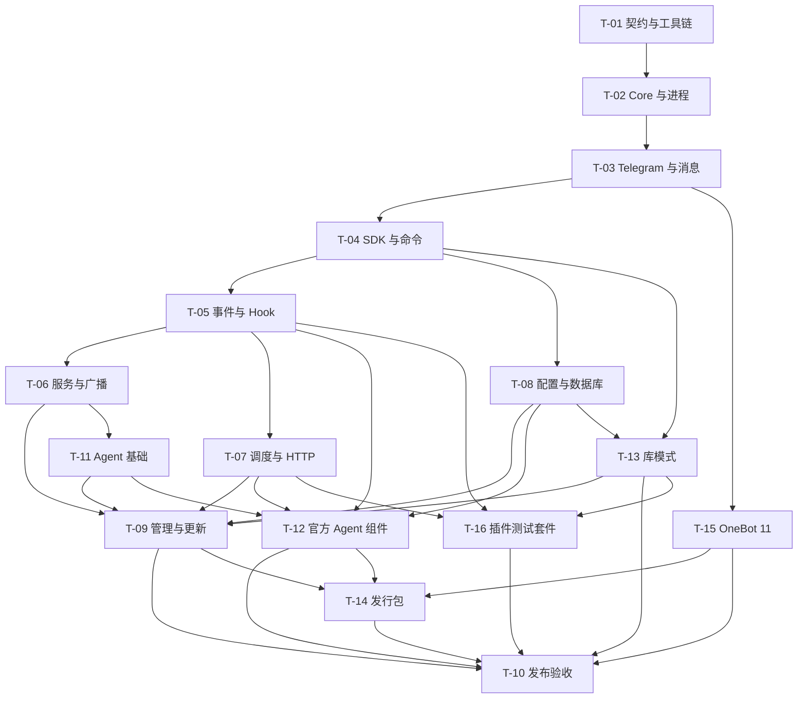

# AlonaBot v0.1 详细实施计划

**技术基线：** v0.6-review  
**编排更新：** 2026-10-22  
**实施状态：** T-01、T-02、T-02.1 已实现，分项证据见 [TEST-MATRIX §3.1](TEST-MATRIX.md#31-已运行的分项证据t-01t-02)，Linux/Windows 的真实运行由 T-10 补齐。独立切片 T-02.2、T-07.1、T-08.2、T-09.2 与 T-12.1 已实现，证据见 TEST-MATRIX §3.2；其余未开始的切片按 §3.1 推进。

从 T-01 开始，按前置任务推进。每项任务交付可编译、可验证的增量；跨任务验收在对应集成点闭合。协议和行为以 [CONTRACTS-v0.1.md](CONTRACTS-v0.1.md)、[WIRE-FORMAT.md](WIRE-FORMAT.md)、[MESSAGE-MODEL.md](MESSAGE-MODEL.md) 为准，验收编号统一使用 [TEST-MATRIX.md](TEST-MATRIX.md)。

## 1. 最终交付

交付一个 Go Core、Go 插件与 Adapter SDK、可安装的官方 Telegram 与 OneBot 11 Adapter、官方 Agent 组件、可替换的官方 WebUI 组件与管理 CLI。用户用发行归档、`install.sh` 或 `docker compose` 安装官方整合包即可开箱即用，官方 Adapter、Agent 与 WebUI 都可以换成社区组件；开发者可以在自己的 `main.go` 中把框架当作 Go 库运行，并在改动源码后热部署。用户能够安装预构建的插件与 Adapter，配置并启用它，在指定聊天/话题执行命令、发送消息和媒体、进行多轮对话，使用 Service、Event Bus、Scheduler、插件 HTTP 与受管 SQLite；能够与 Agent 对话，Agent 调用工具前按策略取得用户确认；管理动作能够按确定的代次和维护规则更新、停止及恢复。机器人回复与 WebUI 提供英文和简体中文。

首发目标为 linux/amd64、linux/arm64、windows/amd64、darwin/amd64、darwin/arm64。每插件一个 Native 子进程，每个 Adapter 包一个 Native 子进程（承载其全部实例），TCP 默认、stdio 可选；框架托管 HTTP 只开放 Core 的一个公开端口。动态跨插件命令 Router、其他官方 Adapter、多语言 SDK、持久化的多轮会话状态与暂停 DSL、跨会话的记忆检索和额外客户端后置。分层休眠与按需唤醒在 §7 单独规划（S-01～S-06），不属于 v0.1 交付。

## 2. 实施目录和工作流

下表列出代码目录及其首次交付的任务，已实现的范围以 [ARCHITECTURE.md](../ARCHITECTURE.md) 为准。全部代码在一个 Go module 中。

| 拟建位置 | 负责内容 | 首次交付 |
| --- | --- | --- |
| `go.mod`、`go.sum` | 实际模块路径、Go 与依赖版本 | T-01 |
| `contracts/` | Protobuf 源文件、生成类型、消息/配置/manifest Schema 和兼容 fixture | T-01 |
| `sdk/` | Native 会话、Context/Send、注册、生命周期、媒体与按需数据库包（`sdk/sqlitedb`、`sdk/gormdb`）；Adapter SDK（`sdk/adapter`）；文本生成服务契约（`sdk/llm`） | T-01 给出类型，T-02～T-08 逐步实现 |
| `internal/core/` | 状态、进程、RPC、路由、权限、服务、调度、HTTP 与管理编排 | T-02 起 |
| `adapters/telegram/` | 官方 Telegram Adapter 程序：接收、发送、能力和平台映射 | T-03 |
| `agent/` | 官方 Agent 组件（含记忆） | T-12 |
| `plugins/help/`、`plugins/welcome/`、`plugins/rss/` | 预装插件 | T-14 |
| 根包（`alonabot.go` 等） | 库模式入口 `alonabot.Run`，与 `alonabot serve` 共用 Core 装配 | T-13 |
| `scripts/dist/` | 发行归档的构建与打包 | T-14 |
| `Dockerfile`、`deploy/compose.yaml`、`deploy/install.sh` | 官方容器镜像、compose 整合包入口与 install.sh | T-14 |
| `cmd/alonabot/` | Core 启停、开发者与管理 CLI 装配 | T-02 起，T-09 完整 |
| `web/admin/` | 官方 WebUI 组件：配置表单/i18 组件、管理界面与静态资源 | T-08 组件，T-09 完整 |
| `examples/plugins/` | 随 SDK 版本同步编译的最小示例和集成样例 | T-02 起 |
| 各包的 `testdata/` 与测试文件 | 非生产 fixture、错误注入和行为验证 | 随负责任务交付 |

生成代码只由受版本约束的生成命令产生，不手工修改；工具可执行文件和业务凭证不放进发布包。日常编译与验证在仓库根执行：

```sh
go generate ./...
go test ./...
go build ./...
```

Telegram、LLM Provider、浏览器和目标平台的测试单独记录环境与命令；缺少真实环境时不能用普通测试结果替代。Core 可执行文件与 SDK 根包链接的模块由审查时用 `go list -deps` 对照允许清单核对（V-75）。每个任务先验证直接变更及其边界，再做工作包要求的集成检查。

## 3. 任务依赖与交付次序

| 任务 | 前置任务 | 本项完成时的可用能力 | 当前状态 |
| --- | --- | --- | --- |
| T-01 | 无 | 可编译契约、固定生成方式、驱动/备份验证基线 | 已实现；分项证据见 TEST-MATRIX §3.1 |
| T-02 | T-01 | 最小真实 Native 进程的状态、双 IPC、启动和停止；统一日志与调优参数 | 步骤 1～8 已实现，darwin/arm64 运行通过，Linux/Windows 运行未执行（T-10）；日志基线（T-02.1）已实现；调优参数（T-02.2）已完成（证据见 TEST-MATRIX §3.2） |
| T-03 | T-02 | 可安装 Adapter 的进程与 SDK；官方 Telegram Adapter 的入站与显式 Send、媒体、按钮、extension 片段、真实回执 | 未开始 |
| T-04 | T-03 | 根插件 SDK、自动/显式注册、命令树与动态权限 | 未开始 |
| T-05 | T-04 | 完整事件链、Rule、Hook、传播、可信身份、延续调用与多轮等待 | 未开始 |
| T-06 | T-05 | Service Broker 与有界 Event Bus | 未开始 |
| T-07 | T-05 | Core Scheduler、SDK HTTP 与统一代理组件 | 未开始 |
| T-08 | T-04 | 配置/Secret/Schema/i18、用户可见文案与插件 DB 候选准备能力 | 未开始 |
| T-09 | T-06、T-07、T-08、T-11 | 安装更新/回退、完整管理认证、CLI/API/WebUI | 未开始 |
| T-10 | T-02～T-09、T-11～T-16 | 全部验收闭合、目标平台产物与资源报告 | 未开始 |
| T-11 | T-06、T-08 | 工具目录、调用策略与用户确认、Agent 会话存储 | 未开始 |
| T-12 | T-05、T-07、T-08、T-11 | 官方 Agent 组件（含记忆） | 未开始 |
| T-13 | T-03、T-04、T-08 | 库模式入口、同进程的开发组件与热部署 | 未开始 |
| T-14 | T-09、T-12、T-15 | 发行包、容器镜像、首次运行与预装插件 | 未开始 |
| T-15 | T-03 | 官方 OneBot 11 Adapter（正向 WebSocket）与跨 Adapter 一致性验收 | 未开始 |
| T-16 | T-05、T-07、T-13 | 插件测试套件 `plugintest` | 未开始 |

本表和下图是工作包整体完成的先后，休眠扩展的 S 工作包见 §7。切片按实际用到的成果另列前置（§3.1），可以在上游工作包完成前开始。T-10 的测试设施随任务建立，最终发布门槛在依赖全部完成后检查。



### 3.1 执行切片

每个工作包按下表拆成切片，一个切片对应一个 goal（`goal-N` 目录、分支与 PR）。执行者实现，审查者审查并合并，角色与授权见 [CONTRIBUTING「角色与合并」](../CONTRIBUTING.md#角色与合并)。可直接派发的 goal 语句在 [goals.md](../goals.md)，并行派发、共享文件与合并顺序的约束在 [执行顺序](../docs/execution-order.md)。

切片只是把 §4 的步骤重新分组，工作包的范围、验收和失败停止条件不变。为了能并行执行，切片的前置按实际用到的成果列出，比 §3 的工作包依赖更细。§4 各工作包的「前置输入」指整个工作包需要的成果，单个切片只需要它在下表中的前置。例如调度触发计算、配置 JSON 语义和安装包预检不依赖消息链路，可以最先执行；根插件注册只依赖首个 SDK 切片，不等待 Telegram；各工作包的汇总切片只产出示例和证据，因此不作为下一个工作包的前置，统一由 T-10.1 汇总。

- **前置**只列直接依赖。前置都已合并的切片可以派发。
- **主要验收**列出该切片负责的 V 分项。分项证据写在该切片的 tasks.md 中；每个工作包的最后一个切片负责把证据汇总进 TEST-MATRIX §3。整项 V 何时关闭仍按 §5 的跨任务规则。
- **状态**由审查者在合并前写入该切片的 PR：未开始，或「已完成」。
- 需要真实外部环境的分项已在表中注明；缺少环境时，该分项记为未运行。

| 切片 | goal | 内容 | §4 步骤 | 前置 | 主要验收 | 状态 |
| --- | --- | --- | --- | --- | --- | --- |
| T-02.1 | goal-65 | 日志基线：Core 与 SDK 改用注入的 slog Logger，控制台与 JSON 格式、来源标签、插件 stderr 的 JSON 解析与非结构化行、panic 堆栈、Bootstrap 下发级别与进程内过滤、`--log-level`/`--log-format`、不输出 Bootstrap 与配置明文；按日期轮转的日志文件与保留上限 | T-02 步骤 9 | T-02 | V-62、V-63 的级别过滤分项、V-68 的写入与轮转分项 | 已完成，darwin/arm64 运行通过（TEST-MATRIX §3.1） |
| T-02.2 | goal-76 | 调优参数：`internal/tune` 参数表，把现有常量迁入；`--args` 的直接参数与文件输入、校验与相互约束、启动 WARN、`alonabot tune list`；`SessionLimits session_limits = 11`（max_inflight、max_payload_bytes、request_timeout_ms）；`GOMEMLIMIT` 软上限 | T-02 步骤 10 | T-02.1 | V-69 | 已完成，darwin/arm64 运行通过（TEST-MATRIX §3.2） |
| T-02.3 | goal-86 | 状态库改用 GORM：现有各表的读写改为 GORM 模型，经 `libtnb/sqlite` 复用同一单连接，schema 仍由唯一的初始迁移定义，锁、PRAGMA 核对与损坏不重建的行为不变 | T-02 步骤 11 | T-02 | V-36 的状态库分项与现有状态库集成测试的回归、V-75 | 未开始 |
| T-03.1 | goal-2 | 首个可用 SDK 切片：事件路由注册、Context/Send、业务分发；Core 的 Adapter 实例接口、内存 Adapter、固定服务 mux、事件派发与 `core.send`；echo 插件经真实 REGISTER/ACTIVATED 后收发 | T-03 步骤 1 | T-02.1、T-02.2 | V-07、V-08 的 SDK 分项，V-62 的 Handler 分项 | 已完成（PR #29；TEST-MATRIX §3.2） |
| T-03.2 | goal-3 | Target 与最小授权：`allowed_adapter_instances` 持久化、显式 To、后台 Send、逐次发送准入、NO_DEFAULT_TARGET、Core 内部许可读写入口 | T-03 步骤 3 | T-03.1 | V-07 | 已完成（PR #31；TEST-MATRIX §3.3） |
| T-03.3 | goal-4 | Adapter 进程与 `sdk/adapter`：Adapter 角色的注册校验、实例启停、`adapter.send`、事件交付与游标持久化、事件归属校验、账号唯一；实例上下线时生成 `bot.online`/`bot.offline`；回环测试 Adapter | T-03 步骤 2 | T-03.1 | V-48 的进程与实例分项、V-51 | 已完成（PR #32；TEST-MATRIX §3.2） |
| T-03.4 | goal-5 | 官方 Telegram Adapter 的接收：Bot API 客户端、本地 Bot API 模拟服务、getMe、webhook 冲突、long polling、逐条交付与游标、7 天轮次重建、401/409、媒体组、Actor.locale、`to_me`、实例代理 | T-03 步骤 4 | T-03.3 | V-45、V-54 的 locale 分项，V-62 的 Bot Token URL 分项 | 已完成（PR #39；TEST-MATRIX §3.2） |
| T-03.5 | goal-6 | 媒体上传与配额：BeginUpload/Chunk/Commit、大小/MIME/SHA256 校验、全部固定配额与期限、owner 退出释放 | T-03 步骤 5（上传） | T-03.1 | V-09 | 已完成（PR #38；TEST-MATRIX §3.2） |
| T-03.6 | goal-7 | 入站媒体与 Grant：IncomingMedia token、经 `adapter.media.read` 首次取件并校验缓存、多 Session 共享、Grant 范围、租约；出站媒体经 `core.media.read` 交给 Adapter | T-03 步骤 5（入站与授权） | T-03.2、T-03.4、T-03.5 | V-44、V-09 | 未开始 |
| T-03.7 | goal-50 | 官方 Telegram Adapter 的发送计划与回执：Chain 完整预检、物理操作计划、UTF-16 实体、相册/引用/按钮渲染、PartResult 汇总 | T-03 步骤 6（发送） | T-03.4 | V-08、V-35 | 未开始 |
| T-03.8 | goal-8 | 按钮 token 与回调路由；extension 片段的声明与校验；manifest 的 `role`（plugin/adapter/agent/webui）、`adapter_id`、`icon`、`adapter_dependencies`、`plugin_dependencies` 与 WebUI 字段的解析，开发入口的依赖检查 | T-03 步骤 7 | T-03.2、T-03.7 | V-08 的按钮分项、V-48 的依赖分项、V-52 的解析分项 | 未开始 |
| T-03.9 | goal-51 | 消息编辑：`core.edit`、`adapter.edit`、Telegram editMessageText、`message.edit` 能力、出站 Hook 的 edit 输入 | T-03 步骤 6（编辑） | T-03.7 | V-53 | 未开始 |
| T-03.10 | goal-9 | 开发入口（`alonabot run` 同时启动 Adapter 与插件，实例配置取自 `adapters/<adapter_id>/instances/`），echo/media 示例与发送接收故障矩阵，汇总证据 | T-03 步骤 8 | T-03.6、T-03.8、T-03.9 | V-07、V-08、V-09、V-35、V-44、V-45、V-48、V-51～V-54 的 T-03 分项；真实 Telegram 需要测试账号 | 未开始 |
| T-03.11 | goal-89 | 官方 Telegram Adapter 的平台权限：`telegram.chat_owner`/`telegram.chat_admin` 的声明、`getChatAdministrators` 的会话缓存与作废、获取失败时不带权限，`adapters/telegram/perm` 常量包 | T-03 步骤 9 | T-04.6 | V-85 的 Telegram 分项 | 未开始 |
| T-04.1 | goal-10 | 根插件 API 与显式注册；静态注册索引、重复拒绝、跨插件遮蔽的稳定选择 | T-04 步骤 1、3 | T-03.1 | V-10 的注册分项、V-02 的注册原子性 | 已完成（PR #34；TEST-MATRIX §3.2） |
| T-04.2 | goal-11 | 构建期生成器 `sdk/generate`：限定扫描范围、build tags、生成注册代码、稳定输出；`cmd/alonabot` 的构建检查入口 | T-04 步骤 2 | T-04.1 | V-10 | 已完成（PR #42；TEST-MATRIX §3.2） |
| T-04.3 | goal-12 | 命令选择与参数绑定：完整 token、@username、最长路径/别名→文本匹配（Regex、keyword、startswith、endswith、fullmatch）→Raw、消费状态、参数语法、usage/silent | T-04 步骤 4 | T-04.1 | V-11 的命令分项、V-49 | 已完成（PR #47；TEST-MATRIX §3.2） |
| T-04.4 | goal-13 | 持久化命令策略与管理服务层：继承、禁用、全局禁止、下一次派发生效 | T-04 步骤 5 | T-03.2、T-04.1、T-04.6 | V-12、V-43 的服务层分项 | 未开始 |
| T-04.5 | goal-14 | 用同一 SDK 升级示例，完成构建与策略验收，汇总证据 | T-04 步骤 6、7 | T-03.10、T-04.2、T-04.3、T-04.4、T-04.7 | V-10、V-11、V-12、V-43、V-49 的 T-04 分项 | 未开始 |
| T-04.6 | goal-87 | 权限、扩展事件与命令解析的协议和 Core 侧：proto 修改与生成；Adapter 权限与扩展事件声明的校验；平台权限的保留与隐含展开、按权限名集合判定；扩展事件的交付校验；`command_prefixes` 与按实例覆盖、去掉开头的 reference 与本账号 mention、非文本 token 与 `user`/`image`/`message` 参数、usage 文案键 | T-04 步骤 8 | T-03.3、T-03.6、T-04.3 | V-85、V-86、V-87 的 Core 分项 | 未开始 |
| T-04.7 | goal-88 | SDK 链式注册与自有类型：命令、文本匹配、事件、Service 与 Event Bus 订阅的 builder，Permission 值对象，事件常量与 `sdk.AdapterEvent`，Service Schema 由生成器生成，SDK 自有的 Message/Target/Actor/SendResult/错误码，自动回复型可 `c.Send`；生成器、示例与已合并调用方同步 | T-04 步骤 9 | T-04.2、T-04.6、T-06.1、T-06.3、T-08.1 | V-10、V-14 与 V-86 的 SDK 分项 | 未开始 |
| T-05.1 | goal-15 | 可信事件上下文与有界同事件分发：64 条并发链、256 条/8 MiB 等待队列、稳定候选排序、链执行与读循环分离；经回环测试 Adapter 运行，按钮与 scheduled 绑定先用规范 fixture | T-05 步骤 1、2 | T-03.3、T-04.3、T-04.4 | V-13、V-16 的 fixture 分项 | 未开始 |
| T-05.2 | goal-16 | SDK Rule（含 `ToMe`）、HandlerOutcome、自动/手动 Send、StopPropagation 锁存与错误分支 | T-05 步骤 3、4 | T-05.1、T-04.7 | V-14、V-11 的 Rule 分项 | 未开始 |
| T-05.3 | goal-17 | PreEvent/BeforeSend/AfterSend 三阶段 Hook，send_forbidden 的保存与继承 | T-05 步骤 5、6 | T-05.2 | V-15 的直接路径分项 | 未开始 |
| T-05.4 | goal-52 | 延续调用与多轮等待：`core.continuation.start`、`core.wait`、等待键与消费、超时与 Session 失效；SDK 的 `Continue` 与 `Wait` | T-05 步骤 7 | T-05.2 | V-50 | 未开始 |
| T-05.5 | goal-18 | 多进程事件流水线验收（含真实按钮回调与多轮等待），汇总证据 | T-05 步骤 8 | T-03.8、T-05.3、T-05.4 | V-11、V-13～V-16、V-43、V-49、V-50 的 T-05 分项 | 未开始 |
| T-06.1 | goal-19 | Service/Bus 描述与编码校验、SDK 入口；Broker 定位与准入 | T-06 步骤 1、2 | T-04.1 | V-19 | 已完成（PR #45；TEST-MATRIX §3.2） |
| T-06.2 | goal-20 | 父调用链上下文传播、循环与深度检查、跨段取消与背压 | T-06 步骤 3、4 | T-03.6、T-05.3、T-06.1 | V-18、V-42 的嵌套分项 | 未开始 |
| T-06.3 | goal-21 | 非持久 Event Bus：发布准入、逐订阅者 256 条/4 MiB 队列、drop-newest 计数 | T-06 步骤 5 | T-06.1 | V-17 | 未开始 |
| T-06.4 | goal-22 | Session 变更时的清理与计数，A/B/C 端到端验收（含 Hook→Service→Send），汇总证据 | T-06 步骤 6、7 | T-06.2、T-06.3 | V-15、V-17、V-18、V-19、V-42 | 未开始 |
| T-07.1 | goal-23 | interval/五字段 cron/IANA 时区/夏令时的表达式校验与下一次触发计算（纯计算包 `contracts/schedule`，Core 与官方 Agent 组件共用） | T-07 步骤 2 | T-02 | V-20 的计算分项 | 已完成（TEST-MATRIX §3.2） |
| T-07.2 | goal-24 | schedule 注册校验，运行槽与调度调用：独立 run_id、15 分钟期限、同 job 跳过重叠、迟到响应与断链 | T-07 步骤 1（schedule）、3 | T-05.1、T-07.1 | V-20、V-46、V-16 和 V-05 的 scheduled 分项 | 未开始 |
| T-07.3 | goal-25 | HTTP 注册校验，SDK 托管 HTTP Listener 与 Core Session 代理映射；Core 设置文件 `alonabot.yaml` 的读取、缺省值与命令行覆盖 | T-07 步骤 1（HTTP）、4、5 | T-04.1 | V-22 的组件分项 | 已完成（PR #46；TEST-MATRIX §3.2） |
| T-07.4 | goal-26 | 两个 Host 的边界、插件兑换票据与插件会话 | T-07 步骤 6 | T-07.3 | V-47 的组件分项 | 未开始 |
| T-07.5 | goal-27 | 统一启停与清理，时间、进程和 HTTP 边界验收，汇总证据 | T-07 步骤 7、8 | T-07.2、T-07.4 | V-20、V-21、V-22、V-46、V-47 的 T-07 分项 | 未开始 |
| T-08.1 | goal-28 | 配置字段描述与构建检查（在 T-04 生成器上扩展），含表单选项的图标路径 | T-08 步骤 1 | T-04.2 | V-25 的描述分项 | 未开始 |
| T-08.2 | goal-29 | 配置 JSON 语义与 Pending：原始对象保留、完整替换、Merge Patch、编辑快照导入、base_generation | T-08 步骤 2 | T-02 | V-23、V-38 | 已完成（TEST-MATRIX §3.2） |
| T-08.3 | goal-30 | SDK 配置准备顺序：OnLoad→补缺键默认→typed decode/Schema | T-08 步骤 3 | T-08.1、T-08.2 | V-37、V-21 的配置分项 | 未开始 |
| T-08.4 | goal-31 | 不可变 Secret Store：引用、解引用、重新抽取、脱敏读取、受保护清理 | T-08 步骤 4 | T-08.1、T-08.2 | V-25 | 未开始 |
| T-08.5 | goal-32 | `sqlitedb.Open` 与 `gormdb.Open` 的连接生命周期、迁移互斥与 versioned 迁移、external 插件的维护许可 | T-08 步骤 5、6 | T-08.3 | V-26、V-39 | 未开始 |
| T-08.6 | goal-33 | SQLite 候选复制与资源交接，写出给 T-09 的调用约定 | T-08 步骤 7 | T-08.4、T-08.5 | V-24、V-36 的候选分项 | 未开始 |
| T-08.7 | goal-34 | `web/admin` 前端骨架（官方 WebUI 组件的源码），配置表单与 i18 组件及 fixture（选项图标用 ``），界面文案的 en-US/zh-CN 目录与语言切换 | T-08 步骤 9（前端） | T-08.1 | V-25 的表单分项、V-54 的界面组件分项 | 未开始 |
| T-08.8 | goal-53 | 用户可见文案目录：插件 `i18/` 的 `messages`、SDK 的 `T`、Core 的 en-US/zh-CN 文案目录（usage 等）、check 的键与占位符检查 | T-08 步骤 8 | T-04.1、T-04.3、T-04.6、T-08.1 | V-54 的 SDK 与 Core 分项 | 未开始 |
| T-08.9 | goal-35 | configdb 示例与分层验证，汇总证据 | T-08 步骤 9 | T-08.6、T-08.7、T-08.8 | V-23～V-26、V-38、V-39、V-54 的 T-08 分项 | 未开始 |
| T-09.1 | goal-36 | 首次管理认证：admin-token init/reset、login、会话、CSRF、CLI Bearer | T-09 步骤 1 | T-07.4 | V-47 的认证分项 | 未开始 |
| T-09.2 | goal-37 | 安装包预检与安全解压：验签、来源、平台、长度/摘要、受控解压与上限、不可变包目录 | T-09 步骤 2（预检） | T-02 | V-27、V-28、V-41 的预检分项 | 已完成（TEST-MATRIX §3.2） |
| T-09.3 | goal-38 | 开发 CLI：`plugin init/check/build/test/pack`；init 生成插件包与库模式调试用的 `main.go`，build 生成调用 `sdk.Run` 的正式入口；pack 支持四种角色，WebUI 包为 `any` 平台 | T-09 步骤 2（CLI） | T-04.5、T-08.1、T-08.8、T-09.2、T-13.1 | V-01、V-41、V-54 的打包分项 | 未开始 |
| T-09.4 | goal-39 | 唯一管理服务与安装记录：逐包串行、来源/pin/卸载保留、各管理动作的区分；组件角色的同类唯一、`install --source` 与 `--replace`；Adapter 包与实例的管理（凭证经 Secret 引用）；启用、停用、卸载与更新时的 Adapter 依赖和插件依赖检查；`alonabot serve` 按安装记录启动全部已启用的包 | T-09 步骤 3 | T-03.8、T-08.4、T-09.1、T-09.2、T-13.1 | V-40、V-48、V-52、V-82、V-01 的安装分项 | 未开始 |
| T-09.5 | goal-40 | 正式候选 Journal 与准备编排 | T-09 步骤 4 | T-09.4、T-08.6、T-06.4 | V-29 | 未开始 |
| T-09.6 | goal-41 | 唯一提交点（ActiveGeneration+COMMITTED）与激活门禁 | T-09 步骤 5 | T-07.5、T-09.5 | V-30、V-21 的提交分项 | 未开始 |
| T-09.7 | goal-42 | 崩溃恢复、显式回退与引用回收 | T-09 步骤 6 | T-09.6 | V-30、V-31、V-36 | 未开始 |
| T-09.8 | goal-43 | Admin 页面：真实登录、状态、各角色组件的安装启停与替换、Adapter 实例管理、更新/恢复 | T-09 步骤 7（管理页） | T-09.6、T-08.7、T-09.12 | V-40、V-47 的页面分项 | 未开始 |
| T-09.9 | goal-44 | Admin 页面：配置表单与 JSON 编辑、命令权限、发信许可、Core 设置（Core Admin 列表、默认 locale）、工具调用策略、Agent 会话的列出与清除、插件页面代理、界面语言切换 | T-09 步骤 7（配置与插件页） | T-09.8、T-11.1、T-11.3 | V-12、V-22、V-23、V-25、V-43、V-54、V-55、V-56 的页面分项 | 未开始 |
| T-09.10 | goal-66 | 日志管理：按来源级别的持久化与运行时修改（`sdk.log.set_level`）、最近记录缓冲、按日期查询日志文件、管理 API 与 SSE、`alonabot logs` 与 `log-level`、WebUI 日志页 | T-09 步骤 7（日志） | T-02.1、T-03.1、T-09.8 | V-62、V-63、V-68 | 未开始 |
| T-09.11 | goal-45 | 正式流程的故障注入，回填 T-08 待联验项，汇总证据 | T-09 步骤 8 | T-09.3、T-09.7、T-09.9、T-09.10、T-09.12 | V-23～V-25、V-27～V-31、V-39、V-40、V-52、V-54～V-56、V-62、V-63、V-82、V-83 | 未开始 |
| T-09.12 | goal-84 | WebUI 组件与组件图标：Admin host 提供 WebUI 静态文件与单页路由回退、未安装与版本不兼容的提示、Admin API 主版本与 `spec/ADMIN-API.md` 参考、带 sandbox CSP 的图标、库模式的 `alonabot.WebUI` 选项 | T-09 步骤 9 | T-07.4、T-09.1、T-09.4、T-13.1 | V-83 | 未开始 |
| T-10.1 | goal-46 | V-01～V-76、V-82～V-87 证据汇总与跨组件联验 | T-10 步骤 1～4 | T-02.3、T-03.11、T-05.5、T-08.9、T-09.11、T-11.4、T-12.7、T-13.4、T-14.6、T-14.7、T-15.3、T-16.2 | 全部；真实 Telegram 与 LLM Provider 需要测试凭证 | 未开始 |
| T-10.2 | goal-47 | 五个目标组合的构建与运行、100 次启停 | T-10 步骤 5 | T-10.1 | V-32、V-34；需要真实目标平台 | 未开始 |
| T-10.3 | goal-48 | 资源比较报告与常驻内存预算核对 | T-10 步骤 6 | T-10.1 | V-33、V-74；需要固定机器与等价负载 | 未开始 |
| T-10.4 | goal-49 | 发布资产、签名与发布说明 | T-10 步骤 7、8 | T-10.2、T-10.3 | V-28、V-41 的发布复验 | 未开始 |
| T-11.1 | goal-54 | 工具描述与目录：Service 描述的 `tool` 字段、注册校验、`core.tool.list`、调用策略的持久化与管理服务层 | T-11 步骤 1、2 | T-04.4、T-06.1 | V-55 的目录与策略分项 | 未开始 |
| T-11.2 | goal-55 | 工具调用与用户确认：`core.tool.invoke`、`core.tool.confirm`、Core 内部的确认记录与按钮、同一 Actor 与 5 分钟限时、确认文案 | T-11 步骤 3、4 | T-03.8、T-06.2、T-08.8、T-11.1 | V-55 | 未开始 |
| T-11.3 | goal-56 | Agent 会话存储：状态库表、`core.conversation.*`、管理服务层的列出与清除、purge | T-11 步骤 5 | T-03.1 | V-56 | 已完成（PR #35；TEST-MATRIX §3.2） |
| T-11.4 | goal-57 | 工具与会话的多进程验收，汇总证据 | T-11 步骤 6 | T-11.2、T-11.3 | V-55、V-56 的 T-11 分项 | 未开始 |
| T-12.1 | goal-58 | Provider 客户端：OpenAI、OpenAI 兼容与 Anthropic Messages 的流式请求、SSE 解析、工具调用解析、停止原因与用量、本地模拟服务 | T-12 步骤 1 | T-02 | V-57 的 Provider 分项 | 已完成（TEST-MATRIX §3.2） |
| T-12.2 | goal-59 | 对话：`agent/` 骨架与配置、人格、历史、延续调用内的一轮对话、流式编辑显示、`/persona` 与 `/reset` | T-12 步骤 2、3 | T-03.9、T-04.3、T-05.4、T-08.3、T-08.4、T-11.3、T-12.1 | V-57 | 未开始 |
| T-12.3 | goal-60 | 工具循环与 MCP：Core 工具、MCP 客户端（stdio、streamable HTTP）、确认、单轮步数上限 | T-12 步骤 4 | T-11.2、T-12.2 | V-58 | 未开始 |
| T-12.4 | goal-61 | 记忆：Agent 内的会话笔记与用户档案、`memory` 工具、会话快照与档案注入 | T-12 步骤 5 | T-08.5、T-11.2、T-12.2 | V-59 | 未开始 |
| T-12.5 | goal-62 | 技能：技能目录、`SKILL.md` 解析、`load_skill` | T-12 步骤 6 | T-12.3 | V-60 | 未开始 |
| T-12.6 | goal-63 | 定时 Agent 任务：任务工具、任务表、分钟级固定 schedule、后台运行 | T-12 步骤 7 | T-07.2、T-08.5、T-12.3 | V-61 | 未开始 |
| T-12.7 | goal-64 | 官方 Agent 组件的打包与多进程验收，汇总证据 | T-12 步骤 8 | T-12.4、T-12.5、T-12.6、T-12.8 | V-57～V-61、V-76 | 未开始 |
| T-12.8 | goal-83 | 文本生成服务：Core Broker 的 `@agent` 目标解析，`sdk/llm` 的类型、Schema 与调用辅助，Agent 的 `llm.generate` 与调用方许可 | T-12 步骤 9 | T-03.8、T-06.1、T-12.2 | V-76、V-82 的 `@agent` 分项 | 未开始 |
| T-13.1 | goal-67 | 库模式入口：根包 `alonabot.Run`、`alonabot.Start` 与选项、与 `serve` 共用的 Core 装配、开发组件同进程经 loopback 连接、生成代码中嵌入的组件身份、dev 来源与固定代次 | T-13 步骤 1、2 | T-02.1、T-03.3、T-04.2 | V-64 的生命周期分项 | 未开始 |
| T-13.2 | goal-68 | 开发组件的配置与数据库：`config.json` 直读与准备、`dev.sqlite`、拒绝 update/rollback | T-13 步骤 3 | T-08.3、T-08.5、T-13.1 | V-64 | 未开始 |
| T-13.3 | goal-69 | 热部署：`Reload` 选项与 `ALONABOT_RELOAD`、源码轮询、重新编译、开发组件改为子进程并重启 | T-13 步骤 4 | T-13.1 | V-65 | 未开始 |
| T-13.4 | goal-70 | 库模式示例与开发文档，汇总证据 | T-13 步骤 5 | T-03.10、T-13.2、T-13.3 | V-64、V-65 | 未开始 |
| T-14.1 | goal-71 | help 插件与 `core.command.list` | T-14 步骤 1 | T-04.4、T-05.2、T-08.8 | V-67 的 help 分项 | 未开始 |
| T-14.2 | goal-72 | welcome 与 rss 插件 | T-14 步骤 2 | T-05.2、T-07.2、T-08.3、T-08.5、T-08.8 | V-67 | 未开始 |
| T-14.3 | goal-73 | 发行归档：构建与打包全部官方组件、签名、内置官方发布者公钥、`SHA256SUMS` | T-14 步骤 3 | T-03.10、T-09.3、T-12.7、T-14.1、T-14.2、T-15.2 | V-66 的归档分项 | 未开始 |
| T-14.4 | goal-74 | 首次运行：预装与默认启用（help 与 WebUI）、首次管理 token、内置包的可用更新 | T-14 步骤 4 | T-09.6、T-14.3 | V-66 | 未开始 |
| T-14.5 | goal-77 | 容器镜像：`Dockerfile` 多阶段构建、linux/amd64 与 linux/arm64、非 root、`/data` 卷、`ALONABOT_CONTAINER` 的监听规则、作为官方整合包入口的 `deploy/compose.yaml` | T-14 步骤 5 | T-07.3、T-14.3 | V-70 的镜像分项 | 未开始 |
| T-14.6 | goal-75 | 从发行归档与容器镜像到 Agent 对话的端到端验收，汇总证据 | T-14 步骤 6 | T-09.11、T-14.4、T-14.5 | V-66、V-67、V-70 | 未开始 |
| T-14.7 | goal-85 | `install.sh`：Linux（systemd）与 macOS（launchd）的安装、`SHA256SUMS` 校验、管理 token 初始化、服务注册、升级与 `--uninstall` | T-14 步骤 7 | T-14.3 | V-84 | 未开始 |
| T-15.1 | goal-78 | 官方 OneBot 11 Adapter 的连接与接收：正向 WebSocket、access_token、get_login_info、有界退避重连、self_id 校验、数组格式检查、实例事件队列、私聊/群聊/撤回/成员事件的标准化、to_me、群主、群管理员与好友私聊的平台权限及 `adapters/onebot11/perm`、本地 OneBot 11 模拟服务 | T-15 步骤 1、2 | T-03.3、T-03.4、T-04.6 | V-71 的接收分项、V-85 的 OneBot 11 分项 | 未开始 |
| T-15.2 | goal-79 | 官方 OneBot 11 Adapter 的发送计划与回执、入站与出站媒体、`onebot11.face` extension、能力声明 | T-15 步骤 3、4 | T-03.6、T-03.8、T-15.1 | V-71 的发送与媒体分项 | 未开始 |
| T-15.3 | goal-80 | 跨 Adapter 一致性验收与 OneBot 11 手测记录，汇总证据 | T-15 步骤 5 | T-03.10、T-15.2 | V-71、V-72；真实 QQ 端只手测 | 未开始 |
| T-16.1 | goal-81 | 插件测试套件基础：`plugintest.Start`、测试 Adapter、会话与身份、Capability 子集、消息注入、`internal/inproc` 的分发结束通知、配置与数据库 | T-16 步骤 1、2 | T-05.2、T-13.2 | V-73 的基础分项 | 未开始 |
| T-16.2 | goal-82 | 按钮点击、多轮等待、schedule 触发与后台发送；用套件测试示例插件，开发文档，汇总证据 | T-16 步骤 3、4 | T-03.8、T-05.4、T-07.2、T-16.1 | V-73 | 未开始 |

## 4. 逐任务实施工作包

### T-01：契约、工具链与构建基线

#### 前置输入

- 现行 CONTRACTS、WIRE-FORMAT、MESSAGE-MODEL 和 TEST-MATRIX；实际项目位置与发布模块路径由实施时的项目配置确定。
- 可用的 Go 工具链、Protobuf 编译器和生成器；PG 初始化验证需要独立测试数据库。依赖版本须实际验证后写入项目文件。

#### 拟涉及目录

`go.mod`、`go.sum`、`contracts/`、`sdk/` 的公共类型与示例编译检查。它们是待建立的正式代码，数据库小验证放进对应包测试，不建立另一套长期运行时。

#### 按顺序实施

1. 核对项目实际目录、已有 Go/生成工具与模块路径，建立单 module 和可复现生成入口。固定 Go、protoc、Go Protobuf 生成器及所需依赖版本；记录开发环境与目标平台的差别。
2. 将 WIRE 字段表转换成 `.proto`：保留 Envelope 1～16、错误码 1～17、既有 Kind 与 SESSION_ERROR=13；补齐控制帧、Bootstrap、RouteDescriptor、可信 Invocation、HandlerOutcome、SendResult、媒体和 BusEvent 的类型及字段号。字段缺失/零值检查与编码结构分开，结果 payload 和 error 不做 oneof。
3. 为首发消息、配置支持类型、manifest、外部 release 清单建立实际 Schema 与验证入口。静态 fixture 覆盖安全 ID、平台、能力、来源摘要与签名对象；表明构建期能检查的内容及需 REGISTER 才能得到的实例路由。
4. 固定 SDK 的最小公共类型与可编译示例：一个根插件、两类 Handler、Context.StopPropagation、Config.OnLoad、互斥迁移接口、HTTP Handler 和调度声明。此处先证明签名能组合；T-02 起实现运行行为。
5. 用主契约选定的 pure-Go SQLite/GORM 组合完成临时数据库 CRUD/Tx、连接设置、WAL Backup 与恢复读取；验证 Up 与成功账本可在同一插件 DB 事务中提交。对独立 PG schema 验证连接、初始化和事务失败结果。验证通过后锁定实际版本，不预填“最新版可用”。
6. 生成兼容 fixture，测试编码往返、枚举零值、未知必需能力、字段存在性、JSON/Protobuf 编码区分，以及 payload+error 同时返回。让 `go generate ./...` 可重复运行，生成结果稳定；运行构建和相关测试。
7. 对五个目标 OS/arch 验证所选默认驱动与契约包的 `CGO_ENABLED=0` 编译路径，记录每个组合。目标平台的进程启动、运行与清理由 T-02/T-10 完成，不能以交叉编译替代运行证据。

#### 可审查交付

- 已锁版本的模块和生成入口、可编译协议/Schema/SDK 类型、兼容 fixture 与示例。
- 数据库连接/事务/Backup 验证代码和真实结果，供 T-08 直接采用已验证路径。
- V-01/V-02 的静态契约结果，以及 V-26/V-32/V-37/V-39/V-41 在本阶段取得的部分证据；运行和安装语义分别交后续任务闭合。

#### 停止和失败条件

契约能编译、示例签名成立、生成稳定、默认数据库组合的关键事务/备份路径通过，才向 T-02 交付。字段无法表达、驱动无法满足候选复制或目标构建失败时，先定位并修正该具体缺口。若 PG 测试环境尚不可用，可推进已通过的 IPC 工作，但 PG 分支和发布验收保持未完成，不能用 SQLite 结果替代。2026-10-27 起框架不再托管 PostgreSQL（D-48），本任务中的 PG 验证只作为当时的记录保留。

### T-02：Core 状态、Native 进程、双 IPC 与基础生命周期

#### 前置输入

- T-01 已交付可编译的协议类型、控制帧 fixture、manifest/ID 校验规则，以及选定并锁定的 Go、Protobuf 和 Core SQLite 驱动版本。
- 按 [CONTRACTS-v0.1.md](CONTRACTS-v0.1.md) §1、§4、§6.1、§7.1、§12 和 [WIRE-FORMAT.md](WIRE-FORMAT.md) 实施。状态、帧号和错误码直接复用协议定义。
- 本项先贯通无业务 DB 的最小插件。T-08 接入实际配置转换、Secret 和插件 DB 准备；T-09 接入包安装、完整更新 Journal 与管理入口。这里的基础状态库和生命周期是它们共同复用的实现。

#### 拟涉及目录

`contracts/`（复用协议及 fixture）、`sdk/`（会话、RPC、生命周期和进程锁）、`internal/core/` 下的状态、进程与 RPC 实现、`cmd/alonabot/`（Core 启停装配）、`examples/plugins/`（最小生命周期示例）。均为单 Go module 内的拟建目录，当前没有这些正式实现；内部子包按职责划分，不另拆 module。

#### 按顺序实施

1. **建立 Core 状态和操作所有权。** 启动时先取得 `<data_dir>/core.lock`，再打开 `state.sqlite`，核对单连接、WAL、FULL、外键和 busy timeout 的实际值。实现最小安装记录、ActiveGeneration/提交标记、启用状态与权限持久化基础，以及逐插件管理操作串行化。先交付可供无业务 DB 插件使用的提交事务原语；T-09 在同一实现上补齐候选资源引用、完整 Journal 与安装恢复编排。提交时核对预期旧代次；事务内只操作元数据，不等待插件 RPC。状态库损坏、锁失败或配置未生效时停止启动，不重建空库继续服务。
2. **建立 Native 启动与退出控制。** 从已校验的安装记录取得入口、插件 ID、平台与归档摘要，生成本次 Session Secret，构造精简环境并启动子进程；不把 Core 管理凭证传入插件。按平台管理普通进程树、取得退出状态并收集带插件 ID 的日志。SDK 在任何用户初始化或受管 DB 打开前取得稳定 `runtime.lock`，持有至退出；锁文件不删除或替换。为后续停机备份提供“确认退出、Core 暂持锁、释放后才能启动 SDK”的顺序。
3. **实现共用帧编解码与两种传输。** TCP 默认直接绑定 loopback 随机端口并持续持有 Listener；stdio 复用相同协议，把 stdout 留给帧、stderr 留给日志。完整读取长度前缀与载荷，在分配前拒绝零长度和超过 4 MiB 的帧。握手核对 Secret、插件 ID、启动摘要、协议和能力；每条连接只有一个 reader 和一个串行 writer，认证失败或不可恢复错帧只隔离当前 Session。
4. **实现双向调用、取消与资源准入。** 按 `(session_id, initiator_side, call_id)` 管理请求，验证父调用仍在途后才继承可信上下文；普通请求采用 30s 默认期限，子请求不延长父期限。落实每方向 256 个 Request、16 MiB payload 和 Core 合计 64 MiB 的限额，满额立即失败。Response、Cancel 和控制帧走有界优先通道；尚未发送的 Request 被取消后撤出队列，已发送请求的 Cancel 保持因果顺序。重复/迟到响应不二次完成，`payload + error` 同时存在时不丢失有效结果，断链不重放业务。
5. **贯通 Bootstrap 和准备阶段。** HELLO_ACK 一次下发 Generation、原始配置、版本、DB 描述、HTTP 认证材料及阶段期限；Core 在配置迁移前只检查 JSON 对象和大小。SDK 依次完成配置准备、许可的 DB 准备、OnStart，再发送完整 REGISTER；可选步骤不存在时跳过。T-02 用 T-01 的最小配置样例、无业务 DB 插件和阶段失败 fixture 验证顺序，实际迁移与 Secret 落地由 T-08 接入。REGISTER 原子校验，超限或失败不能留下半个注册表，敏感 Bootstrap 不进入日志。
6. **实现提交与激活门禁。** Prepared 仅表示准备完成。新候选只有在 Core 状态事务提交 ActiveGeneration/COMMITTED 后才能收到 ACTIVATE；普通 restart 复用既有提交记录、Generation 和配置引用。SDK 执行 OnReady，唯一 writer 完整写出 ACTIVATED 后才打开本地 ready gate；Core reader 同步应用状态后再读后续业务帧。Preparing、Prepared、Activating 均拒绝业务；提交后启动失败进入 Degraded，不自动选旧数据。以无业务 DB 的候选完成本项集成，受管 DB 副本的真实提交/恢复由 T-08、T-09 验证。
7. **完成阶段超时、停止和有限恢复。** 按主契约落实握手 10s、配置 60s、迁移 15 分钟、OnStart 60s、OnReady 30s 的独立预算；用户函数不响应 context 时仍须由 watchdog 结束失败进程。停用先冻结新根调用并最多排空 6s，允许既有父链内合法子调用完成；随后 Cancel 并发送 STOPPING，其期限为 `min(t0+10s, 发送时刻+4s)`。OnStop 使用独立 context，Core 在总 10s 截止处理进程树；Core Shutdown 并行停止所有插件。EOF 使旧 Session 立即失效，确认旧进程退出后才允许重启；5 分钟内第三次异常退出自动禁用，正常退出不自动重启。
8. **建立真实进程的验收切片。** 最小示例覆盖正常启动/退出，测试辅助进程覆盖挂起、错帧、日志污染、迟到响应和突退。对同一 fixture 分别运行 TCP 与 stdio，检查进程和 Listener 已关闭；注入满额度、双 Core、并发管理操作和 Core 被终止场景。记录实际运行平台、命令、测试位置及结果，并把由 T-08、T-09 集成的配置/DB/更新场景明确标出。
9. **建立统一日志。** 按 CONTRACTS §14 把 Core 与 SDK 现有的直接输出改为注入的 `*slog.Logger`：实现 §14.2 的控制台 Handler（来源标签、级别缩写、源码位置、`key=value`、多行缩进、按终端与 `NO_COLOR` 着色）与 JSON 输出，`--log-level`、`--log-format` 启动参数。SDK 把记录以 JSON 行写到 stderr，在调用边界（生命周期 Hook）捕获的 panic 记为带 `stack` 的 ERROR；Handler 的 Logger 附带 trace_id、route_id、call_id 与 Handler panic 的记录由 T-03.1 的业务分发实现，Bot API URL 中凭证的脱敏由 T-03.4 的 Bot API 客户端实现。Core 逐行解析插件 stderr，补上并保护来源字段，非 JSON 行作为 WARN 原样保留。Bootstrap 追加 `LogLevel log_level = 10`，SDK 与 Core 都按来源的生效级别过滤；按来源级别暂存在内存中，持久化与运行时修改由 T-09.10 接入。日志不输出 Secret、Bootstrap 与配置明文。按 CONTRACTS §14.6 写入按本地日期轮转的日志文件：同日达到单文件上限时续写编号文件，超过合计上限或保留天数时从最旧的删除，写入失败时继续运行并报告一次。
10. **建立调优参数。** 新建 `internal/tune`，按 CONTRACTS §16 的表登记全部可调参数，把 `internal/wire` 与 `internal/core` 中对应的现有常量迁入，调用方改为读取生效值。实现 `--args` 的直接参数与文件输入、值的格式、约束与相互约束检查（出错时指明参数或文件行号）、存在覆盖时的启动 WARN 与 `alonabot tune list`。Bootstrap 追加 `SessionLimits session_limits = 11`，字段 `max_inflight`、`max_payload_bytes`、`request_timeout_ms` 分别对应每方向在途数、每 Session payload 预算、普通请求期限；Core 全局预算不下发给 SDK；设置 `PLUGIN_MEMORY_SOFT_LIMIT` 时为子进程传入 `GOMEMLIMIT`。
11. **状态库改用 GORM。** 按 CONTRACTS §6.1 与 D-68，把 `internal/core/state` 现有各表的读写改为 GORM 模型，经 `libtnb/sqlite` 的 `Conn` 复用同一个单连接；schema 仍由唯一的初始迁移定义，不用 AutoMigrate。core.lock、PRAGMA 回读核对、损坏不重建、提交时核对预期旧代次与事务内不等待插件 RPC 的行为都不变，调用方与集成测试同步修改。之后新增的状态库表直接使用 GORM 模型。

#### 可审查交付

- 可以启动最小 Native 插件并走完 Bootstrap、Prepared、提交、Activated、停止的 Core/SDK 代码；两种传输使用同一协议实现。
- Core 状态表及事务边界、状态转换与门禁、进程锁和退出控制的实现位置；最小示例与故障辅助进程只使用测试数据。
- 按现有 V 编号记录的测试结果，包含失败阶段、退出结果和资源清理证据；不得把 fixture 验证记作真实插件数据库回退已通过。

#### 对照现有验收

| 现有条目 | T-02 要完成的验证 |
| --- | --- |
| V-03、V-04、V-05、V-06 | 双传输帧、认证和代次隔离、双向编号与取消、日志污染和有限崩溃恢复；V-05 的 Scheduler 迟到响应语义在 T-07 接入后补齐 |
| V-21、V-37 | 基础生命周期的阶段失败/挂起、合法 SESSION_ERROR、Bootstrap/REGISTER 上限、就绪顺序和全局停止预算；真实配置/DB 准备及更新恢复与 T-08、T-09 联验 |
| V-36 | 同 data_dir 双 Core、同插件并发操作、旧进程未退出时不能启动第二个受管写入者 |
| V-42 | Request 计数/字节满额、控制通道仍有进展、发送前取消的因果顺序；嵌套 Service 与 Event Bus 部分在 T-06 完成 |
| V-32、V-34 | 提供可复用的构建、启动/退出和进程树测试；五平台完整记录与 100 次启停在 T-10 汇总 |
| V-62、V-63 | 步骤 9：控制台与 JSON 格式、三类来源标签、非结构化行、panic、伪造来源字段、按级别过滤；持久化与查看由 T-09.10 完成 |
| V-68 | 步骤 9：按日期换文件、同日切分、合计与天数上限、写入失败；按日期查询由 T-09.10 完成 |
| V-69 | 步骤 10：直接参数与文件输入、优先级、未知键/格式/约束/矛盾拒绝启动、覆盖 WARN、SDK 使用下发值、GOMEMLIMIT |

#### 停止和失败条件

本项范围内的协议、身份、门禁、锁、取消和停止用例通过，最小进程切片可以重复运行，且后续配置/数据库/安装模块接入位置清楚后即可结束 T-02。若出现双代次接单、旧写入者未退出即启动替代实例、满额度使控制帧永久阻塞、丢失有效错误结果或损坏状态库后默默初始化，必须先修复，不能继续把该基础作为已完成依赖。当前缺少某目标平台的真实运行环境时保留“未运行”，由 T-10 补齐；构建记录不能代替该平台进程锁和退出测试。

### T-03：标准消息、可安装 Adapter 与官方 Telegram Adapter

**目标：** 在 T-02 的真实 Session 与激活流程上，运行能够接收消息、回复、主动发送和处理媒体/按钮的 Native 插件；Adapter 作为可安装包在独立进程中运行，官方 Telegram 是第一个 Adapter（D-26）；平台发送失败后仍能判断已确认结果。完整命令生成、Rule 与 Hook 编排在后续工作包接入同一实现。

#### 前置输入

- T-01 已交付协议 1.0、Event/Target/Segment/SendResult/媒体载荷的生成类型及序列化 fixture；字段以 WIRE-FORMAT 与 MESSAGE-MODEL 为准。
- T-02 已能启动独立插件进程，完成鉴权、Bootstrap、显式静态描述注册、激活、REQUEST/RESPONSE、取消及停止；Core 状态库与 Session/Generation 身份可用。
- 读取 CONTRACTS §1.3～1.4、§8，WIRE-FORMAT §3.4，MESSAGE-MODEL §1～4、§6，DESIGN §M。使用本地 Bot API 测试服务覆盖可控失败；真实 Telegram 实测使用实施环境已经授权的测试账号和会话。

#### 实施步骤

Adapter 以安装包和独立进程运行（CONTRACTS §8）。以下步骤中，Telegram 的接收、标准化、发送计划、answerCallbackQuery 与平台取件都在官方 Telegram Adapter 程序内实现；游标持久化、事件接纳、Target 授权、按钮 token、媒体缓存与派发留在 Core。

1. **交付首个可用 SDK 切片。** 在最终 `sdk/` 中实现标准 Event、Target、Chain 构造、手动 Handler 的调用适配、Context、Send 和媒体客户端；复用 T-02 Session 与 ready gate。通过显式传入实例/函数及 RouteDescriptor 构建最小 echo 插件，先采用返回 `error` 的手动发送签名。该插件必须经过真实 REGISTER/ACTIVATED 后才收业务；不依赖尚未实现的注解生成器或命令树。接口直接使用正式生成类型，不建立另一套临时协议；T-04 在其上增加声明发现和构建检查。

2. **接通 Adapter 进程与 SDK。** Core 按安装记录以 Adapter 角色启动进程，复用插件的握手、准备、激活、停止与有限重启；REGISTER 只接受 Adapter 描述。把进程内的每个账号实例包装为 Core 的 Adapter 实例接口，经 `adapter.instance.start/stop` 单独启停、经 `adapter.send` 发送，启停一个实例不重启进程。接收 `core.adapter.deliver` 时先校验事件属于本 Session 已启动的实例，再持久化游标、接纳事件并应答；`core.adapter.cursor` 保存无事件时的游标变化，`core.adapter.status` 报告实例致命错误。同一平台账号只允许一个已启动实例。实例进入运行状态后生成 `bot.online`，因停用、Adapter 进程退出或致命错误离开运行状态时生成带原因的 `bot.offline`。提供 `sdk/adapter`，并用一个回环测试 Adapter 验证完整链路。

3. **落实 Target 与最小授权路径。** Core 保存真实入站的完整 Target 和可信来源；原事件调用及合法后续父链只可默认回复该 Target。后台发送必须显式 To，其他 Target 与后台调用须匹配 Core 状态库中该插件的 `allowed_adapter_instances`，其初值为空。发送准入逐次检查实例启用、account 对应关系、当前许可和全局禁止，不信插件自报 Actor/Admin；没有默认目标返回 NO_DEFAULT_TARGET。提供 Core 内部策略读写入口供测试及后续管理面复用，避免为本阶段开放未鉴权的管理接口。基础身份与授权随首个 Adapter 落实，T-04 扩展命令继承，T-05 集成完整事件权限链。

4. **接通 Telegram 接收与生命周期。** 在官方 Telegram Adapter 程序中实现 getMe 的账号/用户名绑定、已有 webhook 冲突检查、后台 long polling 和经 `core.adapter.status` 的状态上报；同账号唯一 owner 由 Core 检查。显式设置规定的 allowed_updates；只生成平台实际给出的事件，`sender_chat` 的兼容 fake sender 不构造个人 Actor。每条 update 经 `core.adapter.deliver` 交给 Core，Core 先持久化游标再投入非持久队列，Adapter 收到应答后才处理下一条；满队列丢弃计数且继续推进，不能提前提交整个 batch 的最大 ID。实现契约规定的连续 7 天空闲接收轮次重建。短暂读失败使用有界退避，401/409 停止该实例并报告故障；Start、Stop 和重连均不得创建重复接收 owner。入站媒体组保留 media_group_id，逐 Message 派发。Actor.locale 取 from.language_code，message.created 的 `to_me` 按 MESSAGE-MODEL §6.1 计算。实例配置的 `proxy` 优先于全局代理，作用于该实例的全部 Bot API 请求与文件下载；代理失败按网络错误退避，不改为直连。Adapter 实现放在可导入的包中（`telegram.New()`），程序入口只调用 `sdk/adapter` 的运行函数，供库模式直接引用。

5. **实现同一 Core 媒体暂存与授权。** 接通 BeginUpload→顺序 Chunk→Commit，验证大小、MIME、SHA256，执行 1 MiB 分块、100 MiB 单对象、4 个未完成上传、每 Session 256 MiB、Core 2 GiB 及 15 分钟期限。入站只签 IncomingMedia 描述 token；首次 Read 才经 `adapter.media.read` 由所属 Adapter 调用平台文件 API 取件，Core 校验并缓存，随后按 offset/length 读取。多 Session 获得独立 token、共用一份缓存；上传者读自身对象及真实入站 token 的读授权不依赖主动发送许可。Grant 只给符合契约范围的 Activated 接收者签新 token；共享不会放宽 Send 的目标权限。配额预留、owner 退出、引用过期和消费租约的释放归同一对象管理，不能先返回可用引用再发现下载失败。出站媒体由 Core 为该次发送向 Adapter 签发只读 token，Adapter 经 `core.media.read` 读取。

6. **实现可预测的发送计划及回执。** 在官方 Telegram Adapter 中，每条 Chain 先完成全部结构、目标能力、媒体可用性与平台限制检查，再生成按顺序执行的物理操作列表。落实文本/实体 UTF-16 偏移、单媒体/2～10 项相册、首条引用、末条按钮以及相册后的 markup 更新；不静默截断、重排或降级。每个操作记录 PartResult，明确 ACCEPTED、REJECTED、UNKNOWN、NOT_ATTEMPTED，并据事实汇总逻辑状态。遇明确拒绝或结果未知停止后续操作；保留已确认 ID，同时通过 Envelope 返回有效 payload 和错误。平台确认但 message_id=0 时不伪造可编辑 ID；依赖该 ID 的步骤未尝试并报告 PARTIAL。显式空 Chain 和仅有元数据的 Chain 在调用平台前拒绝。**消息编辑：** Core 的 `core.edit` 按 Send 的 Target 准入执行出站 Hook（输入标明 edit），再经 `adapter.edit` 交给 Adapter；官方 Telegram Adapter 用 editMessageText 实现，只编辑文本消息，并声明 `message.edit` 能力；平台拒绝时不改为发送新消息。

7. **接通按钮 token、回调路由与 extension 片段。** 使用显式注册的 button.clicked 路由验证 action/schema/value；Core 生成 32 字节随机值的无 padding base64url token，持久化绑定插件、路由、Generation、Target 和 24 小时期限。点击先尽力 answerCallbackQuery，再验证 token、当前 actor/策略及目标，使用普通 REQUEST 调用正确 Session。多用户点击逐次鉴权；普通同代次重启保留 token，卸载/切换代次永久失效。拒绝不能落入 Raw/Regex，也不能发额外群错误消息；缺少可核验普通 Target 的 inline 回调明确拒绝。answerCallbackQuery 由 Adapter 在交付点击事件前调用。Adapter 在注册时声明 extension 及其 Schema，Core 在发送前按目标实例所属 Adapter 校验；解析 manifest 的 `role`（plugin/adapter/agent/webui）、`adapter_id`、`icon`、WebUI 的 `assets` 与 Admin API 主版本范围、`adapter_dependencies` 与 `plugin_dependencies`，按 CONTRACTS §9.1 校验各角色的必填与禁止字段，在开发入口启用插件时检查必需依赖（正式管理入口在 T-09）。

8. **运行发送与接收故障矩阵并记录证据。** 让 `alonabot run` 能同时启动一个 Adapter 包与插件，Adapter 的实例配置取自 `<data_dir>/adapters/<adapter_id>/instances/<instance_id>.json`（CONTRACTS §15.4），构建 echo/媒体示例以及本地 Bot API 测试服务；覆盖同包两个实例单独启停、Adapter 进程崩溃后恢复、伪造实例事件被拒、实例上下线事件、消息编辑，验证两个账号/实例、话题、多物理消息、提交后超时、相册后 markup 失败、零 ID、媒体过期/共享/配额、游标提交后崩溃和接收冲突。以调用记录证明失败后没有自动补发，以平台请求的实际数量证明一条 Chain 与两次 Send 的区别。跨插件媒体授权先用两个真实 Session 和显式测试调用验证，不等待 T-06 Service。记录运行命令、实现变更、模拟/真实平台版本和日志；真实 Telegram 尚无可用测试环境时单独标「未运行」，不得用模拟结果冒充平台实测。

9. **接通 Telegram 的平台权限。** 按 MESSAGE-MODEL §6.1 在 Adapter 描述中声明 `telegram.chat_owner` 与 `telegram.chat_admin`；群与超级群中的事件按 `getChatAdministrators` 的会话缓存给出 Actor 的平台权限，缓存 10 分钟，收到该会话的 `chat_member`、`my_chat_member` 时作废；获取失败时本事件不带平台权限并记诊断。发布只含常量的 `adapters/telegram/perm`。

#### 拟目录与交付

| 拟目录 | 本工作包交付 |
| --- | --- |
| `contracts/` | 复用生成的消息/媒体/回执类型与 fixture；发现载荷不足时先修正同一契约，不新增平行 wire |
| `sdk/`、`sdk/adapter/` | Context、Chain、手动 Handler、Send/media 客户端与 ready gate 的实际用法；Adapter 作者使用的接口与 `RunAdapter` |
| `internal/core/adapter/`、`internal/core/adapterhost/`、`internal/core/router/`、`internal/core/message/`、`internal/core/media/`、`internal/core/policy/` | Adapter 实例接口与进程外实现、事件派发、发送准入、回执汇总、对象/引用/租约、实例许可与按钮映射的状态操作 |
| `adapters/telegram/` | 官方 Telegram Adapter 程序：接收、标准化、平台取件、发送计划及 Bot API 故障测试 |
| `examples/adapters/loopback/` | 测试用回环 Adapter，用于不依赖平台的 Adapter 链路集成测试 |
| `examples/plugins/echo/`、`examples/plugins/media/` | 能通过 T-02 实际启动的显式注册插件；后续迭代保持既有行为 |

#### 验收与后续边界

| 验收 | 本工作包必须提供的证据 |
| --- | --- |
| V-07 | 原 Target 回复、显式目标、无许可/撤销、实例账号与话题隔离、NO_DEFAULT_TARGET |
| V-08、V-35 | 完整预检与物理顺序；四类逻辑结果、部分结果、零 ID、payload+error、无自动重发 |
| V-09、V-44 | 上传校验、惰性 Read、授权 Grant、多 Session 共用缓存、配额/过期/租约与失败清理 |
| V-45 | owner/webhook/401/409、订阅范围、匿名发送者、逐条游标和 7 天轮次边界 |
| V-48 | Adapter 进程与实例启停、崩溃恢复、事件归属、extension 校验与依赖解析；正式安装/卸载与实例管理由 T-09 闭合 |
| V-51 | 启动、停用、进程崩溃与 401/409 时的上下线事件及原因 |
| V-52 | `plugin_dependencies` 解析与开发入口的启用检查；正式管理动作由 T-09 闭合 |
| V-53 | 编辑成功、平台拒绝、不支持与不合规的 Chain、每次编辑的出站 Hook |
| V-54 | Telegram language_code 到 Actor.locale 的映射；文案选择由 T-08 实现 |

T-04 的切片从首个 SDK 切片开始即可推进（见 §3.1），不要求本包的 Telegram 部分先完成；T-04.5 的示例升级在本包示例完成后进行。真实平台验证尚未运行的部分继续保持未完成，由 T-10 汇总补齐。完整普通事件排序、自动回复、Hook 和命令策略组合分别在 T-04/T-05 闭合。

#### 失败停止条件

- Target/账号凭证串用、默认实例许可意外放开、IncomingMedia 读取暴露 Bot Token/路径或 Grant 扩权，阻止本包合入。
- Adapter 能为非本 Session 已启动的实例交付事件、平台凭证进入插件进程或日志、启停一个实例需要重启整个 Adapter 进程，阻止 Adapter 链路合入。
- 平台已成功却被报告为完全未发送、部分结果丢 ID、发送前已知不支持却先产生消息、失败后自动重发，必须先修复发送管道。
- 单个 Handler 阻塞 Session 读写、媒体缓存/队列超过固定预算、接收游标可能重放已接纳业务或重复启动 owner，停止主链路集成并回查 T-02/T-03 的所有权与准入实现。
- 碰到平台无法表达的既定能力，记录 UNSUPPORTED 和具体受影响验收；不能用静默降级替代通过，也不能在本包扩展新平台功能。

### T-04：根插件、构建期注册与命令策略

**目标：** 将 T-03 的可运行 SDK 变成可以稳定构建、注册和管理命令的插件开发入口，保留显式注册方式；策略变更无需重启插件。

#### 前置输入

- T-03 的正式 SDK、手动 Handler 示例、发送通路及原事件目标授权可用；T-02 的注册验证、状态库和激活流程可复用。
- T-01 的 manifest、稳定 route ID、RouteDescriptor、Schema 与生成 fixture 可用。读取 DESIGN §D/§E，以及 CONTRACTS §2、§9 的当前注册和命令规则。
- 本包实现配置类型的唯一性/构建描述检查；完整 OnLoad、Secret、DB 候选流程由 T-08 接入，不以 T-08 已实现为前置条件。

#### 实施步骤

1. **完成根插件 API 与实例绑定。** 在现有 SDK 上实现恰好一个根类、嵌入 sdk.Base、至多一个 Config 的发现/验证；插件 ID 只来自 plugin.yaml。保留显式传入根实例或辅助接收者的注册接口，不建立自动 DI。生成器与显式适配器校验两种 Handler 签名及参数类型；执行时的完整 Rule/传播/自动回复组合由 T-05 完成，不另造第二套 Handler 返回协议。

2. **实现限定范围的构建期生成。** 只扫描当前插件在所在 module 中选定的目标构建包及其本模块依赖包，遵守 build tags、GOOS/GOARCH，排除依赖、vendor、测试文件。包级 command/event 标记生成 Go 注册代码，由编译器检查函数类型；实例方法必须通过已提供的实例显式绑定。仓库内各示例以各自构建入口限定扫描范围，不能全仓库扫描所有示例后误报多个根插件。产出稳定描述、schema 引用和构建诊断；同输入重复生成结果一致。通过 `cmd/alonabot/` 的构建检查入口调用同一生成逻辑，避免 CLI 和 SDK 各自维护一份扫描器。

3. **建立静态注册索引与诊断。** 合并生成及显式描述，通过一次 REGISTER 提交；同插件重复 route ID、规范化命令路径或别名拒绝注册。Core 为已经实现的命令/事件描述建立索引，保留后续 Hook/Service 共用的描述及校验入口，不提前开放其未实现的执行能力。跨插件同路径记录唯一胜出者和遮蔽者，按 priority/plugin_id/route_id 稳定确定，与启动次序无关。Session 内注册固定，运行时策略单独读取。

4. **实现命令选择和参数绑定。** 只对 message.created 的 `/` 命令匹配完整 token；Telegram @username 按已验证的当前 bot 处理。先最长普通路径/别名，再文本匹配（Regex、keyword、startswith、endswith、fullmatch，统一按 priority/plugin_id/route_id 排序），最后 Raw。将「已识别普通命令」保存为分发状态，禁止禁用、权限拒绝、参数错误后转入更短路径或其他类别。按契约实现引号、反斜杠、int64、有限 float64、true/false、必需/可选/默认与末位 raw 尾部；Regex 启动编译，捕获结果独立于参数；空模式与非法 Regex 拒绝注册，ignore_case 按 Unicode 简单大小写折叠比较。对允许执行但参数非法的命令生成一次 usage 或采用声明的 silent；权限拒绝不自动发群错误。

5. **实现持久化命令策略。** 以 plugin_id/route_id 为键记录权限和禁用覆盖，复用 T-02 状态库以及 T-03 的实例许可入口。权限取最近显式子项，否则继承；插件、祖先组及自身任一禁用都拒绝，最后与 Core 全局禁止约束合并。每次派发前读取一致的当前策略；已开始调用不宣称被撤销。提供管理服务层的查询/修改/遮蔽诊断方法，持久化成功后才报告变更成功，供 T-09 鉴权后的管理 API/WebUI 使用。

6. **用同一个 SDK 升级示例。** 将 echo/媒体示例增加命令组、子命令、别名、Regex 与 keyword 等文本匹配、Raw、可选参数和显式实例方法，同时保留一条纯显式注册路径。验证生成产物实际编译、启动、注册、接收命令并调用 T-03 Send；不以只比较生成文本代替编译。对 T-05 才执行的自定义 Rule false/error，先用 HandlerOutcome fixture 验证命令消费状态机，后续补真实 SDK Rule 集成证据。

7. **完成构建和策略验收。** 使用独立测试插件或构建 fixture 验证多 root/Config、错误方法签名、依赖中的伪标记、不同 build tags、重复路由和参数溢出；以两个实际 Session 验证交叉同名命令与禁用保留路径。直接调用 Core 管理服务层修改策略，确认下一次派发生效、进程未重启、Core 重启后保留；为后续 WebUI 提供同一方法的输入、输出和失败条件。将静态解析证据与待 T-05/T-09 集成的用例分项登记。

8. **改造权限、扩展事件与命令解析的协议和 Core 侧。** 按 WIRE-FORMAT §5A 的 2026-11-01 条目修改 proto 并重新生成。Core 校验 Adapter 的权限与扩展事件声明（前缀、名称、隐含关系无环、Schema 可编译）；交付事件时只保留已声明的平台权限并展开隐含关系，按声明校验扩展事件；路由按权限名集合判定（CONTRACTS §2.3）。按 CONTRACTS §2.2 实现 `command_prefixes` 与按实例覆盖、去掉开头的 reference 与指向本账号的 mention、非文本 token、`user`/`image`/`message` 参数与 usage 文案键。同步修改已合并的 router、remote Adapter、`sdk/adapter`、Telegram Adapter 与集成测试（D-69、D-71、D-72）。

9. **SDK 改为链式注册并使用自有类型。** 按 D-70 把命令、文本匹配、事件、Service 与 Event Bus 订阅的注册改为链式构建，删除 `RouteOption`、`ServiceOption` 与位置参数形式；新增 Permission 值对象（`Or`）与 `c.Has`、标准事件常量与 `sdk.AdapterEvent`，`Collect` 核对 Handler 的参数类型；Service 的 Schema 由生成器从 Go 类型生成；Context、Send、事件 payload 与错误码改用 SDK 自有类型，自动回复型 Handler 可以 `c.Send`。构建期生成器、示例、`sdk/adapter` 的公共类型与已合并调用方同步修改。

#### 拟目录与交付

| 拟目录 | 本工作包交付 |
| --- | --- |
| `sdk/`、`sdk/generate/` | 根插件/显式绑定接口、限定模块的构建扫描及编译可检验的生成代码 |
| `contracts/` | 静态描述和参数 fixture，复用现有 route/schema 标识 |
| `internal/core/router/`、`internal/core/policy/` | 路由索引、命令消费状态、参数解析、策略持久化和遮蔽诊断 |
| `cmd/alonabot/` | 复用生成器的构建检查入口；完整打包、来源验证和管理鉴权在其所属任务实现 |
| `examples/plugins/` | 同 SDK 下的显式注册、注解函数、实例方法和命令组示例 |

#### 验收与后续边界

| 验收 | 本工作包必须提供的证据 |
| --- | --- |
| V-10 | 单 root/单 Config、函数/方法类型、限定扫描、构建标签及错误注册阻止激活 |
| V-11 | 路径/别名/遮蔽/参数/Regex/Raw 的实际调用；Rule 消费先有结果 fixture，真实 Rule 组合由 T-05 闭合 |
| V-49 | 文本匹配的注册校验、排序、ignore_case 与「已识别命令不进入文本匹配」；与 Rule 和传播的组合由 T-05 闭合 |
| V-12 | 策略服务层的即时生效、持久化和全局禁止优先；实际 WebUI 操作由 T-09 完成 |
| V-43 | 父禁用、子权限覆盖、权限名集合的判定（`admin`、`chat_admin` 与 Adapter 权限互不替代）及下一次派发生效；完整多事件流程由 T-05 再验证 |
| V-85～V-87 | Adapter 权限与扩展事件的声明校验、平台权限的保留与展开、命令前缀与非文本参数；Telegram 的平台权限由 T-03.11、OneBot 11 的由 T-15.1 提供 |

V-12 是跨任务验收：T-04 不依赖尚不存在的 WebUI，但必须交付后续 UI 实际调用的策略服务层。矩阵中保存分项证据；只有 T-09 的鉴权后浏览器操作也完成，才将整项 V-12 标为通过。T-04 完成后，T-05 和 T-08 可以分别使用同一注册器继续实施。

#### 失败停止条件

- 生成器扫描外部依赖或隐式构造接收者、同一源码因启动顺序而选择不同路由、重复 route 被静默覆盖，阻止生成器/注册器合入。
- 已识别但拒绝的命令落入低优先级同名项、短命令或 Regex/Raw，先修复分发状态，不用示例避开冲突。
- 子项启用绕过父禁用、平台权限或 chat_admin 满足 `admin`、Adapter 给出未声明的权限名仍被采信、策略重启后丢失或需要重启插件才生效，阻止策略功能完成。
- 为了测试 UI 而增加临时无鉴权管理端点，或为未来配置迁移建立与 T-08 相竞争的运行时，停止该实现并复用既定服务入口。

### T-05：普通事件分发、Rule、Hook、可信权限链与多轮等待

**目标：** 组合 T-03 发送管道与 T-04 路由，形成可解释的入站处理顺序、两类 Handler、传播停止和 Hook 结果，并提供延续调用与多轮等待；为 T-06 保留完整受信上下文。

#### 前置输入

- T-04 注册器、命令消费状态、策略服务层以及 T-03 Adapter/Send/媒体已可运行。
- T-02 能根据在途父请求保存并验证 Session、actor、target、trace、deadline，子请求取消规则可用。
- 读取 CONTRACTS §2、MESSAGE-MODEL §3～5、WIRE-FORMAT 的 HandlerOutcome/Hook 载荷。T-06 Service 与 T-07 Scheduler 均不是本包前置；其专属集成场景明确交回后续任务。

#### 实施步骤

1. **收口可信事件上下文。** 将 Adapter 原始输入转为 Core 保留的身份、Target、来源消息 ID 及路由绑定，业务 payload 与这些保留信息分开。确认只有可信个人 Actor 才带 `user`，Core 实例作用域管理员才带 `admin`；平台权限只来自 Adapter 的声明，只在该会话有效（CONTRACTS §2.3）。没有 Actor 的事件和后台调用不补用户。按钮 action/schema/value 与 scheduled job/run 等已验证绑定不随可修改 payload 改变；scheduled 用规范 fixture 验证即可，实际 tick 由 T-07 接入。

2. **实现有界的同事件分发。** 接收入口统一执行 Normalize→PreEvent→命令/类型匹配与 Core 权限→SDK Rule/Handler。普通事件每条链顺序执行，跨事件最多 64 条并发；等待队列不超过 256 条且 8 MiB，并计入已有 Core payload 总预算。候选按 priority/plugin_id/route_id 稳定排序；入站超额明确拒绝/丢弃并计数，接收游标依 T-03 规则处理。链执行从 Session 读循环分离，慢 Handler 不能停止 Response/Cancel/控制帧处理。

3. **完成 SDK Rule 与 HandlerOutcome。** 自定义 Rule 与目标 Handler 在同一 RPC 中执行；默认 AND，显式 OR 通过 SDK 组合，false/error 均不运行目标函数。SDK 提供按 message.created 的 `to_me` 判断的 `ToMe` Rule。适配 `error` 与 `(Chain,error)` 两个签名，返回明确 matched/propagation；只有自动模式成功返回非空 Chain 时触发一次 Send，自动模式中的显式 Send 拒绝。手动模式允许多次 Send。panic 转 INTERNAL 并保留诊断，不吞成成功；Context 返回后失效。

4. **固定传播与错误分支。** c.StopPropagation() 在 SDK 锁存，结果即使同时携带 ErrorInfo 也保留 Stop；普通事件 Rule false 跳过、业务错误默认继续，显式 Stop 终止后续候选。已识别命令则沿用 T-04 的消费状态，不因 Rule false/error 回落。测试 Handler 已发送后失败的情况，确保不会补发、撤销已确认消息或自动发送错误回复；后台 goroutine 不得修改已返回结果或继续借用失效父调用。

5. **接入三个 Hook 阶段。** 使用独立 route kind 和稳定排序运行 PreEvent、BeforeSend、AfterSend。PreEvent 只接受允许的 payload/传播变化，拒绝覆盖可信身份、Target、来源与按钮/任务绑定；失败结束本次入站链。每次显式或自动 Send 独立执行一组 BeforeSend→Adapter.Send→AfterSend；修改后的整条 Chain 重新预检，拒绝不调用平台。AfterSend 只观察最终回执/错误，其失败记录诊断而不改写已确认结果。

6. **落实出站递归约束与父链继承。** Core 在 BeforeSend/AfterSend 的受信执行上下文设置 send_forbidden；通过直接 Send 验证拒绝。该标记与 actor、target、scope、deadline 同存于 T-02 父调用记录，并提供给后续 Broker 使用，不能依赖插件自报。当前任务不为验证间接递归而临时实现 Service；在接口 fixture 中证明派生上下文保留此标记，将真实 Hook→Service→Send 拒绝作为 T-06 的必交回归用例。

7. **实现延续调用与多轮等待。** `core.continuation.start` 只接受由真实入站事件触发、具有 Actor 与默认 Target、不在出站 Hook 或 send_forbidden 调用链中的在途 Handler 调用；原调用成功结束后，Core 以同一 route_id 和原可信上下文发出 Handler REQUEST，其 `continuation_of` 为原调用的 call_id；原调用返回错误时不发出。该请求使用独立的 15 分钟期限，不占用分发链与等待队列，传播仍只由原调用决定。延续调用内再次请求或无 Actor 的请求返回 FAILED_PRECONDITION。`core.wait` 在 Core 内存中登记（adapter_instance_id、chat_id、thread_id、external_user_id）键，同键已有等待返回 ALREADY_EXISTS；Core 在 PreEvent 之后、命令匹配之前检查等待，命中的 message.created 作为结果返回，不再进入普通分发。超时、取消与 Session 失效结束等待，不持久化、不补发。SDK 提供 `Continue` 与 `Wait`。

8. **运行实际多进程流水线。** 复用示例插件配置多个 priority、同优先级逆安装顺序、自定义 Rule、两种 Handler 与三个 Hook，以及两个用户在同一群同时等待、等待超时和等待期间插件停用；逐项检查平台调用日志、候选调用次序及 HandlerOutcome。用恶意载荷尝试修改 Actor/Target/button/job 字段，用延迟 Handler 验证控制帧仍推进。将 V-11 的真实 Rule 消费、V-43 的权限组合回归与本包验收一起记录；仅使用 scheduled fixture 的地方标明尚未覆盖真实 Scheduler 执行。

#### 拟目录与交付

| 拟目录 | 本工作包交付 |
| --- | --- |
| `sdk/` | Rule 组合、两个 Handler 适配、StopPropagation 锁存、Context 生命周期、Hook 适配、`Continue` 与 `Wait` |
| `internal/core/router/`、`internal/core/policy/` | 同事件候选链、命令消费衔接、可信身份和逐次策略检查、延续调用与等待表 |
| `internal/core/message/` | 三阶段 Hook 与现有 Send 管道集成、只读 AfterSend 结果 |
| `internal/core/` 的现有 Session/调用上下文实现 | 父链权限和 send_forbidden 的保存/继承接口；不建立平行 Session 管理器 |
| `examples/plugins/` 及所属包测试 | 可运行多插件分发场景与绑定/身份篡改 fixture |

#### 验收与后续边界

| 验收 | 本工作包必须提供的证据 |
| --- | --- |
| V-13 | 不同启动/安装次序下候选调用顺序稳定 |
| V-14 | Rule false/error、两类 Handler、Stop+error、自动型 Send 拒绝、自动回复恰一次 |
| V-15 | 三阶段 Hook、不可改绑定、直接递归 Send 拒绝、AfterSend 不改成功；真实 Service 间接路径由 T-06 闭合 |
| V-16 | 无 Actor fixture、伪造管理员、实际支持的按钮/编辑事件与不支持能力；真实 scheduled 执行由 T-07 补验 |
| V-11、V-43、V-49 | 将 T-04 的命令消费、文本匹配及权限策略接入真实 SDK Rule/事件链，完成相应组合回归 |
| V-50 | 延续调用的上下文与期限、不占分发链、多轮等待的命中与消费、同键冲突、超时、Session 失效与嵌套请求 |

T-05 完成条件包含直接 Hook 和上下文继承能力，不要求 T-06 尚未存在的 Broker 通过 E2E。整项 V-15 必须等 T-06 的间接递归用例通过后才关闭；T-06/T-07 可以在本包完成后并行推进。

#### 失败停止条件

- Stop 随错误丢失、Rule false 仍调用 Handler、自动回复重复发送、普通命令拒绝后回落，阻止事件流水线完成。
- 插件 payload 能改变可信身份、Target、按钮/任务绑定或沿用结束后的用户权限，先修复 Core 记录与 RPC 关联。
- BeforeSend 后未经复检就发平台请求、AfterSend 改写成功事实、直接 Hook 可再次 Send，阻止发送管道合入。
- 队列越界、一个 Handler 阻断 Session 控制或把超时当作已撤销副作用，回查准入/取消实现；不以扩大无限缓冲掩盖失败。

### T-06：Service Broker 与非持久 Event Bus

**目标：** 使用正式 Session 与受信父链完成跨插件服务调用，广播拥有独立的有界队列；闭合 T-05 的间接 Hook 递归检查。

#### 前置输入

- T-05 的上下文/Hook/权限约束、T-04 注册器与 schema 描述、T-03 Send/媒体和 T-02 双传输 RPC 均可复用。
- 读取 CONTRACTS §1.2、§3、WIRE-FORMAT §4～5，动态命令/事件 Router 不在 v0.1 范围内（Q-15）。
- 准备 A/B/C 三个真实插件进程的测试入口和可控阻塞点，不用进程内函数互调冒充 Service E2E。T-07 的调度、HTTP 与 T-09 的管理 UI 不作为前置。

#### 实施步骤

1. **补全 Service/Bus 描述与 SDK 入口。** 通过现有 REGISTER 提交 service_name、输入/输出 schema/version、编码、调用规则及订阅事件声明。支持既定 UTF-8 JSON 和 Protobuf 编码，固定随包 schema 资源；Core 校验标识、版本、大小和 JSON 语法，SDK 用生成类型/校验器检查业务字段。拒绝运行时网络 `$ref`、未声明编码、未知版本及编解码失败，空结果仍返回声明的空对象/消息。Envelope 校验对 REQUEST/RESPONSE 的业务载荷只要求 `schema_version` ≥ 1，版本不符由 Broker 返回 INVALID_ARGUMENT，不断开调用方 Session（D-66）。

2. **实现 Broker 定位与准入。** 以 plugin_id/service_name 定位当前 Activated Session，检查默认 Core/本插件规则以及显式 allowlist/public；public 不赋予用户 Admin。目标不存在、未激活、未授权或输入不合规时在执行目标函数前返回明确错误。把每一段 Plugin→Core 与 Core→Plugin 请求单独编号，保存实际关联，不依靠跨 Session 相同 CallID。

3. **沿父调用传播真实上下文。** parent_call_id 只接纳同 Session 仍在途的 Core→Plugin 请求；从 Core 记录继承 actor、target、scope、trace、祖先插件链和 send_forbidden，不接受插件覆盖。无父链的后台服务只有插件身份。每次追加插件检查同链重复和深度 16，同链重复返回 CALL_CYCLE，深度超过 16 返回 FAILED_PRECONDITION；独立并发链各自记录。服务中向原事件 Target Send 仍经 T-03 准入；媒体跨 Session 仍须 Core Grant，不能把原 token 当公共对象地址。

4. **接通跨段取消和背压。** 子调用 deadline 取父与自身操作预算较早者；父完成/超时/取消或任一 Session 断开，结束对应结果并取消未完成子调用，不重放。复用 T-02 的 256 在途、16 MiB/方向、Core 64 MiB 预算，额满立即失败。Broker、SDK 与各 Handler 不在等普通业务槽位时互相占锁；Response/Cancel/控制保持进展，尚未写出的 Request 被取消即撤出，Cancel 不超越其 Request。普通迟到响应不二次完成调用。

5. **实现独立的非持久广播。** Publish 使用普通带 CallID 的请求，仅确认 Core 完成发布准入；所有权限及命名空间检查在分发前完成。按订阅注册的事件名/schema/version发送无业务回执 EVENT；每个订阅者最多 256 条且 4 MiB，满时 drop-newest 并计数，离线不缓存、不补发。广播回调使用订阅插件身份，不沿用发布者的用户权限；一个慢订阅者不得阻塞其他订阅者或 Publish。广播不参与普通事件的 StopPropagation，也不伪装成 scheduled 请求。

6. **接入 Session 变更和可诊断结果。** 按 T-02 的冻结/drain/STOPPING 流程停止新根调用，处理在途父链和取消；Session 失效时清理路由目标、订阅队列、Broker 映射与预算，不能转交同插件新 Session 自动执行。错误只返回安全 ErrorInfo 与 trace，不暴露远端堆栈/Secret/路径。记录按原因区分的调用拒绝、取消、离线与队列丢弃计数，供后续管理面读取；不建设可靠事件存储或服务自动重试层。

7. **完成嵌套与故障端到端验收。** 分别在 TCP 和 stdio 运行 A→B→C、A→B→A、深度边界及两条独立并发链；检查结果、Actor/Target、deadline 和取消在每一跳一致。运行 A 的出站 Hook→B Service→Send，证明 Core 保留的 send_forbidden 使间接发送失败，从而闭合 V-15。注入 B/C 挂起、退出、满额、畸形输入/输出与排队前取消，检查没有死锁或重复业务效果。并行制造慢订阅者、断线、条数满和字节满，证明新事件按规则丢弃且其他订阅者继续。给每个 V 条目记录实际进程/传输/命令与日志。

#### 拟目录与交付

| 拟目录 | 本工作包交付 |
| --- | --- |
| `sdk/` | Service 客户端/服务适配、Bus Publish/订阅适配及生成类型校验 |
| `internal/core/service/` | 路由授权、跨 Session 调用映射、父链/循环检查和取消传播 |
| `internal/core/eventbus/` | 命名空间准入、独立订阅队列、drop-newest 与清理计数 |
| `contracts/` | 服务/广播编码 fixture，与 T-01 生成模型一致 |
| `examples/plugins/services/` 及所属包测试 | A/B/C 独立可执行示例、嵌套/循环/Hook 间接 Send 与故障场景 |

#### 验收与后续边界

| 验收 | 本工作包必须提供的证据 |
| --- | --- |
| V-17 | 广播离线不积压、256 条/4 MiB 双限额、drop-newest 计数、慢订阅者隔离 |
| V-18 | 真实 A→B→C、循环拒绝、独立并发链互不误判，双传输结果一致 |
| V-19 | 编码/schema/version/授权/大小错误在目标函数前拒绝，正确输入输出可往返 |
| V-42 | 将 T-02 传输压力场景接入真实 Send/Service 嵌套；满额、取消、优先通道和 Event Bus 字节预算均有证据 |
| V-15 | 闭合 T-05 留下的 Hook→Service→Send 间接递归禁令；整个 V-15 在相关分项通过后才关闭 |

T-06 完成后，T-09 可以依赖稳定 Service/Bus 接口集成管理流程；仍不开放跨插件动态命令 Router。T-10 汇总本包已有证据，只有为解决具体剩余风险或目标平台门槛才扩大测试，不重复搭建第二套消息通道。

#### 失败停止条件

- 任何跨 Session Actor/权限串用、过期父链继续授权、Hook 经 Service 绕过发送限制，阻止 Broker 合入。
- 同链循环挂起、独立链误报循环、排队耗尽时 Response/Cancel 无进展或 Cancel 先于 Request，先修复关联和调度，不能用自动重试掩盖。
- 编码/版本/授权错误仍运行目标函数、错误丢有效业务结果或把远端异常变成空成功，阻止服务接口完成。
- Event Bus 超过固定条数/字节预算、慢订阅者拖住其他订阅者、重连补发已丢事件或把广播当任务完成确认，先修正队列和生命周期语义。

### T-07：Scheduler 与统一 HTTP 入口

#### 前置输入

- T-05 已提供事件/路由、可信调用上下文和权限检查；T-02 的 Session 状态、RPC、ready gate、进程退出通知和停止流程可复用。T-01 的 schedule/http 注册描述已能编译。
- 按 [CONTRACTS-v0.1.md](CONTRACTS-v0.1.md) §4.3、§7.2～§7.4 和 [WIRE-FORMAT.md](WIRE-FORMAT.md) 的 REQUEST、注册及 HTTP Listener 契约实施。
- T-09 负责首次管理 token、离线 reset、真实登录/CLI 和 WebUI。本项先完成授权检查与插件票据接口，用测试会话验证组件；实际入口在没有有效管理会话时必须拒绝，不能为了提前演示而开放临时免认证路径。T-09 再完成真实登录后的端到端授权验收。

#### 拟涉及目录

`contracts/schedule`（触发计算）、`sdk/`（scheduled callback 包装、HTTP 注册和 Listener）、`internal/core/` 下的 Scheduler、HTTP 路由/代理与插件会话实现、`cmd/alonabot/`（Core 公共 Listener 和 Base URL 装配）、`examples/plugins/`（定时与 HTTP 示例）。继续使用单 Go module；`web/admin/` 的管理页面由 T-09 交付，本项不新建另一套管理前端。

#### 按顺序实施

1. **接入并校验注册描述。** schedule 注册固定 job_id、interval/cron、timezone 和 job deadline，HTTP 注册 method、插件相对 path、公开/私有及回调验证模式。复用既有完整 REGISTER 校验；同插件重复 ID/HTTP 路由、无效表达式和不合法 endpoint 使整次注册失败。路由描述准备完成不代表任务已启动或代理已公开。
2. **实现下一次触发计算。** interval 至少 1s，首个 tick 为激活时刻加间隔，后续沿固定起点计算；cron 固定五字段，默认 UTC，显式时区必须为有效 IANA 名称。按既有日/星期 OR、其他字段 AND 的规则求下一真实时间点，处理夏令时缺失和重复时刻。激活、恢复或落后时只安排下一未来 tick，不持久化漏 tick，不补跑。触发计算接受明确的当前时间，便于验证时间边界；它放在 `contracts/schedule`，供 Core Scheduler 与官方 Agent 组件的定时任务共用，不读当前时间、不持有状态。
3. **实现实际运行槽与调度调用。** tick 使用 Core→Plugin REQUEST 触发 callback，无用户 Actor、不默认 Admin；每次采用独立 run_id 和 15 分钟 job deadline。不同 job 可并发，同一 job 有实际运行记录时跳过本轮。超时先结束调用结果并取消，但保留运行槽和原调用键；SDK 在用户 callback 真正返回后才发送唯一 Response，迟到响应只释放槽。RPC 断链不能释放仍存活进程的槽，必须等真实完成响应或确认旧进程退出；恢复后仍从未来 tick 开始。
4. **实现 SDK 托管 HTTP Listener。** 仅存在 HTTP 路由时绑定 `127.0.0.1:0`，保持 Listener 打开并在 REGISTER 上报实际端点；插件作者只提供 Handler。用户 Handler 外包 Session 认证检查和就绪门禁；准备阶段即使端口已监听也不执行业务。Listener 与 Session 生命周期绑定，停止、错误和激活失败均关闭，不增加插件端口配置。
5. **实现 Core 的 Session 代理映射。** Core 从 `<data_dir>/alonabot.yaml` 读取 listen、两个 Base URL、可信反代与日志设置，文件不存在时按 CONTRACTS §15.1 的缺省值创建，命令行参数只覆盖本次运行。校验注册端点为合法 loopback 后保存，只有当前 Activated Session 能接单。公共前缀固定 `/plugins/{id}/...`，Core 匹配插件、method、route 和授权，剥掉插件前缀后交给标准库 ReverseProxy.Rewrite。覆盖内部认证头，清除 admin Cookie/Authorization 及未验证的转发身份信息，保留 Core 路径。公开 OAuth/Webhook 只对显式声明的路由生效，示例与测试覆盖插件执行 state/签名/nonce 验证；回调 URL 只从受控 Base URL 构造。
6. **完成两个 Host 的页面边界与插件授权。** 同一公开 Listener 按受控 Host 分配 Admin 和插件内容，两个 Base URL 使用同 scheme/有效端口、不同 host；插件 host 不提供 Admin API。实现 60s 一次性插件兑换票据、独立插件 Cookie、原管理会话失效后的派生授权撤销，以及票据 URL 清理和 no-referrer。管理会话校验接 T-09 的认证入口，T-07 测试注入的会话只存在于测试装配。禁止向 plugin Origin 开放管理凭证 CORS，限制插件 Set-Cookie；未配置第二 host 时保留 JSON API/Webhook，按契约拒绝主动页面并施加响应策略。
7. **接入统一启停和清理。** 在 T-02 的 Activated 转换后启用 Scheduler 和代理；Draining 时停止新 tick 和新 HTTP 派发，停止阶段取消余留调用、撤销映射、关闭 Listener。复用全局 10s 停止预算，不能为 Scheduler、HTTP 和每个插件另起一轮独立预算。Session/Generation 变化后，旧 endpoint、凭证和运行记录不能继续接收新业务；HTTP 失败不得触发自动业务重试。
8. **执行时间、进程和 HTTP 边界验收。** 用给定时间验证 cron/interval/夏令时，用真实插件进程验证不合作 callback、迟到 Response 和断链后的运行槽；用定时与 HTTP 示例验证作者不管理端口。HTTP 测试覆盖未激活、停用后请求、伪造内部头、私有路由、公开回调、两个 Host 和单 Host 响应限制。分别记录 T-07 组件结果与仍需 T-09 首次认证后完成的端到端结果。

#### 可审查交付

- Scheduler 注册、下一 tick 计算、运行槽和 callback 包装的代码；能展示不同 job 并发以及超时后同 job 不重叠的示例和测试记录。
- SDK HTTP Listener、Core Session 代理映射、受控 Host 分流、插件票据/会话和停止清理代码；示例只声明 Handler，不声明内部端口。
- 可查阅的授权接口及 T-09 接入点、默认拒绝行为和测试装配；公开/私有路由与管理 Origin 的验证结果分开记录。

#### 对照现有验收

| 现有条目 | T-07 要完成的验证 |
| --- | --- |
| V-20 | 不同 job 并发、同 job 跳过重叠、cron/interval/IANA 时区/夏令时、离线和落后不补跑 |
| V-46 | 超时后 callback 未结束、迟到 Response、断链但进程仍存活时，实际运行槽的保留与释放 |
| V-21 | Scheduler/HTTP 服从就绪顺序、失败隔离与 Core 多插件共享的停止预算 |
| V-22 | 自动 loopback Listener、无需插件端口配置、Session 代理、公开/私有路由和停止清理；私有页面与真实管理员登录的完整连通在 T-09 联验 |
| V-47 | 两个 Host、内部头/管理凭证隔离、插件兑换票据和单 Host 主动内容限制；首次 token、reset、真实登录/CLI 与原会话撤销在 T-09 完成端到端验收 |

#### 停止和失败条件

定时与 HTTP 组件完成上述验收，正常运行和停止都复用 T-02 的状态机，且 T-09 只需接入真实认证和页面即可集成时结束本项。若同 job 在实际 callback 未结束时再次启动、离线 tick 被补发、准备阶段公开路由、旧 Session 仍能代理、插件取得管理凭证或运行主动内容于 Admin Origin，必须修复后再交付。授权入口尚未接通时保持拒绝并标注联验未完成，不以测试会话宣称首次登录已可用；不为完善本工作包加入多用户账号、每插件独立域名或持久任务队列。

### T-08：配置、Secret 与数据库候选准备

#### 前置输入与边界

直接依赖 **T-04**，并复用其依赖链已交付的 T-01/T-02；可与 T-05 后续工作并行，不等待 T-06/T-07 或 T-09。

| 前置输入 | 开始本任务前须能取得的成果 |
| --- | --- |
| T-01 契约与依赖验证 | 可编译的 Bootstrap/REGISTER 类型、Config Schema 与 manifest 描述；锁定版本的 GORM、SQLite/Backup API；真实 CRUD/事务/备份小验证。 |
| T-02 基础运行时 | Core 状态库存取、Generation/Session 标识、逐插件操作锁、`core.lock`/`runtime.lock`、阶段预算与准备期业务门禁；可在临时数据目录启动测试插件并观察失败结果。 |
| T-04 SDK/生成器 | 单 root/至多单 Config 的发现与注册、构建期类型检查、可扩展的配置字段描述；不重复制作第二套扫描器。 |
| 现行规格 | CONTRACTS §5/§6/§12、WIRE Bootstrap 与 REGISTER、TEST-MATRIX V-23～V-26/V-38/V-39/V-54；迁移接口（`sqlitedb` 与 `gormdb` 两组）、JSON 语义、默认驱动与 external 插件的维护分支以现行契约为准。 |

**本任务交付候选准备能力，不提前实现 T-09 的正式 Journal 和 Active 提交编排。** T-02 只有基础代次/会话原语，不能据此宣称已经完成升级恢复。T-08 对外提供 Pending 导入、候选配置/DB 准备、资源引用与清理能力；T-09 决定何时停止旧版、创建正式操作记录、提交 Active、恢复和回收。测试驱动可以调用这些能力，但不能成为第二套生产激活入口。

#### 实施动作

1. **完成配置描述与构建检查。** 在 T-04 生成器上实现 `json/form/description/secret/hidden` 字段元数据（`form` 的 options 可以为每个选项附包内图标路径，构建时检查文件存在且为 SVG/PNG/WebP）、Go 声明顺序、嵌套结构、受支持类型、必需字段、默认值和 i18 路径。为不支持的自定义编解码、递归类型、错误默认值和越界数字给出明确诊断；生成资源与本次构建的 Schema 一致。准备覆盖可空值、map/slice、secret 和 hidden 的最小示例，不扩展字段类型范围。
2. **实现完整 JSON 与 Pending 编辑能力。** 以原始对象保留嵌套未知键，区分缺失键与显式 `false/0/空串/空集合/null`；实现完整替换、RFC 7396 Merge Patch 和编辑快照导入。提交检查 `base_generation`，旧基线拒绝；直接编辑 `config.json` 不更改 Active。提供供 T-09 管理服务调用的应用层入口和结构化错误，不在此阶段开放未经认证的独立 HTTP 写接口。
3. **接入 SDK 配置准备顺序。** 使用 T-02 的私有 Bootstrap，按 `OnLoad(raw, fromVersion)` → 仅补缺键默认 → typed decode/Schema 校验处理，再进入该启动原因允许的 DB 准备。完整规范 JSON 随 REGISTER 回传，禁止用 typed marshal 替换原始文档；新 Schema 检查必须在 OnLoad 之后。普通 restart 重验原 Active，相同配置版本的 OnLoad 若改变运行配置则失败；所有阶段错误、超限及超时走既有控制错误，准备期不能发普通业务 RPC。
4. **实现不可变 Secret Store。** 新 secret 值生成新引用，Core 在所属 Session Bootstrap 前解引用，在 REGISTER 后按新 Schema 和保留的旧 secret 路径重新抽取；SDK 不计算持久化引用摘要。检查引用归属，管理读取返回引用/设置状态，掩码不成为保存值；日志、错误和普通响应不含明文 JSON、DSN 或 secret。实现运行账号权限/Windows ACL 与按引用清理能力；清理必须保护 Active、Pending、保留代次及恢复中操作引用，正式 Journal 引用由 T-09 接入。
5. **实现受管 SQLite 的两个入口与连接生命周期。** 新建 `sdk/sqlitedb`：`sqlitedb.Open(ctx)` 按 Session 的 DB 描述打开受管 SQLite，同一 Session 复用同一个连接，SDK 停止时关闭；现有 `gormdb.OpenSQLite` 的连接设置与回读核对移入此包，按契约应用 WAL/FULL/外键/5s busy timeout 与单连接。`gormdb.Open(ctx)` 经 libtnb 的 `Conn` 包装同一个 `*sql.DB`，不另开连接。插件不可取得 Core 状态库连接，事务回调使用传入的 tx。连接或数据损坏时返回错误，不能创建空库掩盖问题。只导入 `sqlitedb` 的插件不链接 GORM，用 `go list -deps` 验证。
6. **实现两组互斥迁移与维护门槛。** `sqlitedb` 与 `gormdb` 各定义 SelfMigrator 与 VersionedMigrator，被导入时向 SDK 登记识别方式，SDK 本身不 import GORM；根插件最多实现一个迁移接口。versioned 模式校验非零、唯一、递增 ID，每步 Up 与 `_alonabot_migrations` 完成记录使用插件 DB 的同一事务，失败不记成功，两个包共用同一账本格式。`prepare_effects=external` 的插件在已有安装的候选上没有维护许可时返回 NEEDS_MANUAL_MIGRATION；维护许可须匹配 Core 下发的本次 Session/Generation/DB；事务不支持的 SQL 不得偷偷转为事务外执行。
7. **形成可交接的候选资源结果。** 在已持逐插件操作锁、旧写入者退出且 Core 可取得 runtime.lock 的前提下，使用 Backup API 创建独立 SQLite 候选；首次安装创建空候选，reload/update 同样复制，普通 resume 复用 Active。复制完成后 Core 释放临时 runtime.lock，再由 SDK 取锁打开候选，避免互相等待。将准备好的程序/配置/secret/DB 引用、配置摘要、迁移完成状态与本次身份交给 T-09；本任务不写 Active 指针或伪造 COMMITTED。失败清理只处理未受保护的候选资源。
8. **实现用户可见文案目录。** 在 T-04 生成器与 `plugin check` 中检查 `i18/*.json` 的 `messages`：en-US 必须存在且包含全部键，其他语言不得有 en-US 没有的键，同一键的占位符集合一致。SDK 提供 `T(key, args)`，按 Actor locale → Core 默认 locale → en-US 选择语言，主语言回落按 CONTRACTS §5.4；未知键与缺少参数返回错误。Core 内置 en-US 与 zh-CN 的用户可见文案目录，命令 usage 改为经该目录生成；Core 默认 locale 是一项全局设置。
9. **完成示例与分层验证。** 在临时 data_dir 上分别用 `sqlitedb` 与 `gormdb`，运行配置迁移、显式空值、未知 secret、CRUD/事务、迁移失败以及候选 OnStart 写 DB 后失败的案例。为自动表单提供字段顺序、hidden、i18 回退、掩码和 PATCH 的组件/fixture 验证，并建立 WebUI 文案的 en-US/zh-CN 目录与语言切换组件；`web/admin/` 是官方 WebUI 组件的源码，选项图标只用 `` 显示；真实管理页面在 T-09 接入。记录可独立通过的组件证据，以及仍需 T-09 正式管理入口和 Journal 才能关闭的场景，不把后者标成已通过。

#### 拟目录与交付

| 实施拟建或扩展路径 | 本任务职责 |
| --- | --- |
| `contracts/`、`sdk/config/` | 复用 T-01 描述，配置回调、默认值、原始对象保留、类型校验及对应测试。 |
| `sdk/sqlitedb/`、`sdk/gormdb/` | 受管 SQLite 的 Session 连接、`database/sql` 与 GORM 两个入口、两组迁移接口与执行器、集成测试。 |
| `internal/core/config/`、`internal/core/secrets/` | Pending/候选配置、引用归属、不可变 secret、脱敏读取与受保护引用清理。 |
| `sdk/`、`internal/core/i18n/` | SDK 的 `T` 与 `messages` 加载；Core 的 en-US/zh-CN 用户可见文案目录与默认 locale。 |
| `internal/core/storage/` | 受管 DB 描述、SQLite Backup/候选文件准备、external 插件的维护准入；复用 T-02 状态/锁原语，不另建状态库。 |
| `web/admin/` | 配置 Schema 消费、表单/i18 组件和 fixture；正式登录及管理 API 绑定属于 T-09。 |
| `examples/plugins/configdb/` | 使用真实 SDK 的配置与数据库示例；失败点由测试夹具控制，测试数据不使用生产凭证。 |

交付包括可编译实现、生成资源、示例、测试夹具，以及一份写在代码/测试附近的 T-09 调用约定：输入身份和旧代次、锁与旧进程前置条件、输出资源引用、错误及清理所有权。该约定是既有契约的实现交接，不建立新的公开插件 API 或平行规格。

#### 对应 V 验收与停止条件

| 验收编号 | T-08 必须取得的证据 | 后续闭合 |
| --- | --- | --- |
| V-23、V-38 | 原始/未知键保留，空值/默认/Merge Patch 正确，陈旧基线拒绝，restart 不改 Active。 | 真实 `plugin reload` 与 WebUI 提交链路在 T-09 复验。 |
| V-24 | 独立候选 DB 中 OnStart 写入后失败，旧 DB/配置/secret 不变；锁阻止同时写入。 | Core 在正式候选流程中被 kill 后的权威代次选择，在 T-09 结合 V-30 完成，T-08 不提前关闭整项。 |
| V-25 | 新旧 secret 引用分离、未知 secret 仍保密、hidden/i18/掩码与 PATCH fixture 正确。 | 真实页面、再认证与管理响应在 T-09 复验。 |
| V-26、V-39 | 两个入口的 CRUD/Tx 共用连接，迁移接口互斥，Up+账本同事务，external 插件维护许可的有效性。 | T-09 补自动更新及显式维护的真实入口验证。 |
| V-21、V-37 的配置/迁移分支 | 使用 T-02 会话验证阶段错误/超限/超时无半注册、无准备期业务请求。 | T-09 验证与正式提交前后恢复门槛组合。 |
| V-54 | 文案选择顺序与主语言回落、check 的键与占位符检查、Core usage 文案、WebUI 文案组件。 | 真实页面的语言切换在 T-09 复验。 |

建立上述包后，后端验证入口至少包括 `go test ./sdk/... ./internal/core/config/... ./internal/core/secrets/... ./internal/core/storage/...`。前端使用实际建立的组件测试入口，记录准确命令。所有结果按 TEST-MATRIX 记录代码位置、命令、版本、环境和日志；尚无环境时明确保持未运行。

出现候选污染旧数据、未知键/显式值丢失、secret 越权/明文泄漏、迁移成功记录与实际事务不一致、external 插件未经许可就准备候选、无法验证驱动/备份正确性时，停止向 T-09 交付并修复对应实现。缺少 T-02 锁/会话原语时先回补 T-02，不在本任务用睡眠、PID 猜测、复制 WAL 主文件或临时直写 Active 绕过依赖。

### T-09：安装分发、正式激活恢复与管理入口

#### 前置输入与边界

直接依赖 **T-06、T-07、T-08、T-11**。T-02 基础状态、锁和 Session 能力已在前置链中实现；**本任务扩展 T-02 的同一提交事务原语，完成带候选资源引用的正式 Journal、Active+COMMITTED 提交编排及崩溃恢复**；T-02 的最小提交切片和 T-08 的资源准备不能替代这些集成工作。

| 前置输入 | 开始本任务前须能取得的成果 |
| --- | --- |
| T-01/T-04 构建契约 | manifest/Schema/注册描述解析器、生成器、构建输入约束和已锁定工具链；运行期显式注册的完整校验仍在 REGISTER。 |
| T-02/T-06 基础运行时 | 会话/阶段原语、状态库、锁、普通请求与 Service/Bus 的停止准入接口；不在 Journal 事务中等待 IPC。 |
| T-07 HTTP/调度 | 当前 Session 代理与任务门禁、Core 授权检查接口、票据/插件会话和拒绝路径。T-07 可用测试会话验组件，但生产没有有效管理会话必须拒绝。 |
| T-08 候选能力 | Pending/配置准备、不可变 secret 引用、受管 SQLite 副本、两个数据库入口/迁移与 external 维护准入、候选结果和清理所有权。 |
| T-11 Agent 基础 | 工具调用策略与 Agent 会话的管理服务层。 |
| 现行规格 | CONTRACTS §7.3/§7.4/§9/§12 与 TEST-MATRIX V-27～V-31/V-40/V-41/V-47；首次管理凭证与真实登录由本任务落地。 |

#### 实施动作

1. **落地首次管理认证与真实入口。** 实现 `admin-token init/reset` 的离线 core.lock 检查、32-byte token 一次终端输出、仅存 SHA256 和认证代次；reset 撤销旧管理会话及派生票据/插件会话。实现 admin host 的 POST login、Origin/登录 CSRF、恒时摘要比较、8h 会话、登出撤销与 token 再认证查看 secret；CLI 使用显式 Bearer token。接 T-07 的授权检查，未初始化或无有效认证时拒绝管理访问；纯 loopback 开发与非 loopback HTTPS 边界沿用契约。
2. **实现开发 CLI 与安装预检。** 把 `plugin init/check/build/test/pack` 接到既有生成器和锁定工具链；init 生成插件包、库模式调试用的 `main.go` 与忽略 `.alonabot/` 的 `.gitignore`（开发数据目录中的实例配置可能含平台凭证），build 用生成器为根插件生成调用 `sdk.Run` 的正式入口，产物不包含 Core；仓库内示例复用根 module，面向外部作者的脚手架沿用插件自身 Go Modules 的既有方式。pack 支持四种角色的组件，WebUI 包只含静态文件并以 `any` 为平台，生成 tar.gz 与归档外 release 清单，签名流程对清单确切字节签名；安装预检先做 Ed25519 验签，再核对归档 SHA256/长度、来源、平台和 manifest。受控解压拒绝越界、链接、设备、重复及大小写冲突路径，并执行 256 MiB/1 GiB/10,000 条目上限；所有下载/身份/静态错误必须在停止旧版前拒绝。
3. **建立唯一管理服务与安装记录。** CLI/WebUI/API 调同一管理服务，四种角色的组件使用同一套安装、启停、更新与卸载流程，所有变更按包串行；按 CONTRACTS §9.1 执行同类唯一：同类组件已安装时 install 返回 ALREADY_EXISTS，`--replace` 在新组件通过预检后按 uninstall 的缺省语义卸载旧组件再安装，旧组件原来启用时启用新组件，确认对象列出被替换的组件及不迁移的 Adapter 实例；`--source owner/repo` 从 GitHub Release 下载并持久化安装来源，不给时安装本地包，update 只从安装时的来源取版本；`alonabot serve`（不带子命令时等同）复用 T-13 的 Core 装配，按安装记录启动全部已启用的包；Adapter 实例的创建、启停与删除也经此服务，凭证使用 T-08 的 Secret 引用；启用插件时检查其必需的 Adapter 依赖与插件依赖；卸载被依赖的 Adapter，或停用、卸载被依赖的插件、把它更新或回退到低于 `min_version` 的版本时，须列出受影响插件并显式确认。持久化安装序号、来源/受信公钥、pin、安装/卸载保留状态。实现 install/list/enable/disable/restart/reload/update/uninstall/pin/rollback 的既定区分：重启原 Active 只换 Session，reload 导入编辑快照；卸载默认保留数据及绑定，仅原来源可显式重装，purge 只删除已列明的框架受管对象。首次信任、公钥变化、恢复丢弃新写入等确认只用于契约要求的具体操作，不增加一套通用审批系统。
4. **实现正式候选 Journal 与准备编排。** 通过预检后，以预期旧 ActiveGeneration 开始持久化管理操作记录及其资源引用；冻结新根派发，drain/停旧进程，确认树退出及 runtime.lock，再调用 T-08 复制 DB 和创建候选 Session。将启动原因、维护许可和阶段预算放入已有 Bootstrap；REGISTER 校验后持久化程序/配置/secret/DB 候选引用并形成 PREPARED。普通 resume 走原提交记录，不伪造新候选 Journal；`prepare_effects=external` 的候选在维护门槛停下。
5. **实现唯一提交点与激活门禁。** 确认候选文件及引用已持久化后，在 Core 状态库的同一事务复核预期旧代次并提交 ActiveGeneration+COMMITTED；事务内不做下载、备份或等待 RPC。随后发送 Activate，只有 OnReady/Activated 完整成功才开放命令、事件、Service、Bus、任务与 HTTP；复用 T-06/T-07 门禁。旧按钮按 Generation 失效；提交后启动/OnReady 失败保持新代次权威并进入 Degraded，不自动倒退到旧 DB。
6. **实现崩溃恢复、显式回退与引用回收。** Core 启动持锁后按状态库 Active/Journal 恢复：未提交的已有安装关闭候选后以旧程序启动新 Session，首次安装尚无 Active 则保持未激活；已提交只恢复当前代次。旧进程退出未确认时不启动新写入者。rollback 从选定保留代次复制新的 SQLite 恢复候选并使用新 Generation，继续走同一准备/提交路径；外部数据的恢复沿用显式维护。只有无人引用的失败候选/旧包/secret 才可回收，恢复中操作和保留快照受保护；备份说明覆盖整个 data_dir 与插件自管的外部数据。
7. **完成最小 Admin 页面与 API 绑定。** 页面属于官方 WebUI 组件（`web/admin/`），只调用 Admin API。接入真实登录、状态/日志、安装启停、更新/恢复、配置表单/完整 JSON 编辑、命令权限、插件的发信许可（`allowed_adapter_instances`）、工具调用策略、Agent 会话的列出与清除，以及界面语言切换。Core 设置页管理 Core Admin 列表与默认 locale，与 `alonabot admin add|remove|list` 使用同一管理服务。使用 T-08 的 raw JSON/PATCH/base_generation/secret 语义，显示 Pending、候选失败、Degraded 与维护原因；动态权限复用 T-04。通过 T-07 的两个 host、Host 校验、CSRF、受限票据和代理身份处理提供插件页面；管理 Cookie/Authorization 不进入插件，单 host 不执行插件主动内容。页面只展示用户可操作状态和具体错误，不把内部协议步骤当作用户配置项。**日志：** 按来源的级别持久化在状态库，修改后经 `sdk.log.set_level` 通知 SDK 并立即生效；Core 为每个来源保留最近 1000 条记录，提供按来源、级别与 trace_id 的读取和 SSE 订阅，过去日期的记录从日志文件按日期查询；`alonabot logs`、`alonabot log-level` 与 WebUI 日志页使用同一 API，页面的筛选只在浏览器中进行（CONTRACTS §14.3、§14.4）。
8. **完成正式流程的故障注入与交付证据。** 通过真实 CLI/API 在临时目录跑首次安装→enable→restart→reload→update→pin→disable→同来源重装→显式 rollback，并以包损坏/签名变化/external 插件的维护错误验证拒绝路径。在 PREPARED、提交前后和 OnReady 失败点终止 Core，连同残存旧进程、空间不足、并发同插件操作一起验证无双写、无提前开放、无静默数据回滚。回填 T-08 留待集成的 V-23～V-25/V-39 证据，形成 T-10 可重复使用的发布产物与恢复场景；五平台真实发布结果仍由 T-10 完成。
9. **WebUI 组件与组件图标。** 按 CONTRACTS §7.5 在 admin host 提供已启用 WebUI 组件的静态文件：保留 `/api/` 与内部路径，不存在且无扩展名的路径回退 `index.html`，未安装时返回 503 与英文提示，Admin API 主版本不在 WebUI 声明的范围内时拒绝安装与启用并在 admin host 提示。Admin API 定义主版本号常量，并在 `spec/ADMIN-API.md` 写出全部接口、认证与错误格式，官方 WebUI 只使用其中的接口。图标只提供 manifest 与表单选项声明的路径，带 sandbox CSP 与 nosniff，并要求管理员会话。库模式增加 `alonabot.WebUI(fsys fs.FS)` 选项，以 dev 来源提供开发中的 WebUI。

#### 拟目录与交付

| 实施拟建或扩展路径 | 本任务职责 |
| --- | --- |
| `cmd/alonabot/` | admin-token 命令、开发 CLI、统一管理服务客户端；运行时状态变更不直接写 DB。 |
| `internal/core/packages/` | release 清单/签名、下载/限额/安全解压、来源绑定、不可变程序包；不建设中心商店。 |
| `internal/core/management/` | 逐插件管理动作、安装/pin/卸载保留语义、候选 Journal 编排、恢复与引用清理；复用 T-02/T-08 存储与运行时原语。 |
| `internal/core/auth/`、`internal/core/http/` | 补齐首次认证、管理会话/API，与 T-07 已建授权及代理包整合，避免并列两套认证。 |
| `internal/core/` 的 T-02 状态包 | 扩展 Journal、来源/保留引用、预期代次事务与恢复查询；沿用同一 state.sqlite。 |
| `web/admin/` | 官方 WebUI 组件：真实登录、管理页、配置/权限页及端到端交互；复用 T-08 组件。 |
| `spec/ADMIN-API.md` | Admin API 参考：主版本、全部接口、认证与错误格式（CONTRACTS §7.5）。 |
| `examples/plugins/`、相邻 `testdata/` | 可安装包、配置/DB 版本对、坏包与恢复故障夹具；不得包含生产 token、DB 或签名私钥。 |

交付为可运行的管理 CLI/API/WebUI、可安装的示例发布包、唯一候选提交/恢复实现、备份与维护操作说明，以及按 V 编号关联的测试证据。实现形成后，入口至少包括 `go build ./cmd/alonabot`、管理/包/认证包测试、真实临时 Core 上的 CLI 流程和浏览器端到端验证；把实际 CLI 参数、启动配置和前端测试命令记录在夹具说明中，不能依赖执行者猜测目录或凭证来源。

#### 对应 V 验收与停止条件

| 验收编号 | 本任务通过条件 |
| --- | --- |
| V-27、V-28、V-41 | 安全解压和上限生效；签名/摘要/平台/来源变化均停机前拒绝；无自包含摘要循环，无验签失败降级无签名。 |
| V-29、V-30，复验 V-21/V-24/V-36 | 真实 WAL 候选备份、空间/锁失败、逐提交点崩溃恢复符合契约；未提交选旧、已提交选新，旧进程残存时不另启写入者，未 Activated 不接单。 |
| V-31、V-39 | 首装、resume、自动候选与 external 插件的显式维护均有正确分支；非法维护许可及不可隔离生产变更明确拒绝；失败不假称自动恢复。 |
| V-40、V-48，复验 V-23/V-25/V-38 | 所有管理命令有真实状态变化和持久记录；restart/reload 区分、同来源重装、pin、恢复新 Generation/DB 副本与旧按钮失效正确；配置/secret 语义在真实页面/API 保持。 |
| V-62、V-63、V-68 | 按来源级别的持久化与运行时修改、最近记录与 SSE、按日期查询日志文件、CLI 与日志页、未认证拒绝。 |
| V-52、V-54、V-55、V-56 | 启用、停用、卸载与更新时的插件依赖检查和确认；界面语言切换；工具策略修改在下一次调用生效；会话清除与 purge。 |
| V-82、V-83 | 同类组件不能并存，`--replace` 与 `--source` 的替换与后续更新正确；WebUI 静态文件、单页回退、未安装与版本不兼容的提示，图标的 CSP 与路径限制。 |
| V-47，复验 V-12/V-22/V-43 | 首次 init/login/CLI 可用，reset 撤销旧授权；管理状态变更经认证/CSRF；插件 host 不取得 Admin API/Cookie/凭证；真实页面修改权限在下一次准入生效。 |

协议/Session 鉴权、安装路径或来源校验、secret 泄漏、Active/Journal 原子性、崩溃后双写、提交后自动回退丢数据、维护虚假成功，任何一项失败均阻塞向 T-10 交付。组件缺口回补对应前置任务；不能把授权缺口用测试会话带入生产，不能借 T-10 再处理本任务的确定性数据恢复缺陷。尚无目标平台或浏览器证据时如实标注缺口并准备可重复夹具，不把“可编译”写成“已发布通过”。

### T-10：集成、目标平台与发布验收

#### 前置输入

- T-02～T-09、T-11～T-16 的实现、正式示例、构建产物和各阶段测试证据；76 项用例的未闭合部分可逐项定位。
- 独立 Telegram 测试账号/聊天/话题、LLM Provider 的测试 API key、五目标运行环境，以及资源比较使用的机器和等价工作负载。

#### 拟涉及目录

复用各包测试、`examples/plugins/` 和构建/发布脚本；结果按 [TEST-MATRIX.md](TEST-MATRIX.md) 的证据字段记录，链接到实际测试位置与报告。发布资产目录和 CI 配置在实施时建立。

#### 按顺序实施

1. 汇总 V-01～V-76 与 V-82～V-87 的证据，逐项标记已通过、失败、未运行或待联验。先补齐组件之间的联验：首次管理登录→安装启用→配置/权限→真实消息→插件 HTTP→重载/升级/回退；覆盖 TCP 与 stdio。
2. 使用不同的真实插件二进制验证命令、文本匹配、多轮等待、主动 Send、Service、Event Bus、Scheduler、HTTP、`sqlitedb` 与 GORM 两个数据库入口，以及官方 Agent 组件与 WebUI 组件。示例既覆盖无配置/无 DB 插件，也覆盖实际写入与迁移的插件；不以同一个 worker 的多份进程代替。
3. 执行协议、权限和资源边界测试：伪造/过期 Session、命令遮蔽、无 Actor、实例许可、Hook 递归、媒体租约、满准入、Cancel 顺序、超时仍运行的 job。验证错误回执与已经确认的外部结果保持一致。
4. 执行完整恢复故障注入：停止与持锁、SQLite WAL 备份、候选 OnStart 写入后失败、PREPARED/提交前后 Core 退出、不可变 secret、external 插件的维护许可与 resume、显式 rollback 的新代次。核对数据库内容和权威指针，不能只检查日志出现“恢复成功”。
5. 在五个目标组合分别构建并运行 Core 与插件，覆盖启动、停止、至少 100 次启停、异常退出、合作型子进程树和端口清理。记录 CGO 插件实际支持范围；无运行环境的目标保持未运行。
6. 在固定机器上按 TEST-MATRIX V-33 的四种负载（空闲、消息、数据库、HTTP）测量 Core+插件及附属进程的总 RSS/私有内存、Linux PSS、CPU 与 P50/P95/P99，并用同一模拟服务与功能相同的插件测量 NoneBot2。再按 V-74 测量 Core 与示例插件空闲时的 PSS，对照预算。输出原始数据和复现命令，不预设优胜结论；超出预算按 CONTRACTS §10 处理。
7. 生成五平台候选资产（含官方 Telegram 与 OneBot 11 Adapter、Agent、WebUI 与预装插件）、T-14 的发行归档、容器镜像与 install.sh、外部 release.json 和签名；用干净测试 data_dir 从这些真实资产完成安装、更新和卸载重装。核对来源、长度、摘要、平台和 Schema/二进制一致性，确保安装不依赖开发机的未打包文件。
8. 关闭全部阻塞用例，形成版本、平台、依赖、限制和恢复步骤的发布说明。准备好的发布包与验收记录构成本项交付。维护者用 T-14 的 `scripts/dist/` 在干净环境构建并签名，把发行归档、各安装包及其 `release.json`/`.sig` 发布到本仓库的 GitHub Release，把容器镜像推送到 `ghcr.io/alonabot/alonabot`；签名私钥只在维护者控制的环境中使用。

#### 可审查交付

- V-01～V-76、V-82～V-87 的完整结果与日志、故障注入后的状态/数据证据。
- 五平台真实运行记录和可安装候选资产；可复现的资源比较报告。
- 安装、更新、维护和恢复的用户操作步骤，以及与产物一致的 SDK 示例。

#### 停止和失败条件

协议/身份、Core 全局权限、数据代次唯一性、真实恢复边界、归档来源/越界以及目标平台构建运行等发布阻塞项必须实际通过。发现回归回到负责的 T 任务修复并重跑受影响场景；没有具体风险或必需门槛时不扩张测试范围。全部必要结果齐全后结束本项。

### T-11：Agent 基础

**目标：** 在 Service Broker 与按钮 token 之上，提供 Agent 需要的工具目录、按工具的调用策略、调用前的用户确认和会话存储（CONTRACTS §13）。对话循环不在 Core 中实现。

#### 前置输入

- T-06 的 Service 描述、Broker 定位与准入、父调用链与取消；T-04 的策略持久化与管理服务层；T-03 的按钮 token、Target 准入与 Adapter 发送；T-08 的 Core 文案目录。
- 读取 CONTRACTS §3、§5.4、§13，WIRE-FORMAT §3.3、§3.5，MESSAGE-MODEL §6.3。

#### 实施步骤

1. **工具描述与注册校验。** Service 描述接受可选的 `tool`（description、default_policy）。只有 JSON 编码的 Service 可以声明工具；description 为空或策略取值非法时整次注册失败。Core 为已激活 Session 的工具建立目录，Session 失效时移除。
2. **调用策略与目录。** 以工具名持久化 allow/confirm/deny，未设置时取 default_policy；`core.tool.confirm` 的操作以「调用插件 ID + 操作名」为键，未设置时为 confirm。管理服务层提供查询与修改，修改在下一次调用生效。`core.tool.list` 只返回调用插件按 Service 访问规则可以调用、且生效策略不为 deny 的工具。
3. **调用路径。** `core.tool.invoke` 校验 parent_call_id 后按策略分支：deny 直接拒绝；confirm 进入步骤 4；allow 或确认通过后经 Broker 以父调用链调用目标 Service，结果与错误原样返回。`core.tool.confirm` 只执行策略与确认。两者都不重试工具调用。
4. **用户确认。** 父调用链没有可信 Actor 或默认 Target 时，confirm 直接返回 PERMISSION_DENIED。Core 创建确认记录和两个绑定该记录的按钮 token（沿用按钮 token 表），按 Actor locale 选择 Core 文案；invoke 展示实际的 JSON 参数，confirm 展示插件给出的摘要；确认消息直接经 Adapter 发送，不执行插件出站 Hook；目标不支持 buttons 时返回 UNSUPPORTED。只接受同一 Actor 在 5 分钟内的第一次点击；超时、父调用结束或 Session 失效时记录作废。
5. **会话存储。** 在 Core 状态库建立以（plugin_id、会话键）为键的条目表。`core.conversation.append` 在一个事务内追加并返回最后一条的序号，`list` 按序号分页并受帧上限约束，`clear` 删除全部条目。管理服务层提供列出与清除；卸载时默认保留，purge 时删除。
6. **多进程验收。** 用一个提供工具的插件和一个调用工具的测试插件，经回环测试 Adapter 覆盖三种策略、确认的允许/拒绝/超时/他人点击、无 Actor、目标不支持按钮和策略的运行时修改；会话存储覆盖原子追加、分页、跨插件隔离与 Core 重启。

#### 拟目录与交付

| 拟目录 | 本工作包交付 |
| --- | --- |
| `internal/core/tool/` | 工具目录、调用策略、调用路径与确认记录 |
| `internal/core/conversation/` | 会话存储与管理服务层 |
| `internal/core/state` | 策略、确认记录与会话条目的表 |
| `sdk/` | 工具目录、调用、确认与会话存储的客户端 |
| `contracts/` | Service 描述的 `tool` 字段与 WIRE §3.5 服务的载荷，按只追加规则编号 |

#### 验收与后续边界

| 验收 | 本工作包必须提供的证据 |
| --- | --- |
| V-55 | 三种策略、确认的全部分支、无 Actor、不支持按钮、运行时修改策略；管理页由 T-09 完成 |
| V-56 | 原子追加、分页、跨插件隔离、Core 重启与 purge；管理页由 T-09 完成 |

#### 失败停止条件

- 未经确认执行 confirm 策略的工具、接受非同一 Actor 的点击、后台调用通过确认，阻止本包合入。
- 工具调用绕过 Service 的访问规则或 required_permission，先修复 Broker 接入。
- 会话条目丢失、重排或被其他插件读取，停止会话存储的交付。

### T-12：官方 Agent 组件

**目标：** 交付可安装、可被社区替换的官方 Agent 组件 `agent/`（`role: agent`）：对话循环、Provider、工具与 MCP、Hermes 式的记忆、技能、定时任务与 `llm.generate`（D-27、D-59～D-61）。它只经 SDK 与 Core 通信。

#### 前置输入

- T-05 的延续调用与多轮等待、T-03 的消息编辑、T-04 的命令选择、T-08 的配置准备、Secret 引用与 `gormdb`、T-07 的 schedule 注册与 `contracts/schedule`、T-11 的工具与会话服务。
- 读取 CONTRACTS §2.4、§3、§4.3、§5.4、§9.1、§13 与 DESIGN §R、§T。Provider 与 MCP 使用本地模拟服务测试；真实 Provider 需要 API key，没有时记为未运行。
- Provider 只用标准库实现；MCP 客户端使用已批准的 `github.com/modelcontextprotocol/go-sdk`，版本在 T-12.3 实际验证后锁定。

#### 实施步骤

1. **Provider 客户端。** 在 `agent/provider/` 中用标准库 `net/http` 实现 OpenAI（官方）与 OpenAI 兼容的 Chat Completions，以及 Anthropic Messages：流式请求、SSE 解析、文本增量与工具调用组装、停止原因与用量、错误转换；请求失败不自动重试。使用回调式流接口，避免 goroutine/通道错误被丢失，也让调用方背压自然传递：
   ```go
   type Protocol string
   const (
       OpenAI            Protocol = "openai"
       OpenAICompatible  Protocol = "openai-compatible"
       AnthropicMessages Protocol = "anthropic-messages"
   )
   type Config struct {
       Protocol Protocol
       BaseURL string // API base path，例如 OpenAI 的 https://api.openai.com/v1
       APIKey string
       Model string
   }
   type Message struct {
       Role string // system、user、assistant
       Content string
       ToolCalls []ToolCall
       ToolResults []ToolResult
   }
   type Tool struct {
       Name string
       Description string
       InputSchema json.RawMessage
   }
   type Request struct {
       Messages []Message
       Tools []Tool
       MaxTokens int // 必须大于 0；由调用方显式提供，不在 Provider 内猜默认值
   }
   type ToolCall struct {
       ID string
       Name string
       Arguments json.RawMessage // 完整且合法的 JSON 对象
   }
   type ToolResult struct {
       ToolCallID string
       Content string
   }
   // Event 是流中的一个事件：ToolCall 非 nil 时是一次完整的工具调用，否则 Text 是文本增量。
   type Event struct {
       Text string
       ToolCall *ToolCall
   }
   // StopReason 统一两种协议的常见取值，其他取值原样保留。
   type StopReason string
   const (
       StopEnd       StopReason = "end"
       StopToolUse   StopReason = "tool_use"
       StopMaxTokens StopReason = "max_tokens"
   )
   type Usage struct {
       InputTokens  int // 含 Anthropic 的缓存写入与缓存读取
       OutputTokens int
   }
   type Result struct {
       StopReason StopReason // Provider 未给出时为空
       Usage      *Usage     // Provider 未返回用量时为 nil
   }
   type Client struct{ ... }
   func New(config Config, httpClient *http.Client) (*Client, error)
   func (c *Client) Stream(ctx context.Context, req Request, emit func(Event) error) (Result, error)
   ```
   `New` 校验协议、HTTP(S) base URL、model 和 API key，并要求注入非 nil 的 HTTP client，便于使用已有代理配置和本地测试服务。Request 的 MaxTokens 必须大于 0；Message.Role 只接受 system、user、assistant；ToolCalls 只能出现在 assistant 消息，ToolResults 只能出现在 user 消息，且每个 ToolResult.ToolCallID 必须非空。工具名必须非空且在同一 Request 中唯一，InputSchema 必须是 JSON 对象。OpenAI 把每个 ToolResult 转成对应的 tool 角色消息，同一条消息的文本随后作为 user 消息；Anthropic 把带工具调用或工具结果的消息转成 content blocks，依次为 tool_result、text、tool_use，不丢弃与之同在的文本。两种 OpenAI 协议的差别：`openai` 用 `max_completion_tokens` 并请求 `stream_options.include_usage`；`openai-compatible` 用 `max_tokens`，不发 `stream_options`（避免不认识它的兼容实现拒绝请求），兼容实现自行返回用量时照常读取。Anthropic 的 system 消息按输入顺序合并到顶层 system 字段，其他消息保留顺序。BaseURL 以 API 根路径结尾，OpenAI 追加 `/chat/completions`，Anthropic 追加 `/messages`。OpenAI 使用 Bearer 认证；Anthropic 使用 `x-api-key` 与固定的 `anthropic-version` 请求头。
   `Stream` 逐事件解析 SSE，不缓存完整响应；文本增量按到达顺序交给 emit。工具调用按协议的索引累积，OpenAI 分段中的 id 与 name 取非空值而不拼接（有的兼容实现在每个分段重复它们），只有收到完整结束标记且 arguments 是 JSON 对象后才发出带 ToolCall 的 Event。Anthropic 新增的事件类型与 block 类型按其版本策略忽略。只有收到协议终止标记才算成功，成功时返回停止原因与用量；提前 EOF、无效事件、非成功 HTTP 状态、Provider 错误事件均返回错误，并附上 Provider 错误字段中的说明，其中回显的 API key 替换为 `[REDACTED]`。emit 返回错误时立即停止读取并关闭响应体。错误文本不得包含 API key、认证头或带凭证的 URL；已交付的文本增量由调用方保留，不自动重发请求。
   为三种协议提供本地模拟服务，覆盖正常流、多个文本增量、完整工具调用、重复 id 的工具调用分段、未知 Anthropic 事件、停止原因与用量、非成功 HTTP 状态及其错误说明、中途断开、畸形 SSE/JSON、取消 context 与 emit 返回错误。
2. **组件骨架与配置。** manifest 为 `role: agent`。配置包含：Provider 条目（名称、预设、协议、base_url、`secret` 标记的 api_key、model）与默认 Provider，预设（openai、anthropic、deepseek、ollama 等）给出缺省协议与 base_url，表单选项各带包内图标（D-63）；命名人格（系统提示）与默认人格；纳入上下文的历史条数；MCP 服务器（名称、传输方式；stdio 为 command、args 与 `secret` 标记的 env，streamable HTTP 为 url 与 `secret` 标记的 headers）；技能目录。Provider 列表可以为空，为空时 `/ask` 回复提示管理员配置。每个聊天当前的人格与 Provider 选择保存在 Agent 的数据库。
3. **一轮对话。** 注册 `/ask`、`/agent on|off`、`/persona`、`/provider`、`/reset` 命令与 message 事件路由。`/ask` 与 `/reset` 的缺省权限为 User，`/agent`、`/persona` 与 `/provider` 为 Admin，管理员可按 T-04 的命令策略调整。`/ask` 在任何聊天中触发一轮对话；Admin 用 `/agent on` 为某个聊天开启自由对话后，该聊天中 `to_me` 的非命令消息也触发（私聊的消息都是 `to_me`），默认关闭。群聊的会话条目标明发言人。触发的 Handler 请求延续调用，在其中：
   - 从 Core 会话存储读取最近的历史条目，条数取自配置；会话的第一轮读取该会话的笔记，作为快照条目写入会话；
   - 把当前 Actor 的档案附在本轮用户消息之前，组装请求并流式接收；
   - 事件的 capabilities 含 `message.edit` 时，先发送一条消息，再按命名常量的间隔（初值 1 秒）用 Edit 刷新已生成的内容；平台限流时推迟下一次编辑，生成结束后用完整内容做最后一次编辑。不含 `message.edit` 时（例如 OneBot 11），生成结束后一次发送完整内容，不发送中间增量。回复以纯文本发送，不把模型输出的 Markdown 交给平台解析；
   - 当前消息的文本将超过配置的单条长度上限（默认 4096 字符，对应 Telegram 的单条上限）时，在最近的段落边界结束这条消息，再发送新消息继续显示；不能编辑时同样按上限分成多条发送；
   - 本轮结束后追加会话条目。

   Provider 返回错误或中途断开时保留已显示的内容，按 Actor locale 回复错误说明，不自动重发请求。`/reset` 清除该会话，下一轮重新取记忆快照。
4. **工具循环与 MCP。** 每轮把 `core.tool.list` 返回的工具和已连接 MCP 服务器的工具交给模型；工具名按 Provider 的命名规则映射，映射在一轮内保持稳定。Core 工具经 `core.tool.invoke` 调用；MCP 工具先经 `core.tool.confirm`（操作名为 `mcp/<server>/<tool>`）再调用。拒绝、超时与工具错误作为工具结果交回模型。单轮工具步数上限为命名常量（初值 20），达到时结束本轮并告知用户。MCP 服务器在首次使用时连接，随插件停止关闭；stdio 服务器的子进程属于插件的进程树。
5. **记忆。** 记忆是 Agent 的内部实现（D-60），用 `gormdb` 保存在 Agent 的受管 SQLite：会话笔记按默认 Target，用户档案按 Actor，字符上限为命名常量（初值 2,200 与 1,375，按 Unicode 码点计）：
   - 会话第一轮读取会话笔记作为快照（步骤 3），会话内的写入到下一个会话才进入系统提示；每轮附上当前 Actor 的档案；
   - Agent 注册 `memory` 工具（JSON Service，default_policy 为 allow），模型的调用经 `core.tool.invoke`；工具接受一组 add/patch/remove 操作，target 为 memory 或 user，patch 与 remove 用唯一的 old_text 定位；整组按结果检查上限后原子写入；范围取自 Core 下发的可信上下文；
   - 超限、完全重复的条目与含 Unicode Cf 类字符的内容返回错误，不丢弃已有条目。

6. **技能。** 启动时读取技能目录下各子目录的 `SKILL.md`：YAML frontmatter 中的 name 与 description 必填，其余内容为正文。系统提示列出各技能的名称与描述，`load_skill` 工具返回正文。不合法的文件记诊断并跳过，不阻止插件启动。
7. **定时 Agent 任务。** 提供 `schedule_task`、`list_tasks`、`cancel_task` 三个 Agent 内工具。只有 Core Admin 能创建与取消任务，其他用户只能列出本聊天的任务；创建与取消前先经 `core.tool.confirm`。任务保存创建者、Target、提示词与触发规则，触发规则用 `contracts/schedule` 校验与计算。一个每分钟一次的固定 schedule 检查到期任务，在该 schedule 的回调内运行一轮对话，没有 Actor，只有 job scope：
   - 插件启动时把每个任务的下一次触发重算为未来时刻；一次回调中同一任务只运行一次；
   - 发送需要 `allowed_adapter_instances`；
   - confirm 策略的工具一律拒绝；
   - 不注入记忆，会话键与聊天会话分开；
   - 离线错过的触发不补跑。
8. **打包与验收。** Agent 组件按 T-09 的打包流程生成可安装包。用本地 Provider 与 MCP 模拟服务、回环测试 Adapter 运行 V-57～V-61 与 V-76 的全部场景；真实 Provider 与真实 Telegram 没有凭证时记为未运行。
9. **文本生成服务。** Core 的 Service Broker 按 CONTRACTS §3 把目标 `@agent` 解析为已安装的 Agent 组件（按 T-03.8 解析的 `role`），访问规则与调用链按解析后的 ID 执行，没有 Agent 组件时与目标未激活相同。`sdk/llm` 提供 CONTRACTS §13.5 `llm.generate` 的请求/响应类型、JSON Schema 与以 `@agent` 为目标的调用辅助。Agent 注册该服务（public），配置增加 `llm_service_allowed_plugins`（缺省空列表），按 Core 下发调用链中的上一跳插件检查许可；使用已有的 Provider 客户端完成一次非流式请求（流式接收后拼接），不调用工具、不读写会话与记忆、不套用人格。错误映射为 INVALID_ARGUMENT（Provider 不存在）与 UNAVAILABLE（Provider 出错或断开），Provider 客户端返回的错误说明只写日志，不进入 safe_message；不重试。

#### 拟目录与交付

| 拟目录 | 本工作包交付 |
| --- | --- |
| `agent/` | 官方 Agent 组件：Provider 客户端与模拟服务、对话、工具循环、MCP、记忆、技能与定时任务 |
| `sdk/llm/` | 文本生成服务的类型、Schema 与调用辅助 |
| `internal/core/` 的 Service Broker | `@agent` 目标解析 |

#### 验收与后续边界

| 验收 | 本工作包必须提供的证据 |
| --- | --- |
| V-57 | 三种协议的流式文本、工具调用、停止原因与用量、编辑显示、人格切换、`/reset`、错误与断开 |
| V-58 | Core 工具与 MCP 工具的策略与确认、错误交回模型、单轮步数上限、MCP 进程随插件停止 |
| V-59 | 记忆的增改删、上限与非法内容、快照在会话内不变、群聊多用户、`memory` 工具的策略 |
| V-60 | 合法与不合法的 `SKILL.md`、`load_skill` |
| V-61 | 定时任务的触发、无发信许可、confirm 工具被拒、离线不补跑 |
| V-76 | `llm.generate` 的调用方许可、Provider 选择与错误映射、调用方期限、Agent 未启用；`@agent` 解析到替换后的 Agent |

Agent 组件的真实 Telegram 与真实 Provider 结果由 T-10 汇总。

#### 失败停止条件

- 未经策略与确认执行工具或 MCP 操作、后台任务通过确认、Provider 失败后自动重发请求，阻止合入。
- 记忆超限时丢弃已有条目、一个用户读到另一个用户的档案，阻止记忆合入。
- Agent import `internal/core` 或绕过 SDK 访问 Core 状态，停止并按 ARCHITECTURE 修正。

### T-13：库模式与热部署

**目标：** 让插件、Adapter 与 Agent 的开发者把框架当作 Go 库使用：在自己的 `main.go` 中调用 `alonabot.Run`，开发中的组件与 Core 同进程运行，改动源码后热部署（CONTRACTS §15.4、§15.5，D-32）。

#### 前置输入

- T-02 的 Session、启动流程与日志基线；T-03 的 Adapter 进程与 `sdk/adapter`；T-04 的注册与生成器；T-08 的配置准备与 `gormdb`。
- 读取 CONTRACTS §1、§14、§15 与 DESIGN §S。T-07 的设置文件与 HTTP 入口、T-09 的管理服务合入后，库模式直接装配它们，不另建一套。

#### 实施步骤

1. **根包与 Core 装配。** 根包 `alonabot` 提供 `Run(opts ...Option) error`、`Start(ctx, opts ...Option) (*Core, error)` 与 `Plugin`、`Adapter`、`Reload`、`DataDir` 等选项。`Start` 装配与 `alonabot serve` 相同的 Core，在全部组件激活后返回句柄，ctx 取消时按 CONTRACTS §4.2 停止，`Wait` 返回停止结果；`Run` 是 `Start` 加 SIGINT/SIGTERM 处理，缺省数据目录为 `.alonabot/`（CONTRACTS §15.4）；`cmd/alonabot` 的 serve 调用同一装配代码，不维护两份。同一组件 ID 登记两次或与已安装包相同时，在启动任何组件前返回错误。
2. **同进程的开发组件。** SDK 与 `sdk/adapter` 的启动参数改为也可以由根包直接传入，外部模块不能构造这些参数。开发组件在 goroutine 中经 loopback TCP 连接 Core，走完整的握手、注册、激活与停止。T-04 生成器在构建期嵌入 manifest、Schema 与 i18 资源，根包从中读取组件身份。Core 为开发组件创建 dev 来源的安装记录与固定代次 `dev`；未捕获的 panic 使进程退出；停止预算到期组件仍未退出时，`Run` 返回错误。
3. **开发组件的配置与数据库。** 开发中的 Adapter 的实例配置取自 `<data_dir>/adapters/<adapter_id>/instances/<instance_id>.json`，启动时全部启动。每次启动以 `<data_dir>/plugins/<id>/config.json`（缺失时为空对象）为配置，经 SDK 准备与校验后直接生效，不走候选与 Journal；受管 SQLite 为 `dev.sqlite`，不复制、不回退。dev 来源的组件拒绝 update 与 rollback。开发中的组件缺省日志级别为 debug。
4. **热部署。** `Reload` 选项或 `ALONABOT_RELOAD=1` 启用：根类型所在包属于 main 包所在 module 的组件改为子进程运行，`Run` 把当前 main 包编译到 `<data_dir>/dev/bin/` 后按正常启动流程启动，并在启动环境中指明组件；这种启动环境下 `Run` 只运行该组件。每 500ms 用标准库轮询 module 内 `.go` 文件与嵌入资源的修改时间：编译失败时输出编译器信息，旧组件继续运行；编译成功后依次重启全部开发中的组件。其他 module 的组件留在 Core 进程中不重启；`go.mod` 或 `go.sum` 变化时输出 WARN，提示手动重启。
5. **示例与文档。** `examples/devbot/` 用库模式运行 echo 插件与回环测试 Adapter，覆盖同进程运行、热部署与编译失败。docs/development.md 补充库模式与热部署的用法。

#### 拟目录与交付

| 拟目录 | 本工作包交付 |
| --- | --- |
| 根包 | `Run`、`Start` 与选项、Core 装配 |
| `internal/core/devrun/` | dev 来源记录、同进程组件、源码轮询、编译与子进程重启 |
| `sdk/`、`sdk/adapter/`、`sdk/generate/` | 可直接传入的启动参数；生成代码嵌入组件身份与资源 |
| `examples/devbot/` | 库模式示例 |

#### 验收与后续边界

| 验收 | 本工作包必须提供的证据 |
| --- | --- |
| V-64 | 同进程组件的完整生命周期、dev 来源的限制、panic 与停止超时、与已安装包混合运行 |
| V-65 | 改动后只重启开发中的组件、编译失败旧组件继续、`go.mod` 变化提示、其他 module 的组件不重启 |

#### 失败停止条件

- 库模式中组件的握手、注册、权限或发送语义与独立进程不同，阻止合入；不能为库模式另建一条协议路径。
- `sdk`、`adapters/`、`plugins/` 或 `internal/core` import 根包，按 ARCHITECTURE 修正。
- 热部署时 Core 重启、Adapter 连接中断（来自其他 module 的 Adapter）或编译失败导致正在运行的组件停止，先修复。

### T-14：官方整合包与预装组件

**目标：** 提供 AstrBot 式的开箱即用：用户从本仓库的 Release 用发行归档、`install.sh` 或 `docker compose` 安装官方整合包，在 WebUI 中配置即可使用；首批预装插件为 help、welcome 与 rss（CONTRACTS §15.2、§15.3、§15.6，D-32、D-64）。

#### 前置输入

- T-09 的安装、启用、更新、`serve` 与 WebUI 组件；T-12 的 Agent 组件；T-03 的 Telegram Adapter 包与 T-15 的 OneBot 11 Adapter 包；T-05、T-07、T-08 的事件、调度、配置、文案与数据库。
- 读取 CONTRACTS §9、§15.2、§15.3、§15.6。签名私钥由维护者保管，不进入仓库、构建日志或发行归档。

#### 实施步骤

1. **help 插件与 `core.command.list`。** Core 按调用者 Actor 与默认 Target 返回可用的命令：已启用、权限满足、未被遮蔽；说明按 CommandSpec 的说明键在所属插件 `messages` 中查找，并按 Actor locale 翻译。`plugins/help/` 注册 `/help [命令]`，列出全部命令或单个命令的用法；`/whoami` 回复调用者的实例 ID 与用户 ID，用于添加第一个 Core Admin（CONTRACTS §15.2）。
2. **welcome 与 rss。**
   - `plugins/welcome/` 在 member.joined 时向该聊天发送欢迎语，欢迎语中的 `{name}` 替换为新成员的显示名。欢迎语按聊天配置，缺省使用插件文案；`/welcome on|off|set <文案>` 的权限为 `admin` 或 `chat_admin`，默认关闭。
   - `plugins/rss/` 提供 `/rss add|list|remove`，订阅经 `sqlitedb` 保存在插件数据库，不链接 GORM；add 与 remove 的权限为 `admin` 或 `chat_admin`，list 不限。一个固定 interval 的 schedule 检查订阅，间隔是配置项（缺省 10 分钟）。用标准库解析 RSS 2.0 与 Atom，按 guid 或链接去重，只推送新条目；后台推送需要 `allowed_adapter_instances`。
   - rss 抓取只允许 http 与 https；解析出的地址以及每次重定向后的地址都不能是 loopback、私网、链路本地、组播或未指定地址。响应大小上限 5 MiB、抓取超时 30s，均为命名常量，超过时本次抓取失败并记 WARN。
3. **发行归档。** `scripts/dist/` 为每个目标平台构建 Core 与全部官方组件（含构建 `web/admin/` 得到的 WebUI 包），用 `plugin pack` 生成安装包与外部 `release.json`，签名后放入 `packages/`，再打成 zip（Windows）或 tar.gz，并生成列出全部发行归档 SHA256 的 `SHA256SUMS`。发行版 Core 在构建时嵌入官方发布者公钥。
4. **首次运行。** 数据目录首次初始化时，按普通安装流程安装 `packages/` 中的包，只启用 help 与官方 WebUI，Agent 只安装不启用（D-50、D-62）；Telegram 与 OneBot 11 Adapter 在管理员为它添加第一个实例时启用。交互终端下按 CONTRACTS §15.1 初始化管理 token。之后不再自动安装；新版本发行包中版本更高的内置包作为可用更新列出。
5. **容器镜像。** 仓库根目录的 `Dockerfile` 用多阶段构建：在 Go 构建阶段以 `CGO_ENABLED=0` 构建 Core 与全部官方包，最终镜像只含 `alonabot`、`packages/` 与 CA 证书，以 UID 10001 运行，`/data` 为卷，设置 `ALONABOT_CONTAINER=1`。Core 在该环境变量下才允许 `0.0.0.0` 的 listen 搭配本机 http 的 Base URL，并在启动时输出 WARN 提醒端口只发布到宿主本机。`deploy/compose.yaml` 是官方整合包的 compose 入口，随 Release 发布，固定对应版本的镜像，给出卷、`init: true`、`127.0.0.1:7650:7650` 与首次 `docker compose run --rm alonabot admin-token init` 的用法。镜像构建 linux/amd64 与 linux/arm64 两个平台。
6. **端到端验收。** 在干净的数据目录上，分别从发行归档与容器镜像依次完成：首次运行、登录 WebUI、添加 Telegram 实例（本地 Bot API 模拟服务）、启用 Agent 并配置 Provider（本地模拟服务）、`/ask` 对话、`/help`、启用 rss 并收到推送。真实 Telegram 与真实 Provider 没有凭证时记为未运行。
7. **install.sh。** `deploy/install.sh` 按 CONTRACTS §15.6 实现：只依赖 POSIX sh、curl、tar 与 sha256sum/shasum；不支持的系统与没有 systemd 的 Linux 在改动前退出；按 `SHA256SUMS` 校验后才停止旧服务、替换程序；尚无管理凭证时经 `/dev/tty` 运行 `admin-token init`，没有终端时不启动服务并输出初始化命令；写入 systemd 单元（系统用户 `alonabot`）或用户 LaunchAgent 并启动；再次运行即升级，`--uninstall` 保留数据目录。Release 流程把它与 `SHA256SUMS` 一起上传。用 `shellcheck` 检查（未安装时记为未运行）；在真实的 systemd Linux 与 macOS 上各完成一次安装、升级与卸载，模拟环境与容器内的 systemd 不能代替。

#### 拟目录与交付

| 拟目录 | 本工作包交付 |
| --- | --- |
| `plugins/help/`、`plugins/welcome/`、`plugins/rss/` | 三个预装插件 |
| `internal/core/router/` | `core.command.list` |
| `scripts/dist/` | 发行归档的构建、打包与签名步骤 |
| `Dockerfile`、`deploy/compose.yaml` | 官方容器镜像与 compose 整合包入口 |
| `deploy/install.sh` | Linux 与 macOS 的安装脚本 |
| `internal/core/management/` | 首次初始化的预装与默认启用、内置包的可用更新 |

#### 验收与后续边界

| 验收 | 本工作包必须提供的证据 |
| --- | --- |
| V-66 | 首次运行的预装与默认启用、token 初始化、签名错误的包、卸载后不重装、内置包更新只列出 |
| V-67 | help 的权限过滤与翻译、welcome 的入群欢迎、rss 的去重、推送与私网地址拒绝 |
| V-70 | 两个平台的镜像、首次运行与 token 初始化、本机端口发布、非 root、HTTPS 出站、停止容器时插件进程全部退出 |
| V-84 | install.sh 在真实 systemd Linux 与 macOS 上的安装、升级、卸载、校验失败与无终端的分支 |

五个目标平台的发行归档与两个平台的容器镜像运行结果由 T-10 汇总。

#### 失败停止条件

- 预装包绕过签名或摘要校验、首次运行之外自动安装或更新包，阻止合入。
- install.sh 在校验失败后改动已有安装，或升级、卸载时删除数据目录，阻止合入。
- rss 能访问 loopback、私网或链路本地地址，阻止 rss 合入。
- 签名私钥或管理 token 出现在仓库、日志或发行归档中，立即停止并处理。

### T-15：官方 OneBot 11 Adapter

**目标：** 提供第二个官方 Adapter，以正向 WebSocket 接入 OneBot 11 实现端；它与 Telegram 在按钮、编辑、提及、媒体与专属内容上的差别用来检验通用 Segment 与 Capability 的设计（CONTRACTS §8、MESSAGE-MODEL §7，D-46）。

#### 前置输入

- T-03 的 Adapter 进程与 `sdk/adapter`、入站媒体与 Grant、extension 声明与校验，以及 Telegram 的模拟服务与故障矩阵（一致性验收需要）。
- 读取 CONTRACTS §8、MESSAGE-MODEL §2、§4、§7 与 OneBot 11 标准原文。依赖 `github.com/coder/websocket` 只用于 `adapters/onebot11/`。真实 QQ 端依赖非官方协议实现，有账号风险，只由维护者手动测试；CI 与验收使用本地模拟服务。

#### 实施步骤

1. **连接与账号。** `adapters/onebot11/` 为每个实例建立一条正向 WebSocket 连接（`mode` 只接受 `forward`），握手带 `access_token`；连接后调用 `get_login_info` 取得 account_id。握手 401/403 与字符串格式上报使实例致命失败并经 `core.adapter.status` 报告；断线按有界退避重连，重连不重放已提交的 Send。API 调用按 `echo` 配对，读循环同时处理响应、心跳与事件。实现放在可导入的包中（`onebot11.New()`），程序入口只调用 `sdk/adapter` 的运行函数。
2. **接收与标准化。** 事件进入实例内 256 条的有界队列，按到达顺序逐条交付，收到应答后才交付下一条；队列满时丢弃并计数。按 MESSAGE-MODEL §7.1 映射私聊/群聊消息、撤回与成员变动，chat_id 写作 `private:<id>` 与 `group:<id>`，匿名消息不构造 Actor，无通用对应的段只留在 platform_payload；`self_id` 不符的事件丢弃并记诊断；to_me 按私聊、mention 本账号与 `get_msg` 查得的引用发送者计算。同时实现本地 OneBot 11 模拟服务（`adapters/onebot11/onebottest`），可注入上报、记录 API 调用并控制响应。
3. **发送计划与回执。** 按 MESSAGE-MODEL §7.2 声明能力并生成物理操作：连续的 text、mention、image 与 extension 合成一条消息，video 单独成一条，reference 只加在第一条前；ok、async、failed、写出后断线与超时分别得到 ACCEPTED、ACCEPTED 加 message_ids_unavailable、REJECTED、UNKNOWN，遇到非 ACCEPTED 即停止并把其余部分记为 NOT_ATTEMPTED。
4. **媒体与 extension。** 入站 image、video 签发 IncomingMedia token，`adapter.media.read` 时用段中的 `url` 取件（只允许 http 与 https）；出站 media_ref 与 incoming_ref 经 `core.media.read` 读出后以 `base64://` 发送，https_url 原样传递。注册 `onebot11.face` v1 extension 及其 Schema。
5. **一致性验收与手测。** 让同一个插件经 `alonabot run` 同时连接 Telegram 与 OneBot 11 两个模拟服务，按 TEST-MATRIX V-72 的同一组 Chain 与入站消息比较两边的结果，并证明未声明的能力在首个平台请求前被拒绝。维护者用真实 OneBot 11 实现端与测试 QQ 账号手测时，记录实现端名称、版本与结果；没有手测时记为未运行。

#### 拟目录与交付

| 拟目录 | 本工作包交付 |
| --- | --- |
| `adapters/onebot11/` | 官方 OneBot 11 Adapter：连接、接收、标准化、发送计划、媒体与 extension |
| `adapters/onebot11/onebottest/` | 本地 OneBot 11 模拟服务 |

#### 验收与后续边界

| 验收 | 本工作包必须提供的证据 |
| --- | --- |
| V-71 | 连接、鉴权、重连、格式检查、事件映射、to_me、队列上限、发送计划、媒体与各种响应的回执 |
| V-72 | 同一组 Chain 与入站消息在两个 Adapter 上的结果对照，以及未声明能力在平台请求前被拒绝 |

反向 WebSocket 不在 v0.1 范围内（D-46）。

#### 失败停止条件

- 为了 OneBot 11 修改通用 Segment 的语义，或让 Core 按 adapter_id 分支，先回到契约讨论，不合入。
- 不支持的片段被静默丢弃、降级或拆成多次 Send，阻止合入。
- access_token 出现在日志、错误或普通响应中，立即修复。

### T-16：插件测试套件

**目标：** 给插件作者一个类似 NoneBug 的集成测试工具：在 `go test` 中用真实 Core 与测试 Adapter 运行被测插件，注入事件并断言这次分发产生的发送（CONTRACTS §17，D-47）。

#### 前置输入

- T-13 的 `alonabot.Start`、同进程开发组件与 dev 配置/数据库；T-05 的 HandlerOutcome、多轮等待；T-03 的按钮；T-07 的 schedule。
- 读取 CONTRACTS §15.4、§17。套件是 SDK 公共 API，导出的名称与语义要稳定。

#### 实施步骤

1. **套件骨架与测试 Adapter。** 新建 `plugintest/`：`Start(t, opts...)` 在 `t.TempDir()` 上用 `alonabot.Start` 装配 Core，登记被测插件与套件自带的测试 Adapter（adapter_id 缺省 `plugintest`），写入实例文件并在 `t.Cleanup` 中停止。提供 `Plugin`、`Config`、`Admin`、`Capabilities`、`Adapter`（指定 adapter_id 并声明其权限与扩展事件）与授予 `allowed_adapter_instances` 的选项，以及私聊、群聊、带平台权限的用户的构造函数；可以注入已声明的扩展事件。测试 Adapter 的发送与编辑一律 ACCEPTED，消息 ID 递增。
2. **消息注入与分发结束通知。** Core 在一个事件的全部分发链结束，或其中的 Handler 进入多轮等待时，经 `internal/inproc` 通知套件；注入消息的方法据此返回这期间的全部 Send、Edit 与 Handler 错误。通知只在库模式装配中注册，独立进程运行的 Core 没有这条路径。
3. **按钮、多轮等待、schedule 与后台发送。** 对结果中的按钮注入点击；多轮等待中的下一条消息按普通注入处理；立即触发一次 schedule 并在其调用结束后返回；后台发送按顺序读取。
4. **示例、文档与证据。** 用套件为 `examples/plugins/` 中的示例插件编写提交的集成测试，覆盖 V-73 的场景；docs/development.md 补充套件的用法。

#### 拟目录与交付

| 拟目录 | 本工作包交付 |
| --- | --- |
| `plugintest/` | 公开的插件测试套件与测试 Adapter |
| `internal/inproc/` | 分发结束通知 |
| `examples/plugins/` | 用套件编写的示例测试 |

#### 验收与后续边界

| 验收 | 本工作包必须提供的证据 |
| --- | --- |
| V-73 | 套件覆盖命令、Rule、权限、Capability 子集、按钮、多轮等待、schedule、后台发送、配置与数据库；`-count=2 -race` 通过；Start 失败与停止后无残留 |

WebUI 中可交互的沙盒不在 v0.1 范围内（D-47）。

#### 失败停止条件

- 套件为测试跳过权限、Target 准入、Capability 预检或 Hook，或另建一条派发路径，阻止合入。
- 注入的返回依赖 sleep 或轮询时间，先改为 Core 的分发结束通知。
- 生产代码或 `internal/core` import `plugintest`，按 ARCHITECTURE 修正。

## 5. 验收与任务完成规则

任务完成需同时具备：本项列出的实现、可复现示例或测试、对应结果记录，以及供后续任务直接调用的明确接口。不得仅因某项接口已声明便把它记作完成。

跨任务 V 用例按 TEST-MATRIX 的阶段分工记录。较早任务只完成自己负责的组件断言；用例整体在最终闭合任务完成后才标为通过。例如动态权限的管理服务测试不等于 WebUI 操作通过，内置 Send 的 Hook 检查不等于跨插件 Service 递归已经验证。后续接入仍复用较早实现，测试装配不能成为生产放行路径。

每项 V 的证据记录包含实现版本、测试位置、完整运行命令、平台/依赖、结果与失败日志。T-10 汇总时按 V-01～V-76 与 V-82～V-87 逐项查证，不以其他名称的新清单取代现有编号；休眠扩展的 V-77～V-81 由 S-06 汇总，不属于 T-10。除 TEST-MATRIX §3.1 所列分项外均未运行。

若接口无法表达既定行为，先修对应契约和 fixture，再推进消费者；若已经表达但测试失败，先修负责实现。驱动备份、进程所有权、权限和提交唯一性未通过，不得被下游功能完成状态覆盖。

## 6. 资料与维护

根目录维护当前实施工作和契约；[adr/DECISIONS.md](adr/DECISIONS.md) 保存 D/P/Q 决策及处置，[adr/README.md](adr/README.md) 索引历史审阅和依据。需要了解选择原因时查 ADR，执行任务时直接按本文件与契约推进。

后续修改行为时同步契约、工作包、依赖和验收；决策理由和历史审计保存在 adr/，已有编号保持稳定。

## 7. 休眠扩展

**目标：** 让闲置的插件、Adapter 乃至整个实例释放进程与内存，并在消息、命令、HTTP、跨插件调用或定时任务到来时按需唤醒（D-53～D-58）。设计依据见 [adr/SLEEP-DESIGN.md](adr/SLEEP-DESIGN.md)。

S 工作包在 v0.1 主链路之后推进：不是 T-10 的前置，不进入 v0.1 发布门槛，未启用休眠时 v0.1 的行为与验收不变。每个 S 工作包的第一步是把设计中对应的部分并入 CONTRACTS、WIRE 与 DESIGN，并同步 TEST-MATRIX；之后按契约实施，设计文档不再同步细节。切片与 goal 在前置合并后由审查者拆分，写入 §3.1 与 goals.md。

| 工作包 | 前置 | 完成时的可用能力 | 主要验收 | 当前状态 |
| --- | --- | --- | --- | --- |
| S-01 | T-04.1、T-09.4、T-09.6 | 插件运行状态（含 `SUSPENDED`）与已提交代次的路由快照，插件不运行时仍能定位路由 | V-77 的快照分项 | 未开始 |
| S-02 | S-01、T-05、T-06、T-07.5 | 插件按需唤醒、并发唤醒合并、有界等待、空闲退出 | V-77 | 未开始 |
| S-03 | S-02、T-07.2 | Scheduler 唤醒休眠插件，区分正常休眠与异常离线 | V-78 | 未开始 |
| S-04 | S-02、T-03.3、T-15 | Adapter 休眠准入，实例停止与进程停止分开，`bot.offline` 区分空闲休眠 | V-79 | 未开始 |
| S-05 | S-03、S-04、T-09.7、T-14 | 外部唤醒提供者、整机休眠事务、外部触发的认领与去重（先支持 Stop/Start） | V-80 | 未开始 |
| S-06 | S-02～S-05 | 管理 CLI/WebUI 的模式与状态、指标、故障注入、资源测量与初值调整 | V-81 | 未开始 |

### S-01：路由快照与运行状态

1. **并入契约。** 把设计 §3、§4.1、§4.2 并入 CONTRACTS（运行模式、运行状态、路由快照的内容与校验）与 DESIGN；manifest 增加可休眠声明（缺省不可休眠）。
2. **运行状态。** 管理层的运行状态与 `enabled` 分开持久化；缺省模式 `always_on`。
3. **路由快照。** 激活提交时把 REGISTER 的路由描述、路由摘要与包摘要写入状态库，不保存 Listener 地址、Session Secret 与进程句柄；Core 重启后从当前代次的快照恢复路由索引。

**失败停止条件：** 快照与当前代次不一致仍被采用，或快照中出现 Secret，阻止合入。

### S-02：插件按需唤醒

1. **并入契约。** 把设计 §4.3～§4.5 并入 CONTRACTS 与 WIRE（StopReason 追加 `IDLE`）。
2. **EnsureActive 与活动引用。** Supervisor 提供 EnsureActive：同一插件的并发唤醒合并为一次启动，以 `activation_reason=resume` 建立 Session，ACTIVATED 后校验路由摘要，不一致时停止激活。路由、Broker 与 HTTP 代理在交付前取得活动引用，结束时释放。
3. **有界等待。** 等待唤醒的请求进入有界队列，沿用原有的绝对 deadline；取消的请求移出队列；交付前重新检查截止时间、路由与权限。
4. **空闲退出。** Idle Controller（拟建 `internal/core/idle/`，按 ARCHITECTURE 登记依赖）在设计 §4.4 的条件全部满足时经正常 STOPPING 退出，记 `SUSPENDED`；停止与新请求由同一门禁协调；空闲退出不计入有限重启的异常次数。空闲超时等初值登记到 `internal/tune`。

**失败停止条件：** 出现双进程、请求被交付两次、冷启动延长了请求期限，或休眠触发了 ActiveGeneration 更新与迁移，阻止合入。

### S-03：Scheduler 唤醒休眠插件

1. **并入契约。** 修订 CONTRACTS §4.3：`SUSPENDED` 插件的到期任务经唤醒后执行，异常离线仍跳过且不补执行。
2. **唤醒执行。** Scheduler 到期时对目标插件执行 EnsureActive，ACTIVATED 后按现有 `scheduled` 调用；同一 job 不重叠、15 分钟期限与不自动重试保持不变；结束后释放活动引用。

**失败停止条件：** 正常休眠的插件丢失到期任务，或异常离线期间的 tick 被补执行，阻止合入。

### S-04：Adapter 休眠准入

1. **并入契约。** 把设计 §5 并入 CONTRACTS §8 与 MESSAGE-MODEL：Adapter 声明是否具备外部唤醒来源；`bot.offline` 的 payload 区分空闲休眠与真实掉线。
2. **准入与恢复。** 只有全部实例都不需要持续连接、且声明了外部唤醒来源的 Adapter 包可以休眠；官方 Telegram（long polling）与 OneBot 11（正向 WebSocket）保持常驻。唤醒时重建连接、验证账号、恢复实例配置与游标，可用后才交付业务。

**失败停止条件：** 为休眠改变官方 Adapter 的通信模式，或有活跃接收实例的 Adapter 进程被停止，阻止合入。

### S-05：Core 整机休眠

1. **并入契约。** 把设计 §6、§7.2～§7.4 并入 CONTRACTS：外部唤醒提供者接口、整机休眠事务、触发凭证、认领记录与 `UNKNOWN` 状态、迟到容忍窗口。
2. **调度提供者。** 定义提交、取消与核对未来触发计划的接口；实现 Core 内置与外部 HTTP Wake/Timer 两种。
3. **休眠事务。** 按设计 §6.3 的顺序执行，任一步失败时恢复服务；外部唤醒时取得 core.lock 后恢复状态并激活组件，再通知外部入口继续交付。
4. **认领与去重。** 外部触发按计划时刻与修订标识持久化认领，重复触发不造成第二次执行尝试；结果未知的记 `UNKNOWN`，不重跑。

**失败停止条件：** 外部接管或触发器注册未确认就退出，或同一次触发被执行两次，阻止合入。库模式进入整机休眠，按设计 §6.4 修正。

### S-06：管理与性能验收

1. 管理 CLI 与 WebUI 显示运行模式、各组件运行状态与最近的唤醒/休眠原因，管理员可以切换模式与按组件关闭自动休眠。
2. 指标：冷启动 P50/P95/P99、活跃与休眠时的 PSS/RSS、唤醒次数、失败与丢弃数。
3. 故障注入：唤醒中崩溃、停止中到达请求、外部调度器不可用、切回 `always_on`。
4. 按测量调整设计 §8 的初值，在 TEST-MATRIX §3 记录 V-77～V-81 的证据；需要真实托管平台的分项没有环境时记为未运行。
